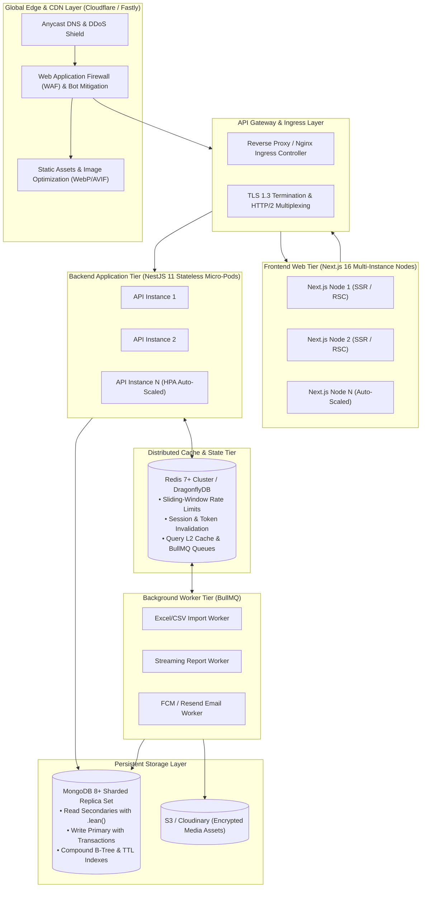

# Startup-Scale Production Architecture & Engineering Standards

This document specifies the enterprise/startup-grade architecture required to scale the Student Portal to millions of users with rock-solid security, sub-100ms response times, and high maintainability.

---

## 1. System Architecture (Scale to Millions)



### Key Scaling Principles:
1. **Stateless API Tier:** All NestJS instances are completely stateless. Sessions are tracked via signed JWTs or validated via Redis blacklist (`tokenVersion`).
2. **Distributed Sliding-Window Rate Limiting:** All rate limits use Redis hashes with sub-second sliding windows, protecting against credential stuffing, OTP brute-forcing, and DDoS.
3. **Decoupled Background Processing (BullMQ):** Long-running CPU/IO operations (Excel imports > 500 rows, PDF generation, bulk email dispatch) are immediately offloaded to asynchronous worker queues.
4. **Read/Write Splitting & Read Secondary Queries:** Heavy dashboard and reporting queries target MongoDB read secondaries with `.lean()` execution.

---

## 2. Monorepo File Structure & Component Management

```text
student-portal/
├── apps/
│   ├── api/
│   │   └── src/
│   │       ├── common/                     # Cross-cutting concerns
│   │       │   ├── decorators/             # @Roles, @RequirePermissions, @CurrentUser
│   │       │   ├── filters/                # Global exception handling & error shaping
│   │       │   ├── guards/                 # JwtAuthGuard, CsrfGuard, FirstLoginGuard
│   │       │   ├── interceptors/           # TransformInterceptor (ApiEnvelope wrapping)
│   │       │   ├── middleware/             # Security headers, cookie parser, rate limit
│   │       │   ├── pipes/                  # ParseObjectIdPipe, ValidationPipe
│   │       │   └── rate-limit/             # RateLimiterModule, Service, Rules, Stores
│   │       ├── core/                       # Core system infrastructure
│   │       │   ├── logger/                 # Winston contextual structured logging
│   │       │   └── queues/                 # BullMQ queue definitions and worker processors
│   │       └── modules/                    # Feature modules (CQRS / Domain driven)
│   │           └── <feature>/
│   │               ├── controllers/        # Thin HTTP routing & documentation only
│   │               ├── dto/                # class-validator DTOs with strict typing
│   │               ├── schemas/            # Mongoose schemas with indexes & projections
│   │               ├── services/
│   │               │   ├── <feature>-query.service.ts    # Read models & aggregations
│   │               │   └── <feature>-command.service.ts  # Write models & transactions
│   │               └── <feature>.module.ts
│   │
│   └── web/
│       └── src/
│           ├── app/[locale]/               # Next.js App Router (Thin Layout & Shells)
│           │   ├── admin/<feature>/page.tsx
│           │   └── dashboard/<feature>/page.tsx
│           ├── components/
│           │   └── ui/                     # Radix headless accessible primitives (shadcn)
│           │       ├── button.tsx, dialog.tsx, select.tsx, table.tsx, badge.tsx ...
│           ├── features/<feature>/         # Self-contained feature slices
│           │   ├── api.ts                  # Typed endpoints using api-client
│           │   ├── queries.ts              # TanStack Query keys & hooks
│           │   ├── schema.ts               # Zod validation schemas matching backend DTOs
│           │   ├── types/                  # Domain contracts and view models
│           │   └── components/             # Reusable domain components
│           │       ├── <Feature>Table.tsx
│           │       ├── <Feature>Toolbar.tsx
│           │       ├── <Feature>FormDialog.tsx
│           │       └── <Feature>KpiCards.tsx
│           └── hooks/
│               ├── use-table-state.ts      # URL search params synchronization
│               └── use-auth.ts
│
└── packages/
    └── shared/                             # Zero-dependency contracts
        └── src/
            ├── constants/                  # Roles, permissions, levels, statuses
            ├── types/                      # Shared DTOs and API envelopes
            └── validation/                 # Reusable regex and rules
```

---

## 3. Database Schema & Indexing Matrix

### High-Throughput Compound Indexes
```typescript
// StudentProfile Schema
StudentProfileSchema.index({ studentCode: 1 }, { unique: true });
StudentProfileSchema.index({ level: 1, enrollmentStatus: 1, createdAt: -1 });
StudentProfileSchema.index({ fullName: 'text', studentCode: 'text' }); // Fast text search

// CourseRegistration Schema
CourseRegistrationSchema.index({ studentId: 1, academicYear: 1, semester: 1 }, { unique: true });
CourseRegistrationSchema.index({ academicYear: 1, semester: 1, status: 1 });

// Rate Limiting TTL Collection
RateLimitSchema.index({ expireAt: 1 }, { expireAfterSeconds: 0 }); // Automatic document eviction
```

### Security Projection Principles
- Sensitive fields (`passwordHash`, `nationalId`, `otp`, `twoFactorSecret`) **MUST** declare `@Prop({ select: false })`.
- Public list queries must never `.populate()` unmasked PII. Only return masked identifiers (`nationalIdMasked: 299****`).

---

## 4. API Security & Rate Limiting Matrix

| Endpoint | Method | Window | Max Limit | Identification Strategy | Threat Mitigated |
| :--- | :--- | :--- | :--- | :--- | :--- |
| `/api/auth/student/login` | POST | 15 min | 8 | `studentCode` + Client IP | Credential Stuffing |
| `/api/auth/admin/login` | POST | 15 min | 8 | `email` + Client IP | Brute-force admin accounts |
| `/api/auth/forgot-password` | POST | 15 min | 5 | `studentCode` / `email` + IP | Email Flooding / SMTP Exhaustion |
| `/api/auth/reset-password-otp` | POST | 15 min | 5 | `studentCode` + Client IP | 6-Digit OTP Brute-forcing |
| `/api/auth/google/link/verify-otp`| POST | 15 min | 5 | User ID + Client IP | Account Takeover via OTP guess |
| `/api/student/chat/messages` | POST | 10 min | 25 | Authenticated Student ID | LLM Token / Quota Depletion |
| `/api/courses/:id/quizzes/:qid/submit` | POST | 1 min | 10 | Student ID + IP | Automated bot submissions |
| `/api/admin/:resource/export/*` | GET | 10 min | 15 | Staff / Admin User ID | CPU / Memory Streaming Exhaustion |
| `/api/admin/uploads` | POST | 1 hour | 20 | Admin User ID | Disk Filling / Worker Queue Jam |
| `/api/students/complaints` | POST | 24 hours | 3 | Student Code | Ticket Spamming & Harassment |

---

## 5. Modern UI Architecture & Best Practices

1. **URL-Synchronized Filter State (`useTableState`):**
   - Never store route-specific table filters (page, search, category, sort) in global Zustand stores.
   - Use URL search parameters (`?page=2&level=3&search=Ahmed`) for deep-linking, browser history navigation, and tab isolation.
2. **Accessible Headless UI Primitives:**
   - Standardize on Radix UI (`@radix-ui/react-dialog`, `@radix-ui/react-select`, `@radix-ui/react-popover`) styled with Tailwind CSS v4.
   - Prevent custom portal / positioning implementations that suffer from z-index clipping.
3. **Compound Component Organization:**
   - Break large page components (> 300 lines) into dedicated feature folders:
     - `Toolbar`: Search, filters, and action buttons.
     - `DataTable`: Header, virtualization, row actions, and empty states.
     - `PaginationBar`: Per-page dropdown, page numbers, total counts.
     - `Dialogs`: Isolated form dialogs managed with explicit boolean states.
4. **Data Fetching & Cache Management:**
   - Use TanStack Query v5 with strictly typed query key factories:
     ```typescript
     export const studentKeys = {
       all: ['students'] as const,
       lists: () => [...studentKeys.all, 'list'] as const,
       list: (params: StudentListParams) => [...studentKeys.lists(), params] as const,
       detail: (id: string) => [...studentKeys.all, 'detail', id] as const,
     };
     ```
   - Use `keepPreviousData` for smooth table transitions without jarring loading flickers.
