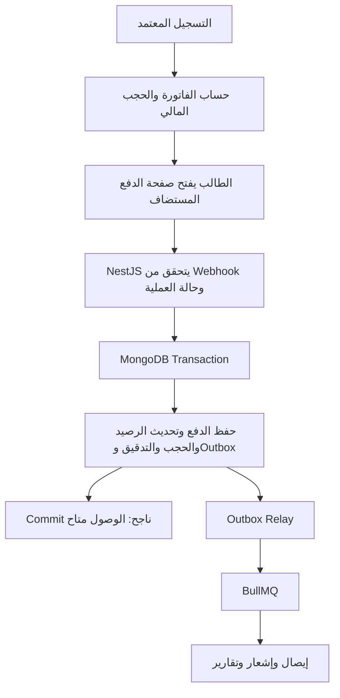

# بنية دفع المصروفات وفتح خدمات الطالب فور السداد

**الحالة:** خطة معمارية معتمدة للتنفيذ لاحقًا؛ لا يتضمن حفظ هذا المستند تنفيذ نظام الدفع.

**تاريخ إعداد الخطة:** 28 أكتوبر 2026.

## 1. النتيجة المطلوبة وقواعد الفوترة

المشروع حاليًا يخزن حالة المصروفات والحجب، لكنه لا يحتوي فواتير بمبالغ أو سجل دفعات. سنضيف وحدات داخل NestJS الحالي، مع Worker مستقل على الـVPS، ونستخدم MongoDB Atlas لحفظ البيانات المالية وBullMQ للمهام اللاحقة.

القواعد التي اعتمدناها:

- فاتورة لكل طالب وعام وفصل، تُحسب من **التسجيل المعتمد فعليًا**.
- سعر ثابت للمادة حسب مستوى المادة في لائحة قسم الطالب، مع إمكانية تحديد سعر خاص للمقرر. مادة الإعادة تُحسب بمستواها الأصلي، والساعات لا تدخل في الحساب.
- تحفظ الفاتورة المواد وأسعارها ونسخة التسعير المستخدمة. تعديل جدول الأسعار لا يغيّر الفواتير القائمة تلقائيًا.
- إضافة مادة تُنشئ فرقًا مستحقًا؛ حذفها يُنشئ تسوية دائنة موثقة. الرصيد الدائن يُستخدم داخل فاتورة الفصل نفسه، دون رد بنكي أو ترحيل لفصل آخر تلقائيًا.
- يبدأ الحجب المالي عند إصدار فاتورة برصيد مستحق، ويُرفع بعد سداد كامل الرصيد. أي حجب إداري مستقل يظل قائمًا.
- تظل خدمات الحساب والدفع والتسجيل متاحة للطالب المحجوب ماليًا، مع الحفاظ على نطاق الخدمات المقيدة حاليًا: الكتب والمواد والاختبارات.

## 2. الوحدات والبيانات والواجهات

### وحدات NestJS

| الوحدة | المسؤولية |
|---|---|
| `Billing` | التسعير، الفواتير، التسويات، السداد الخارجي والإعفاءات |
| `Payments` | إنشاء الدفع المستضاف، التحقق من البوابة، تسجيل الدفعات والمصالحة |
| `StudentAccess` | تجميع أسباب الحجب وتحديد الخدمات المتاحة |
| `Outbox` | حفظ الأحداث داخل المعاملة وتسليمها لاحقًا |
| `Worker` | تشغيل Relay وBullMQ والإيصالات والإشعارات والتقارير |

تبقى هذه وحدات ضمن المشروع، دون تحويلها إلى خدمات مصغرة منفصلة.

### مصدر الحقيقة

- `PriceBooks`: تسعير منشور لكل فصل، يتضمن أسعار المستويات واستثناءات المقررات.
- `Invoices`: فاتورة فريدة لكل طالب وفترة، مرتبطة بالتسجيل وإصداره، مع تفاصيل المقررات والأسعار.
- `LedgerEntries`: سجل مالي غير قابل للتعديل للرسوم والتسويات والمدفوعات والإعفاءات والمبالغ المرتجعة.
- `PaymentAttempts`: محاولة الدفع، مرجع البوابة، المبلغ والعملة وإصدار الفاتورة.
- `PaymentEvents`: صندوق وارد موثّق لأحداث البوابة، لمنع فقد الأحداث أو تكرار أثرها.
- `OutboxEvents` وسجل تنفيذ المهام: أحداث دائمة، مع تتبع مستقل لكل إيصال أو إشعار أو تحديث تقرير.
- يُضاف إلى ملف الطالب حجب بأسباب مصنفة و`accessVersion`. يظل `isBlocked` و`tuitionFeesStatus` تمثيلًا متوافقًا مع الواجهات الحالية، ويُحدّثان داخل المعاملة المالية نفسها.

كل المبالغ **أعداد صحيحة بالقروش بعملة EGP**، دون حسابات مالية باستخدام الكسور العشرية العائمة.

### واجهات API الأساسية

- `GET /api/billing/me`: الفواتير والأرصدة وأسباب الحجب الحالية.
- `POST /api/payments/checkout`: يستقبل `invoiceId` وإصدار الفاتورة، مع `Idempotency-Key`. الخادم يحدد كامل الرصيد المطلوب؛ الطالب لا يرسل سعرًا معتمدًا.
- `GET /api/payments/:id/status`: الحالة المؤكدة لمحاولة يملكها الطالب، وحالة الوصول.
- `POST /api/payments/webhooks/paymob`: استقبال إشعارات البوابة والتحقق منها.
- واجهات إدارية للتسعير والفواتير والتسويات والسداد الخارجي والمصالحة، بصلاحيات مالية مستقلة وسجل تدقيق.

تُوحّد جميع تغييرات التسجيل المعتمد—المباشر، والمرشد، والإدارة، وExcel، والإضافة والحذف الجماعي—لتحدّث التسجيل والفاتورة والحجب **داخل معاملة واحدة**. التسعير الناقص يمنع اعتماد التغيير، ولا يُعامل كسعر صفر.

## 3. تدفق الدفع ومعاملة فتح الوصول

البوابة الأولى المقترحة هي **Paymob Unified Checkout**، خلف واجهة `PaymentGatewayAdapter` تسمح باستبدالها لاحقًا. تدعم Paymob إنشاء Intention وربطها بصفحة الدفع المستضاف. [توثيق Paymob](https://developers.paymob.com/paymob-docs/developers/intention-apis/create-intention)

**خطوات المعالجة:**

1. حفظ محاولة محلية قبل الاتصال بالبوابة، وربطها بالطالب والفاتورة والمبلغ والعملة.
2. التحقق من HMAC وفق خوارزمية Paymob، قبل تحويل بيانات الإشعار أو تعديلها. صفحة الرجوع من الدفع ليست دليلًا على السداد. يُستثنى مسار Webhook وحده من JWT وCSRF. [توثيق الإشعارات والتحقق](https://developers.paymob.com/paymob-docs/developers/transaction-callbacks)
3. حفظ الحدث الموثق في صندوق الوارد، والتحقق من تفاصيل العملية من الخادم: حساب التاجر، بيئة الاختبار أو الإنتاج، مرجع الطلب، المبلغ، العملة وحالة التحصيل. التفويض وحده لا يفتح الوصول.
4. تشغيل معاملة قصيرة عبر `Connection.transaction()`، بقراءة من `primary` وكتابة `majority`، تشمل:
   - تسجيل الدفعة والقيد المالي مرة واحدة.
   - إعادة حساب **الرصيد الحالي** للفواتير، حتى لو تغيّر التسجيل أثناء الدفع.
   - إزالة الحجب المالي الذي تمت تسويته فقط.
   - تحديث حالة الطالب ونسخة الوصول وسجل التدقيق.
   - حفظ أحداث Outbox وتحديد الحدث الوارد كمعالج.
5. إرجاع نجاح Webhook بعد نجاح الحفظ. تُنفّذ اتصالات البوابة خارج المعاملة لأن المعاملة قد تُعاد عند تعارض الكتابة. [معاملات Mongoose 8](https://mongoosejs.com/docs/8.x/docs/transactions.html)

تُفرض فهارس فريدة على مرجع عملية البوابة ومفتاح الأثر المالي. الإشعار المكرر لا يكرر السداد، والفشل المتأخر لا يلغي نجاحًا مؤكدًا. دفعتان مختلفتان تُسجلان بالكامل، ويظهر الزائد رصيدًا دائنًا. أي Refund مؤكد يُسجل كقيد عكسي ويعيد تقييم الرصيد والحجب.

## 4. فتح الوصول والطابور والواجهات

### الوصول الفوري

- فحص الخدمات المقيدة يقرأ حالة الوصول من MongoDB مباشرة؛ لا يعتمد على حالة مالية مخزنة داخل JWT أو كاش Redis.
- بعد الـCommit، يستطيع الطلب التالي للطالب استخدام الخدمات دون انتظار Worker أو إيصال أو إعادة تسجيل الدخول.
- صفحة الرجوع تعرض «جارٍ تأكيد الدفع»، وتستعلم كل ثانيتين أثناء الانتظار. لا تعرض النجاح اعتمادًا على معاملات الرابط.
- عند التأكيد تُحدّث استعلامات الفواتير وملف الطالب والمواد والاختبارات؛ وهذا يعالج كاش ملف الطالب الحالي الذي قد يبقى خمس دقائق.
- تُعرض تفاصيل الفاتورة والأسعار والتسويات بالعربية والإنجليزية، مع RTL وتواريخ القاهرة.

### الخلفية

- يعمل API وWorker كعمليتين منفصلتين على الـVPS، ويستمر استخدام Nginx وHTTPS الحاليين.
- تستخدم مهام الدفع نشرًا صارمًا إلى BullMQ؛ لا تستخدم fallback التنفيذ داخل طلب HTTP الموجود حاليًا.
- إذا تعطّل Redis، يظل الدفع محفوظًا والوصول مفتوحًا، وتبقى أحداث Outbox لإعادة التسليم.
- يتتبع النظام اكتمال كل أثر في MongoDB؛ لا يعتبر مجرد إضافة Job إلى Redis تنفيذًا مكتملًا. المهام قابلة لإعادة المحاولة بأمان، مع عرض الفشل وإعادة التشغيل للإدارة.
- يُخصص Redis للطوابير بتخزين دائم و`noeviction`. معرّف Job وحده لا يكفي لمنع التكرار بعد حذف المهمة. [متطلبات BullMQ](https://docs.bullmq.io/guide/going-to-production)، [حذف المهام ومنع التكرار](https://docs.bullmq.io/guide/queues/auto-removal-of-jobs)
- المصالحة الدورية تعالج الإشعارات المتأخرة والمحاولات غير المحسومة، مع تنبيهات لتأخر التأكيد وتراكم Outbox.

تتوقف مسارات Excel والإدارة عن الكتابة المباشرة فوق الحالة المالية. السداد الخارجي والإعفاء يصبحان قيودًا موثقة؛ والحجب الإداري إجراء مستقل لا تزيله دفعة مالية.

## 5. الاختبارات والإطلاق

**اختبارات القبول الأساسية:**

- تسعير المواد والإعادة والأسعار الخاصة، ومنها مقرر 326 بسجله المشترك وتوزيع قسم الطالب.
- اختلاف المبلغ أو العملة، توقيع مزور، زيارة رابط النجاح يدويًا، ومحاولة دفع فاتورة طالب آخر.
- تكرار Webhook وتوازيه، انتهاء المحاولة، وتأخر نجاحها بعد تغيير التسجيل.
- إضافة وحذف مادة قبل الدفع وبعده، والسداد الزائد والرد المؤكد.
- فشل المعاملة لا يترك دفعة أو رصيدًا أو حجبًا جزئيًا.
- Redis وWorker متوقفان: الدفع يفتح الخدمات بعد الـCommit، وتُستكمل المهام بعد التعافي.
- بقاء الحجب الإداري أو أي مديونية أخرى بعد سداد فاتورة واحدة.
- اختبارات واجهة بالعربية والإنجليزية، واختبارات معاملات على MongoDB محلية تعمل كـReplica Set، ثم lint والأنواع والبناء وE2E.

**الإطلاق:**

1. إنشاء الفهارس، وتجهيز حساب Paymob التجريبي، والتسعير المنشور، وخدمة Worker.
2. إعداد ترحيل بمعاينة واعتماد مالي: حساب الفواتير الحالية وتسجيل تسويات افتتاحية للمسددين وإعفاءات المَعفيين، دون اختراع دفعات بوابة.
3. مراجعة أسباب الحجب القديمة غير الواضحة؛ لا تُصنَّف تلقائيًا كحجب مالي.
4. تشغيل تجريبي على مجموعة طلاب، ثم تفعيل الفصل تدريجيًا مع مراقبة المصالحة وOutbox.

**حدود النسخة الأولى:** سداد كامل الرصيد، دون أقساط أو خصم تلقائي أو رد بنكي آلي. رسوم البوابة لا تُضاف للطالب تلقائيًا، وبيانات البطاقة تبقى داخل صفحة مزود الدفع.
