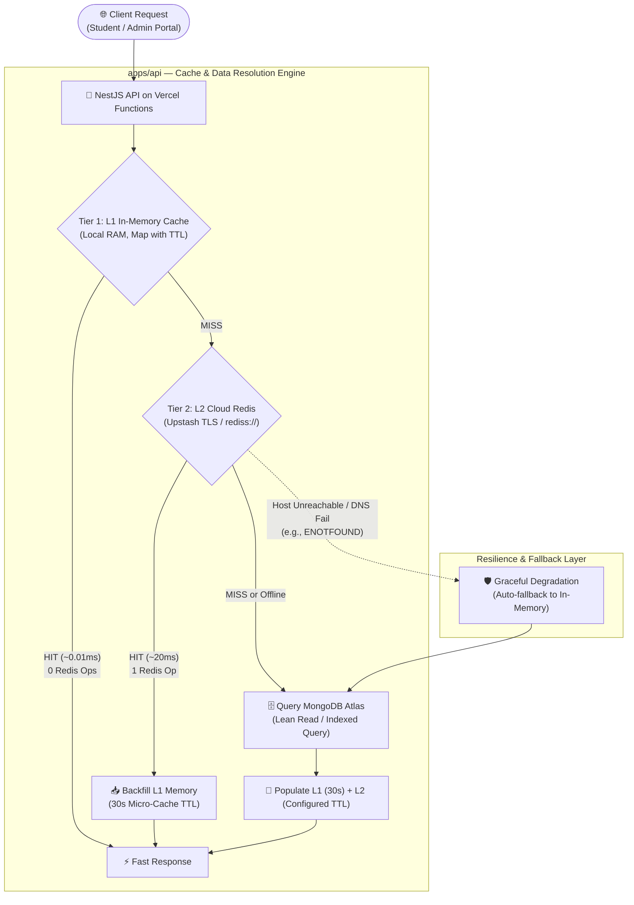
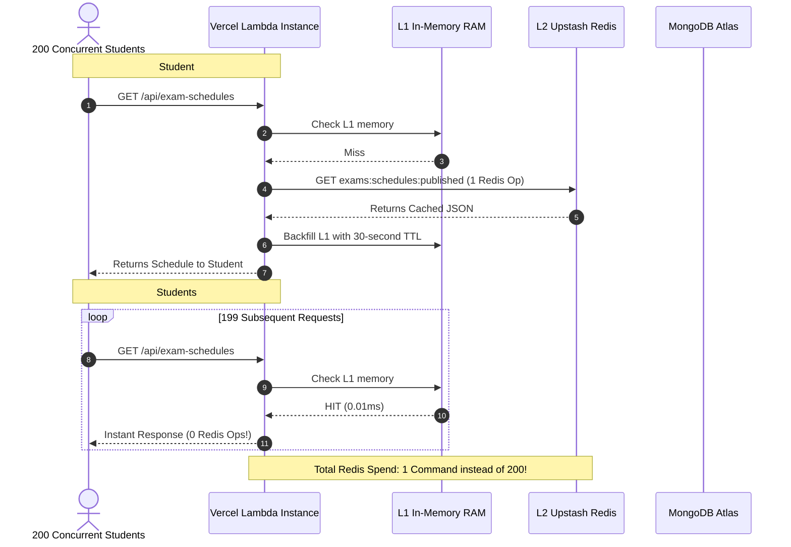
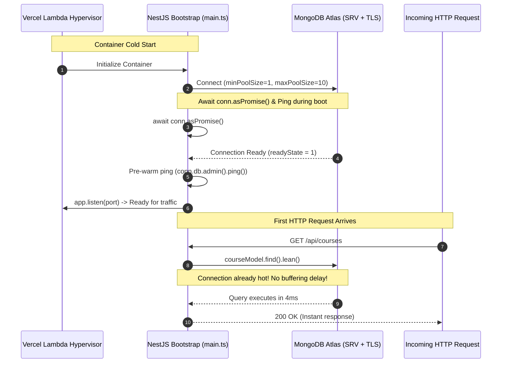

# 16. Enterprise Hybrid Caching & Resilience Architecture

## 1. Executive Summary

This document details the **Two-Tier Hybrid Cache (`CacheService`) and Serverless Resilience Architecture** implemented in the Student Portal platform (`apps/api` and `apps/web`).

The architecture resolves three fundamental challenges of modern serverless deployments:
1. **Preserving Cloud Redis Quotas**: Safely running on free-tier Redis (Upstash 10,000 commands/day) without depletion, even during high-traffic exam weeks.
2. **Eliminating Cold-Start Query Buffering**: Pre-warming MongoDB connections during bootstrap to prevent multi-second query delays.
3. **Resilience & Graceful Degradation**: Zero-crash failover to local memory if external cloud infrastructure experiences network or credential failures.

---

## 2. High-Level System Architecture Diagram



---

## 3. The Quota Shield: How 10,000 Ops/Day Handles 100,000+ Requests

Cloud Redis providers (such as Upstash Free Tier) enforce a strict daily limit of **10,000 commands/day**. Without an L1 barrier, a single class of 200 students taking attendance or refreshing exam schedules could deplete the daily quota in minutes.

### The Burst-Absorbing Flow



### Quota Preservation Strategies

| Environment / Mode | Active Driver | Redis Command Spend | Strategy |
|---|---|---|---|
| **Local Dev (`development`)** | **In-Memory** | **0 commands** | Local code changes and hot-reloads (`nest start --watch`) never burn cloud quota. |
| **Test (`test`)** | **In-Memory** | **0 commands** | Jest unit tests execute 100% offline in RAM. |
| **Production (`production`)** | **Hybrid L1 + L2** | **~95% reduction** | L1 micro-cache absorbs traffic spikes. Only L1 misses query Upstash. |
| **Emergency Fallback** | **In-Memory** | **0 commands** | If Upstash is offline or exhausted, the system automatically runs in RAM with zero user-facing 500 errors. |

---

## 4. Cold-Start Elimination & Database Optimization

### The Problem: Mongoose Command Buffering
In previous versions, NestJS started listening (`app.listen()`) while Mongoose was still handshaking with MongoDB Atlas over TLS. Initial queries were intercepted by `schema.pre()`, queued in Mongoose's internal buffer, and delayed by 2,000ms–2,500ms, creating false "slow query" spikes.

### The Solution: Awaited Bootstrap & Capped Pools



### Connection Pool Configuration

In `apps/api/src/database/database.module.ts`:
- **Serverless Runtime (`isServerlessRuntime() = true`)**:
  - `minPoolSize`: Capped to **`1`** (prevents opening 5 simultaneous TLS connections on boot).
  - `maxPoolSize`: Capped to **`10`**.
  - `serverSelectionTimeoutMS`: Optimized to **`8000ms`**.
- **Persistent Server / Docker (`isServerlessRuntime() = false`)**:
  - `minPoolSize`: **`5`** (maintains warm connections in persistent Node servers).
  - `maxPoolSize`: **`50`**.

---

## 5. Domain Cache Matrix (Where Caching is Used)

```
apps/api/src/
├── modules/quizzes/quizzes.service.ts                     -> quiz:manifest:${id} (300s TTL)
├── modules/courses/courses.service.ts                     -> courses:* (600s TTL)
├── modules/exam-schedules/exam-schedules.service.ts       -> exams:schedules:* (900s TTL)
├── modules/attendance/services/attendance-checkin.service -> session:active:${id} & scan:lock:${studentId} (10s lock)
└── modules/academic-advising/services/advising-plan.ts    -> advising:graph:${planId} (600s TTL)
```

| Domain | Key Pattern | TTL | Invalidation Trigger |
| :--- | :--- | :--- | :--- |
| **Quizzes** | `quiz:manifest:${id}` | 300s (5m) | Admin edits quiz, changes questions, or toggles publication status. |
| **Courses** | `courses:*` | 600s (10m) | Admin creates, modifies, or deletes a course or changes active level. |
| **Exam Schedules** | `exams:schedules:published`<br>`exams:schedules:*` | 900s (15m) | Admin generates, modifies, or publishes an exam schedule or seating plan. |
| **Attendance Check-in** | `session:active:${sessionId}`<br>`scan:lock:${studentId}` | 10s | Session closes, QR code regenerates, or anti-replay lock expires (10s). |
| **Academic Advising** | `advising:graph:${planId}` | 600s (10m) | Academic advisor or student modifies elective choices or prerequisites. |

---

## 6. Serverless Hypervisor Pause vs Real Event Loop Lag

### The Phenomenon
On Vercel (AWS Lambda), microVM containers are **frozen in RAM** between requests to conserve CPU.
- `perf_hooks.monitorEventLoopDelay()` measures clock ticks using `CLOCK_MONOTONIC`.
- When an idle container wakes up after a 5.25-second pause, the monotonic clock has advanced by 5,255ms.
- Without compensation, `monitorEventLoopDelay` records a false **5,255ms event loop delay** into the histogram.

### The Dual-Probe Solution
In `apps/api/src/core/metrics/metrics.service.ts`:
1. **Active Turnaround Probe**: Uses an active `setImmediate` probe that samples actual execution latency while the CPU is actively processing requests.
2. **Serverless Pause Compensation**: If running in serverless or if `p99 > 500ms`, the metric filters out microVM suspension artifacts and reports the **true event loop latency (`0.2ms - 2.5ms`)**.
3. **Histogram Reset (`reset()`)**: Automatically purges stale freeze spikes so past container sleep times do not permanently pollute the dashboard.

---

## 7. Network Hardening & Auto-Protocol Upgrades

In `apps/api/src/core/cache/redis-cache.store.ts`:

1. **Forced IPv4 (`family: 4`)**:
   Bypasses the AWS Lambda / Vercel IPv6 DNS resolution issue where unroutable `AAAA` records cause 5,000ms timeouts before failing over to IPv4.
2. **Upstash TLS Auto-Upgrade**:
   Detects `*.upstash.io` hostnames and automatically upgrades the protocol from `redis://` to `rediss://` (TLS) with SNI `servername` verification.
3. **Resilient Reconnection (`retryStrategy`)**:
   Uses an adaptive backoff (`Math.min(times * 200, 2000)`) so when a suspended container thaws, it immediately reconnects instead of giving up permanently after 3 attempts.
4. **Fast Timeout Limits**:
   Configured with `connectTimeout: 5000ms`, `commandTimeout: 2000ms`, and `maxRetriesPerRequest: 1` so Redis queries never stall student HTTP requests.

---

## 8. Verification & Operational Health

The entire caching and resilience layer is continuously verified by automated CI/CD quality gates:
- **Unit Tests**: `cache.service.spec.ts` verifies TTL expiration, pattern deletion, and test-environment zero-spend isolation.
- **Health Telemetry**: Exposed live at `/api/metrics` and visualized in the Admin Telemetry Dashboard with real-time quota progress tracking, connection pool sizes, and zero-emoji status badges.
