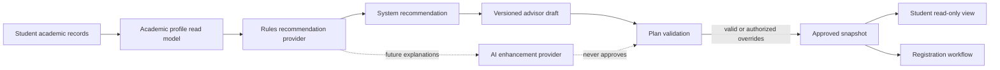
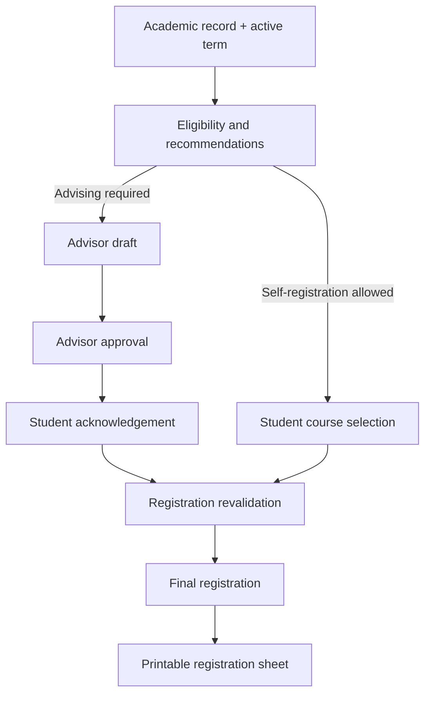

# Academic Advising MVP Architecture

## 1. Architecture overview

Academic advising is a domain beside registration, not a replacement for it. The existing registration module remains the final enrollment boundary. The new domain owns student review, explainable recommendations, plan drafts, validated React Flow graphs, approval, notes, and audit history.

The MVP is split into four boundaries:

1. **Academic record read model** — combines users, student profiles, courses, grades, registrations, and advising metadata into one advisor-safe profile. National ID data is never returned.
2. **Recommendation boundary** — `AcademicRecommendationProvider` defines deterministic, explainable output. `RulesBasedRecommendationProvider` is the MVP implementation. A future AI provider may enrich explanations but cannot bypass validation.
3. **Plan boundary** — immutable system recommendations and versioned advisor drafts produce one approved snapshot. Optimistic concurrency rejects stale writes with `409 PLAN_VERSION_CONFLICT`.
4. **Registration boundary** — approval recalculates eligibility from database-owned course and academic-record values, then publishes the approved plan to the student workflow.

## 2. Advising workflow

`NOT_STARTED -> AUTO_RECOMMENDED -> ASSIGNED -> UNDER_REVIEW -> DRAFT -> WAITING_FOR_STUDENT -> APPROVED -> REGISTERED -> CLOSED`

Student review moves `WAITING_FOR_STUDENT` to `REVISION_REQUESTED`; an authorized administrator may reopen an approved case. Every transition is authorized server-side and recorded in the audit log.

### Unified registration paths

The active term is authoritative. First-semester plans may only contain first-term offerings, second-semester plans may only contain second-term offerings, and summer plans may only contain courses whose `offeredTerms` explicitly includes `summer`. The summer course-count policy is never applied to first or second semester. Advisor approval does not bypass final registration validation.

## 3. Persistence model

- `advising_cases`: one case per student, academic year, and semester; indexed by student, advisor, status, and term.
- `advising_plans`: versioned `SYSTEM_RECOMMENDATION`, `ADVISOR_DRAFT`, and `FINAL_APPROVED` records. Selected courses store IDs only; the server derives codes, credits, and eligibility.
- `advising_graphs`: validated node/edge projection for a plan. Allowed node types are `SEMESTER`, `COURSE`, `DECISION`, `WARNING`, and `MILESTONE`. Course nodes reference course IDs and contain presentation metadata only.
- `course_recommendations`: explainable provider output and advisor accept/reject decisions.
- `advising_notes`: `INTERNAL` or `STUDENT_VISIBLE` notes.
- `advising_audit_logs`: append-only actor/action snapshots with bounded metadata.

Existing `student_academic_profiles`, `courses`, `grades`, `course_registrations`, and `academic_advising_requests` remain source collections during migration. The advising case links to the legacy request until cutover.

## 4. API and authorization

Admin routes use `/api/admin/advising`; student routes use `/api/student/advising`. JWT, role, permission, first-login, and CSRF guards remain global project concerns. Admin can access all cases; staff/advisors only assigned cases unless granted an explicit permission; students only their own approved/student-visible data.

Recommendation generation is idempotent for `(caseId, academicRecordVersion, rulesVersion)`. Approval is transactional where MongoDB transactions are available and always performs server-side validation immediately before publishing.

## 5. Validation pipeline

Validation loads canonical courses and records, rejects unknown/duplicate/passed/in-progress selections, evaluates prerequisites and co-requisites, selected-term availability, timetable conflicts, warning-adjusted credit limits, failed-course priority, and graduation rules. Errors block approval. Warnings require acknowledgement. Overrides require an authorized role, a non-empty reason, and an audit record.

## 6. React Flow contract

The client edits a normalized graph DTO rather than arbitrary React Flow objects. Nodes contain `id`, `type`, `position`, and a discriminated metadata object. Edges contain `id`, `type`, `source`, and `target`. The backend rejects unknown keys, invalid types, dangling edges, duplicate IDs, sensitive fields, and course references outside the plan.

Completed course/semester nodes are locked. Only recommended or planned nodes can move, connect, or be removed. Zustand owns selection, undo/redo, viewport, and unsaved state; TanStack Query owns persisted case, plan, recommendation, and note data.

## 7. Incremental rollout

1. Introduce the recommendation provider behind the existing `recommendCourses` adapter and verify current behavior.
2. Add advising schemas, plan validation, audit logging, and admin APIs behind a feature flag.
3. Add the admin directory and advising workspace; keep the existing registration review as fallback.
4. Add the student read-only page and printable approved snapshot.
5. Backfill open legacy requests into cases, compare outputs, then route new requests to the advising module.
6. Remove the compatibility adapter only after approved-plan registration and audit parity are confirmed.

## 8. Future AI boundary

`AiEnhancedRecommendationProvider` may call the deterministic provider and add explanations, alternatives, or question answering. Deterministic eligibility, plan validation, authorization, overrides, and approval remain authoritative backend services. The assistant endpoint returns `503 FEATURE_DISABLED` until a configured provider is enabled.
