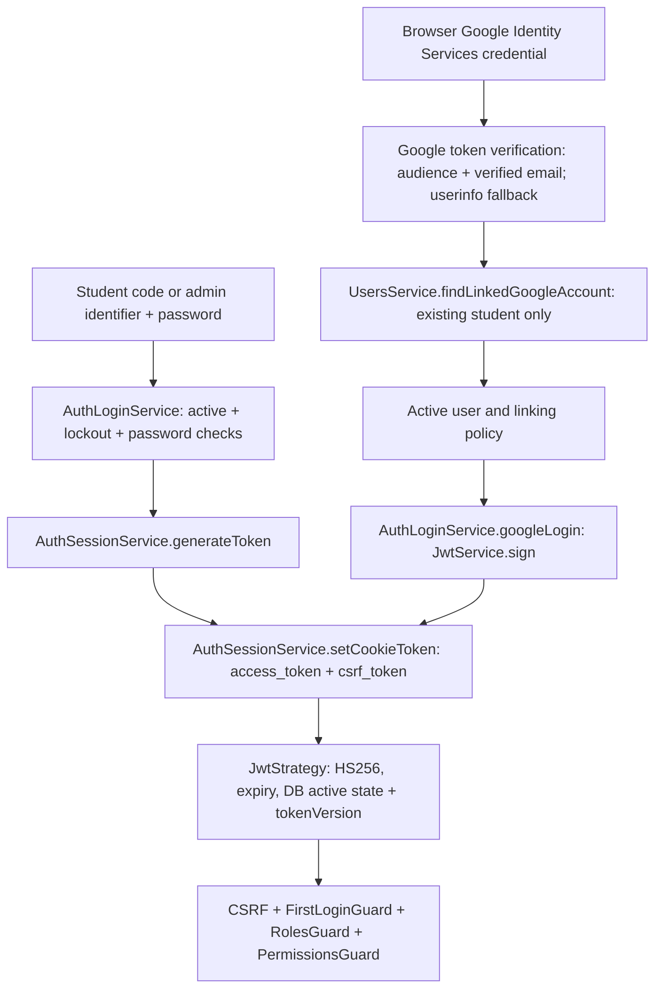

# Authentication audit

> Historical baseline. The subsequent [authentication remediation report](security/AUTH_REMEDIATION_REPORT.md) supersedes the logout, hashing, Google nonce and recent-auth descriptions below. Preserve this audit as before-change evidence; it is not a statement of current runtime behavior or deployment readiness.

Audit date: 2026-10-27. Initial findings below were captured by static inspection before authentication code changes. No production credentials, database contents or device behavior were inspected.

## Existing flows

JWT `sub` is the existing MongoDB user `_id` string. Claims are `sub`, `role`, `tokenVersion`, with library-issued `iat`/`exp`. Database roles and permissions override token role for authorization. This is a single-institute app with no tenant selector or MFA policy found.

There is **no implemented refresh-token rotation or refresh endpoint**. Refresh-related user fields are dormant. `/auth/csrf` refreshes only the CSRF token. Logout records activity and clears cookies; copied JWTs remain valid until expiration or a tokenVersion change. Password change/reset use existing password services and token-version invalidation. These semantics will be preserved.

Google issuance reuse point: `AuthLoginService.googleLogin` currently signs directly through its injected `JwtService`, then `AuthController.googleLogin` invokes `AuthService.setCookieToken` -> `AuthSessionService.setCookieToken`. Implementation will route successful Google and passkey issuance through a small common `AuthSessionService` handoff using the identical claim/cookie shape and existing activity update.

## Inventory

| File | Responsibility / finding | Planned change |
| --- | --- | --- |
| `apps/api/src/modules/auth/services/auth-login.service.ts` | Password lockout; Google audience/verified-email checks and explicit linked-account lookup; no automatic account creation | Shared successful login handoff only |
| `apps/api/src/modules/auth/services/auth-session.service.ts` | JWT issuance, safe user projection, HttpOnly access cookie; CSRF cookie | Reuse for passkey session |
| `apps/api/src/modules/auth/auth.controller.ts` | Existing login response `{user, csrfToken}` | Preserve contracts |
| `apps/api/src/modules/auth/strategies/jwt.strategy.ts` | HS256, expiry, active account, tokenVersion validation on every request | Preserve |
| `apps/api/src/modules/auth/guards/` | JWT, CSRF, forced-password-change, role and permission gates | Preserve; no passkey allowlist bypass |
| `apps/api/src/modules/users/schemas/user.schema.ts` | Required passwordHash; sparse unique Google identifiers; single-institute identity | No existing user migration |
| `apps/api/src/modules/users/users.service.ts` | Password comparison, lockout, safe auth projection, activity | Reuse |
| `apps/api/src/common/rate-limit/` | Shared Mongo rate store; optional memory mode; trusts forwarded-for | Add passkey rule independent of legacy IP-header trust |
| `apps/api/src/main.ts`, `config/cors-origins.ts` | Credentialed CORS includes wildcard preview patterns; strict DTO pipe | Dedicated exact passkey origin policy |
| `apps/web/src/providers/auth-provider.tsx` | Login, cookie confirmation, query cache, safe attendance return URL | Extend login type with passkey |
| `apps/web/src/lib/api.ts` | Credentials enabled, CSRF propagation/retry; envelope unwrapped once | Reuse |
| `apps/web/src/hooks/use-google-signin.ts` | Google GIS popup/FedCM ID credential callback, no application nonce configured | Preserve; review nonce/login-CSRF policy in staging |
| `apps/web/src/hooks/use-google-signin.ts` | Google GIS popup/FedCM ID credential callback, no application nonce configured | Preserve; review nonce/login-CSRF policy in staging |
| `apps/web/src/app/[locale]/login/{student,admin}/page.tsx` | Existing login UI + Google student fallback | Add optional passkey button |
| `apps/web/src/app/[locale]/dashboard/profile/page.tsx` | Password/security and Google management | Add passkey manager; provide shared security route for staff |
| `.env.example`, `.env.prod.example`, `deploy/`, Vercel config | Localhost and Vercel deployment examples; no verified production RP topology | Disabled default + explicit deployment configuration |
| `.github/workflows/ci-cd.yml`, API Jest, web node tests | CI lint/typecheck/unit/build/e2e and deployment artifacts | Run checks and record evidence |

## Risks and classification

| Finding | Severity / exploit scenario | Affected code | Treatment / verification |
| --- | --- | --- | --- |
| No recent-auth mechanism | High: stolen long-lived JWT could enroll attacker credential | auth/session | Must fix for passkeys: password step-up, short TTL, hash binding to exact session; stale/wrong-session tests |
| Legacy rate limiter trusts arbitrary forwarded-for | High: attacker rotates header to evade IP-only rules unless edge sanitizes | rate-limit.rules.ts, proxy deployment | Must resolve for rollout: passkey rule uses Express/socket trusted address; verify production proxy sanitization and capacity |
| Credentialed wildcard preview CORS | Medium: compromise of permitted preview broadens attack surface | cors-origins.ts, env examples | Passkeys use independent exact origin allowlist, including public login; document preview isolation |
| Google userinfo bearer fallback lacks ID-token audience binding | High: access tokens minted for other OAuth clients may be accepted by legacy login | auth-login.service.ts | Existing behavior retained per compatibility constraint; must assess/remove fallback in separately approved OAuth change before broad rollout |
| Google pending-link confirmation can occur during login | Medium: linking depends on previously authenticated email setup plus verified Google identity | auth-login.service.ts, users.service.ts | Preserve rules; review with real Google staging credentials; never use unverified email |
| Cookie clearing is not server revocation | Medium: copied JWT survives logout | auth.controller.ts, auth-session.service.ts | Unrelated session improvement; preserve semantics; passkey grants tied to session token and expire independently |
| Existing public logins skip CSRF guard | Medium: login CSRF consideration | csrf.guard.ts | Passkey login requires exact Origin and separate browser-flow header secret, consumed atomically |
| CSRF token in localStorage; JWT only HttpOnly | Low: XSS can act as user (CSRF is not an XSS defense) | web/lib/api.ts | Preserve client contract; never persist raw JWT/challenge in web storage |
| Cookie lifetime fixed at seven days while JWT expiry configurable | Low: stale cookie UX | auth-session.service.ts | Unrelated; document, preserve |
| Google subject-or-email lookup | Medium: reassigned verified provider email may resolve an account whose stored Google subject differs | users.service.ts `findLinkedGoogleAccount`, auth-login.service.ts | Existing linking rules preserved; assess subject-only lookup/backfill before broad rollout |
| No dedicated legacy Google login rate rule | Medium: invalid-token traffic can consume Google verification/userinfo and API capacity | rate-limit.rules.ts, auth-login.service.ts | Existing behavior preserved; add and test a dedicated rule in auth hardening work |
| Google subject-or-email lookup | Medium: reassigned verified provider email may resolve an account whose stored Google subject differs | users.service.ts `findLinkedGoogleAccount`, auth-login.service.ts | Existing linking rules preserved; assess subject-only lookup/backfill before broad rollout |
| No dedicated legacy Google login rate rule | Medium: invalid-token traffic can consume Google verification/userinfo and API capacity | rate-limit.rules.ts, auth-login.service.ts | Existing behavior preserved; add and test a dedicated rule in auth hardening work |
| Logs/exception telemetry may carry legacy provider errors | Medium: upstream details may be logged | auth-login.service.ts, filters/logger | New passkey logs use fixed event names + internal user ID only; no assertions, tokens, passwords, challenges |

Open redirects: provider return URL restricted to same-origin attendance paths. Browser Google credential exchange is not an application redirect/callback authorization-code flow; no server PKCE/state callback to modify. Google nonce and access-token fallback still require staging review. Reset OTP and linking OTP have route rate rules; delivery and actual recovery were not exercised. No claim of a complete penetration test is made.

## Implementation plan and assumptions

1. Pin maintained SimpleWebAuthn browser/server versions after verifying registry and installed APIs against official docs.
2. Add isolated credential, flow and recent-auth grant collections. Mongo TTL plus atomic `findOneAndDelete` enforces expiry/replay protection across replicas and tabs. Credential ID unique; user/handle identity stable and opaque.
3. Add `auth/passkeys` controller/service inside existing AuthModule. Management inherits every global guard. Password reauthentication uses current user's password, lockout, and exact JWT hash; all accounts have required password fallback. A Google sign-in user can use their existing portal password for step-up; no fresh Google token is inferred from a JWT.
4. Require UV, exact RP/origin policy and HTTPS (localhost exception); login flow secret travels in a custom header and is stored only as a hash. Enforce counter compare-and-swap, owner filters, duplicate protection and active/locked/forced-password policy. Preserve password recovery and optional Google fallback.
5. Add bilingual accessible login and management components, next-intl strings, loading/cancel/error/fallback states, confirmation before removal; no raw biometrics are collected.
6. Run lint, typecheck, unit, production build, Vercel checks, API e2e, existing web tests, formatting and dependency audit. Add meaningful mocked service/security tests; explicitly separate physical-device acceptance.

Rollout starts disabled. Required production RP ID and exact frontend origins are operator configuration, not inferred from request headers. No destructive migration, account creation, password reset, session invalidation, or production deployment is authorized by this implementation.

## Implementation outcome

The passkey controller/service and two isolated schemas now live under `apps/api/src/modules/auth/passkeys/`, registered in the existing AuthModule. Existing Google issuance now calls `AuthSessionService.generateToken` instead of signing the same claims directly; password issuance remains unchanged. Passkeys call the same generator through `completeCredentialLogin` and use the existing cookie/CSRF response. Account activity and authorization still come from UsersService and the global guards. No refresh semantics were added.

Passkey-specific fixes: session-hashed password step-up grants, exact Origin policy independent of wildcard CORS, hashed login-flow secrets, Mongo atomic challenge consumption/expiry, owner-scoped credential mutations, unique credential IDs, UV/signature/RP checks, zero-counter-compatible compare-and-swap, non-sensitive events and strict-address rate rule. Backend and bilingual UI defaults remain disabled. See `passkeys-architecture.md` for routes, storage and recovery; `passkeys-security-and-test-report.md` records actual checks and release blockers.

The dependency audit additionally found high advisories in the existing Zod/body-parser/multer dependency tree and moderate/low fast-uri advisories. These are rollout remediation items, not evidence that the new WebAuthn packages are vulnerable. Existing OAuth fallback and proxy configuration risks above remain open. Neither live Google credentials, live password recovery delivery nor production topology was tested.
