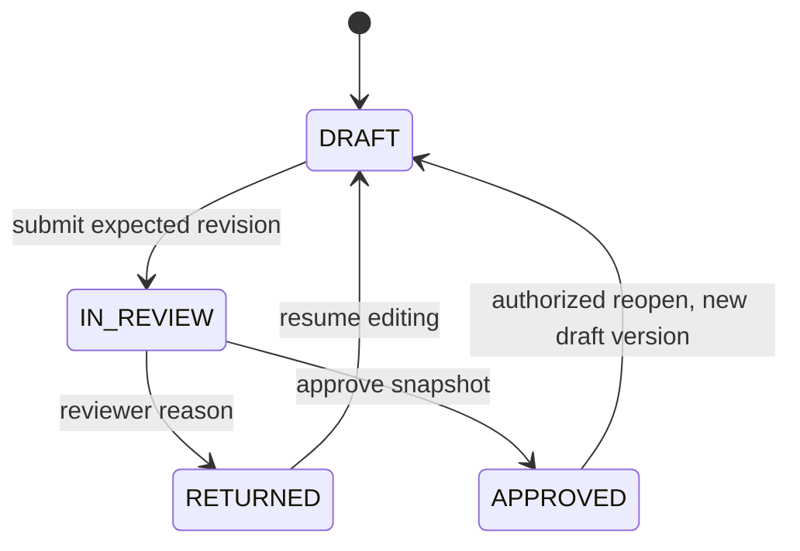
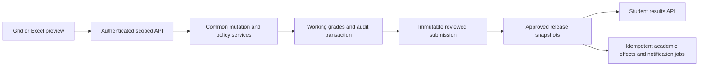

# Control System (الكنترول): Product and Implementation Plan

Date: 6 November 2026  
Status: implementation reference and live delivery tracker. Checked items require the evidence recorded below.  
Scope: the existing single-institute Student Portal, Arabic and English.

## Live phase tracker

Updated: 13 November 2026. Current follow-up: **D/F permissions, course-level student visibility, compact management and tuition holds**. Local test instructions and synthetic accounts: [control-testing.md](control-testing.md). Detailed follow-up evidence: [control-permissions-and-visibility.md](control-permissions-and-visibility.md). Update this table, the phase checklists, and the verification log together after each increment; code presence alone is not completion.

| Phase | Current status | Delivered work / remaining gate |
| --- | --- | --- |
| A — baseline and policy | Implementation reviewed; deployment data audit pending | Existing writers/readers and permissions mapped; coursework policy confirmed below. Historical production totals still need classification before migration. |
| B — reliable entry and review | Locally verified | Transactional marks/audit, persistent clear revisions, independent review, locks, all-column workbook and coursework breakdown. |
| C — Excel and reports | Locally verified | Scoped XLSX template, preview, valid-row commit, atomic receipt, stale preview rejection and whole-course context export. |
| D — publication hardening | Implemented and locally tested | Grades preview/digest, immutable releases, atomic active pointers, withdrawal, history and durable in-app notification/reconciliation jobs. |
| E — official final course results | Implemented and locally tested; historical rollout gate remains | Versioned pass/final-minimum/retake policy, complete approved results, attempt-aware GPA/credits/warnings and student/certificate coursework. Real historical totals still need classification. |
| F — corrections and acceptance | Correction workflow and local demo delivered; production acceptance pending | Snapshot continuity, replacement releases and reversible academic effects. Staff pilot, production reconciliation and backup/restore rehearsal remain external gates. |
| G — extensions | Optional / pending | Anonymous marking, practical/oral, multiple sittings and appeals. |

### Confirmed product decisions for this increment

- November 14 follow-up: improve Control client filtering and acknowledged-row autosave, hide student coursework while including it in authorized official totals, show only released midterm/final columns, replace level estimates with the stored warning count, and simplify XLSX entry. Admin retains full powers as confirmed; staff final approval remains explicit. Midterm marks carry no course letter. Final status codes are FX for banned and IC for an explicitly approved incomplete final (no numeric official outcome or GPA credit). Final verification is recorded in [ci-reports.md](ci-reports.md).

- Instructor-quiz follow-up: Grades visibility and bulk publication now cover coursework, midterm and final only. Instructors retain independent quiz publication; official result closure/dates/levels cannot override it. Financial/administrative holds remain enforced. The management dialog is limited to 768px and shows three components. Verified locally with 97 unit suites / 933 tests, 19 Control integration tests, bilingual desktop/mobile acceptance, workspace lint/types and isolated shared/API builds; final web-build evidence is recorded in [ci-reports.md](ci-reports.md).

- November 13 follow-up is locally verified: independent approval/publication permissions, visibility by course level by default, clear Eye/EyeOff management, zero scores with absent/banned labels, and tuition holds enforced on student results/quizzes. Removing a hold restores only otherwise published and visible results. Evidence: 97 API suites / 931 tests, 19 Control replica-set tests, bilingual browser acceptance, workspace lint/types, isolated API build and default Next.js/Turbopack build with route-manifest validation. Build details and deployment limitations are tracked in [ci-reports.md](ci-reports.md); production acceptance gates above are not automatically completed by these local checks.

- **Coursework is always out of 20**, consisting of attendance and quiz contributions. Default: **attendance 5 + quizzes 15**. Admin configures the attendance allocation per course/term; quiz allocation is `20 - attendance allocation`. Both contributions are stored and audited with the aggregate. The split is frozen once coursework is entered.
- Contributions are awarded marks, not unscaled source values. Example: 80% attendance gives 4/5; 80% in selected quizzes gives 12/15; coursework is 16/20. Review and round awarded contributions to the configured step before entry. Source attendance/quiz changes never silently overwrite marks. Automatic source selection/aggregation remains future work.
- Start operationally with **midterm**, then prepare coursework/final using the same workbook. All columns remain visible: student, attendance, quizzes, coursework /20, midterm, final, course total, status and actions. Only the selected component is editable/reviewable.
- **Grades remains the publication and open/close authority.** The flow is `Control entry -> submit -> different reviewer approves -> publish/hide on Grades -> student's Grades window`. An open window alone never reveals a draft. No competing publishing screen is introduced in this increment.
- Existing historical results are retained. Independent Control midterm/coursework releases do not drive official GPA, credits or promotion; only activated complete official course outcomes do. Student result reads no longer perform academic progression writes. Official final publication now requires complete independently approved components and an explicit release. Confirmed configurable defaults: coursework 20 + midterm 20 + final 60, pass at 50%, no separate final minimum, latest approved attempt counts toward GPA. Policy freezes after the first course/term release.
- Core component edits, including old manual/import APIs, must use Control. Legacy upload attempts receive an instruction to use the Control template. This intentionally closes the previous unaudited mutation bypass.

### Verification log

12 November increment: bilingual colored scheme/workbook guidance, strict scheme request serialization, file previews with sequential 500-row transactional uploads (10,000 rows / 2 MB per file), original Excel row error numbers, cross-batch duplicate checks, safe receipt retries, paginated audit detail previews, localized validation guidance and Arabic level terminology. Operational steps and regression commands are in [control-testing.md](control-testing.md). This increment does not change the pending production rollout gates.

Production acceptance evidence and outstanding gates are tracked in [control-production-acceptance.md](control-production-acceptance.md). On 6 November, the live portal's login/health returned 200 and existing protected routes returned 401, but the new Control policy/history routes returned 404. The explicitly configured database audit found no flagged inconsistencies (its identity as the live database is unconfirmed). A real synthetic backup/restore rehearsal passed across 16 collections. General performance E2E still times out in fixture setup; production acceptance remains pending.

| Check | Evidence so far |
| --- | --- |
| Control unit suites | 5 suites, 50 tests passed within the full workspace run. Expanded tests are in `apps/api/src/modules/control/` |
| Real MongoDB integration | 12 tests passed: original transaction/import/review cases plus legacy course discovery and official 80/100 publication, stale activation rejection, correction continuity, GPA/credit/warning reconciliation, withdrawal/reactivation, drained outbox and preserving pre-migration published results, policy version/freeze checks and legacy coursework /20 normalization. Log: `outputs/control-release-integration.log` |
| GUI acceptance | Workbook and release-panel fixtures passed, including real response envelopes and Arabic/English desktop/mobile. Release screenshots: `outputs/control-release-browser/`. Workbook evidence: real component/CSS fixture in `apps/web/tests/control-workbook.browser.mjs`, Arabic/English, all columns, autosave/retry, draft restoration, stale-scheme refresh and desktop/mobile screenshots. Transport is mocked; persistence is verified separately. |
| Workspace lint | Passed with existing warnings; no errors |
| Workspace typecheck | Backend, web and E2E fixture compilers passed separately; logs: `outputs/control-release-api-types.log`, `outputs/control-release-web-types.log`, `outputs/control-release-final-e2e-types.log` |
| Full API unit run | 91 suites and 859 tests passed. Log: `outputs/control-release-unit-final.log` |
| Production build | Root `pnpm run build` passed all 3 tasks with Turbopack; web TypeScript/route generation passed, and API runtime/root-route manifest audits passed. Final backend compatibility fix is checked separately in `outputs/control-release-final-api-build.log`. Log: `outputs/control-release-build.log` |
| Read-only audit helper | `node --test apps/api/test/control-data-audit.test.cjs` passed; local inventory: `outputs/control-data-audit.json`. Empty canonical local grade collections do not establish anything about production data. |
| General API E2E | Incomplete: local performance fixture startup exceeded its 120-second hook timeout; a later localhost MongoDB socket timeout also occurred. The unsuccessful broad run was stopped, with no timeouts weakened. This is not a green full-CI claim. Log: `outputs/control-release-general-e2e.log` |

Local verification uses synthetic data on an isolated localhost MongoDB replica set. Docker failed to start on this machine, so a portable official MongoDB binary and all test data/caches are kept in ignored `outputs/` on D:. C: disk exhaustion affected initial runs; failed/stalled checks are not counted as passes.

### Operating notes

Open **Admin -> Control**, select the year/semester and course, then select the component. Set the coursework split in **Grading scheme** before entering coursework. Earlier saved schemes may still have coursework/final disabled from the old midterm-only phase: explicitly enable those components in that dialog when ready. Download **Excel / template** from the workbook, edit only the selected component inputs and preserve student IDs/revisions, then preview and confirm valid rows. Invalid rows are listed without changing their marks. Blank cells mean unchanged; clear marks explicitly in the UI.

The workbook paginates 100 students per page. Save transactions and direct row/paste imports support at most 500 changes. XLSX files are capped at 2 MB / 10,000 rows and previewed and committed in sequential 500-row batches. The former 2,000-student roster cutoff has been removed; local regression checks cover 3,001 students. Unsaved drafts survive navigation within the same tab for the same authenticated user; review and retry restored drafts explicitly. Refreshing or closing the browser requires resolving the unsaved-work warning.

After all students have a mark or reviewed status, submit the sheet. A different user with review permission approves it. Publish it from **Grades** and configure that page's opening/closing window. For corrections to a snapshot-backed release, reopen it in Control with a reason, correct, review and activate a fresh preview in Grades. The old snapshot stays visible until replacement. Withdraw explicitly from Grades to hide a release. A legacy published sheet without a snapshot must still be hidden before reopening.

Grant new staff capabilities explicitly: `control.sheets.submit`, `control.sheets.review`, `control.import`, and `control.export`, together with existing Control access/view/entry permissions and course assignments. Admins retain the existing role bypass for permissions, but cannot self-approve a submitted sheet.

The live tracker and [test guide](control-testing.md) describe delivered behavior. Detailed design sections below also retain proposed future extensions; they are not a claim that optional Phase G has shipped.

## 1. Outcome and delivery boundaries

Give the Control office one workspace to prepare course rosters, enter and import marks, review exceptions, approve results, publish them to students, and correct them with a complete history. Support midterm, coursework, final, and the complete course result without creating a second competing grade database.

The core release includes:

- Academic-year, semester, department, level, course, and component navigation.
- Midterm, coursework, and final mark entry using one reusable grid.
- Versioned marking schemes, roster validation, special statuses, and concurrent editing protection.
- Excel preview/import/export, review, approval, publication, withdrawal, and correction.
- Student results, accurate final course results, GPA/progression integration, audit, and operational reporting.

Exam timetables and places remain owned by the existing exam-schedules feature. Control can link to them. Attendance and quizzes remain source systems; importing their marks into coursework must be an explicit reviewed action, never an automatic overwrite. Anonymous marking, practical/oral components, committee signatures, and special exam sittings are extension work described below.

The earlier [Control module plan](control-module-plan.md) and the original Phase 1/Phase 5 code labels are background references. This tracker uses A–G to avoid confusing historical labels with verified delivery. The confirmed decisions above override earlier proposals where they differ.

## 2. Evidence from the current repository

This table records the baseline inspected before the A–C increment. Use the live tracker above for current delivery and runtime evidence.

| Area | Current evidence | Planning consequence |
| --- | --- | --- |
| Component contracts | `packages/shared/src/constants/control.ts` defines coursework, midterm, final; only midterm is enabled | Generalize component handling before enabling the others |
| Default scheme | Coursework 20, midterm 20, final 60; step 0.5 | Useful example, not a confirmed institute regulation |
| API | `apps/api/src/modules/control/control.controller.ts` supports capabilities, courses, sheets, entries, locks, audit, schemes | Extend the existing module |
| Access | `services/control-access.service.ts` checks permissions and assigned course scope | Apply the same rules to imports, exports, approval, and publication |
| Storage | Marks are in `grades`; `control_sheets` identifies course + year + semester + component | Keep the marks here; snapshots described later are immutable release evidence |
| Grid | `apps/web/src/features/control/components/control-grid.tsx` has autosave, paste preview, undo, statuses, conflict handling | Preserve behavior and extract reusable pieces; coursework/final are currently read-only |
| Roster | `services/control-sheets.service.ts` uses approved registrations and also displays existing grade holders outside the roster | Reconcile exceptions rather than silently deleting marks |
| Legacy paths | `modules/grades` and `modules/uploads/importers/grade.importer.ts` can write grades outside the Control grid | Unify mutation rules; existing lock checks alone do not prove rule parity |
| Publication | Existing Grades API has publish/hide and result-window settings; Grade schema defaults `isPublished` to true, while Control creates hidden marks | Explicit hidden defaults and a common release policy are required |
| Academic progress | `grades.service.ts` calls `mergeAcademicCourseProgress`; that utility groups by course code and sums records when final marks exist | Rework attempt identity and aggregation before releasing full component results |
| Tests | Control has shared, access/scheme, and grade-service unit suites | Reuse and expand them; their presence is not evidence they pass |

Source paths beginning `services/` above are relative to `apps/api/src/modules/control/`. Existing student-code lifecycle work is documented separately in [admissions-code-lifecycle.md](admissions-code-lifecycle.md); preserve its identity and import safeguards.

## 3. Academic policy to record before production use

Use versioned policy settings, with effective year/semester and approving actor. Do not bury policy in JSX, importer defaults, or GPA code. The development example is 20 coursework + 20 midterm + 60 final = 100; production release is blocked until the institute confirms:

| Decision | Proposed implementation behavior |
| --- | --- |
| Component distribution | Set per course/term; explicitly distinguish required, optional, and not applicable components |
| Pass threshold and grade scale | Reuse the existing shared scale where approved; version any institute changes |
| Minimum final mark | Optional explicit rule; do not infer one from total pass percentage |
| Absence or ban in the final | Confirm whether it forces course failure regardless of total; current progress utility treats these as blocking |
| Excused/incomplete | Defer the result; do not treat missing marks as zero or fail by default |
| Withheld | Preserve the internal mark, suppress public numeric results, defer academic effects until disposition is confirmed |
| Rounding | Calculate using integer hundredths; define the exact rounding stage before threshold comparison |
| Retakes | Define latest/best/replacement attempt and GPA policy; never combine components across terms |
| Coursework composition | Confirm whether a single approved aggregate suffices or quiz/attendance/practical subcomponents are required |
| Review separation | Proposed default: approver differs from submitter; exceptional admin override requires a recorded reason |
| Student visibility | Midterm can be published independently; official course result requires all required components and approval |
| Historical imports | Establish which legacy `final` values mean final-exam marks and which mean whole-course totals |

Retain unresolved policy as explicit configuration blockers. Ordinary midterm entry can proceed once its own scheme and visibility rules are approved; do not require unrelated extension decisions for that pilot.

## 4. GUI and navigation

Use the current dark teal design system, existing sidebar, `PageTitleBanner`, `DataTable`/`DataTableShell`, Radix controls, and TanStack Query. Ordinary management tables use the shared table system; the mark grid remains a specialized accessible editing component with shared shells and controls.

### 4.1 Control overview: existing `/[locale]/admin/control`

Filters are URL-synchronized: year, semester, department, level, course search, component, workflow status. Scope filters on the server; a staff member must not discover other courses through counts or dropdown options.

```text
Control                 [Academic year] [Semester]
[Department] [Level] [Component] [Status] [Search]

Courses | Missing marks | Awaiting review | Ready to publish

Course/code | Registered | Midterm | Coursework | Final | Release | ...
CS101       | 120        | 118/120 | 120/120    | 0/120 | Hidden  | ...

Progress shows entered/expected counts and a textual status.
```

The row menu opens a component sheet, opens the course result summary, downloads an authorized roster, or views history. Show server-derived counts for missing, absent, deferred, withheld, and out-of-roster records. Empty term, no assigned courses, and no filter matches have separate messages.

### 4.2 Component sheet: existing `/[locale]/admin/control/[sheetId]`

```text
CS101 / Course name      Year • Semester • Midterm
[Midterm] [Coursework] [Final] [Course result]
Workflow: Draft         Release: Hidden        Saving: All changes saved
Max: 20 • Step: 0.5      Registered: 120 • Missing: 2

[Search] [Missing / Absent / Invalid / Conflicts / All]
[Paste] [Import Excel] [Export] [Submit for review] [...]

Select | Student code | Student name | Mark /20 | Status | Saved | ...
       | 260001       | ...          | 16.5     | Present| Saved | ...

Selected: 8   [Set permitted status] [Clear marks] [Export selection]
```

- Component tabs resolve their own sheet IDs and preserve the course/term context. The result tab is computed and read-only.
- Pin student code/name and column headings on desktop. Keep row identity visible while scrolling. Use horizontal scrolling or a compact single-student editor on narrow screens.
- Enter moves to the next student; Tab/Shift+Tab follow a documented order. Escape cancels an unsaved cell. Restore focus after a dialog closes.
- Retain 800ms autosave unless measurement justifies changing it. Clearly distinguish unsaved, saving, saved, invalid, conflict, and failed states, using text/icons as well as color.
- Flush pending valid edits before review/lock/navigation; if edits cannot save, keep the user on the sheet with retry/discard choices. Never silently discard failed edits.
- Support Arabic/English digits and decimal separators. Blank, numeric zero, absent, and clear are separate operations.
- Selection applies to the current visible page; any all-filtered operation requires an explicit scope/count preview. Bulk clear/status changes show affected students and a confirmation.
- Paste preview lists matched students, old/new values, errors, and overwrites. Code-keyed paste is preferred; positional paste requires explicit confirmation of the visible row mapping.
- A conflict dialog shows the saved value and the user's value. Keeping the user's value submits against the latest revision; it never bypasses permissions or the sheet state.
- Clearing a published mark creates a correction draft; it does not erase the currently released result.

### 4.3 Scheme dialog

Display all components with required/enabled state, maximum, step, total maximum, and policy version. Reject duplicate/missing component definitions. After marks exist, changes require an impact preview listing incompatible marks, affected results, and approvals to invalidate. Increasing/decreasing maximum must not silently rescale marks. Never clamp an over-limit mark.

### 4.4 Review and publication workspace: proposed screens

Review actions are implemented on the component workbook: submit, approve, return, and reopen with reasons and revisions. A dedicated review queue remains proposed. Publication continues on `/[locale]/admin/grades`; do not build a second releases screen. Future release snapshots should sit behind the existing Grades actions.

Publication shows exact course/component/student scope, approved revision, scheme version, visibility window, withholding exclusions, and academic-impact preview. Confirming creates a release operation; show progress and recoverable errors. Midterm release and official final-course release are clearly different actions.

### 4.5 Audit, student results, and reports

- Reuse `control-audit-drawer.tsx`: actor, Cairo time, source, before/after, reason, revision, import/release correlation ID. Row and course history require the same course scope.
- Student results show only the authenticated student's released data, course/term, component maxima, public statuses, and release date. A draft correction never appears early. Incomplete results show a clear pending label.
- Reports: component roster, missing marks, exceptions, review queue, approved course results, publication history, and correction history. Every export states whether it is draft or official, filters, year/term, and generation time. Official reports include release ID/version.

### 4.6 Arabic, accessibility, and interface states

Use `next-intl` keys under a proposed `control` namespace for all labels and status messages. Arabic names use the existing Arabic-field fallback. Portaled dialogs/menus explicitly receive direction. Codes and marks are LTR; mixed codes use `bdi`. Dates use `ar-EG` or `en-GB` with `Africa/Cairo`.

Use logical alignment, RTL-aware modal actions, labelled inputs, visible focus, semantic headers, error associations, and a polite save-status live region. Large cards/dialogs use `rounded-xl`/`rounded-2xl`; reserve `rounded-squircle` for controls and badges. Include loading skeletons, initial empty state, no matches, retryable errors, forbidden access, expired session, and read-only approved/locked states. On failed authentication or lost permission, stop autosave and explain the state without exposing other records.

## 5. End-to-end academic workflows

### 5.1 Midterm

1. Admin confirms the term scheme and staff assignments.
2. Open the midterm sheet; roster comes from approved registrations for the exact course and term.
3. Enter or import hidden marks; validate maximum/step and student membership on the server.
4. Resolve blanks, conflicts, and status exceptions; submit a specific sheet revision for review.
5. Reviewer returns it with comments or approves that revision.
6. Publisher previews and releases midterm marks. Midterm alone does not finalize a course, award credits, or promote a student.
7. Corrections repeat review/publication and preserve the earlier release history.

### 5.2 Coursework

Reuse the same sheet engine. Initially support one approved coursework aggregate. If quiz/attendance contributions are needed, store the selected source period, source IDs/versions, weights, and previewed calculation. A later source change marks the import outdated; it does not change approved coursework automatically. Prevent counting the same quiz both in coursework and as an extra course-result component.

### 5.3 Final and course result

1. Enable final only after scheme, legacy-data classification, and aggregation tests pass.
2. Enter the final-exam mark against its own maximum, not the whole-course maximum.
3. Review final marks and confirm approved required coursework/midterm components are available.
4. Compute the official course result from the exact student's course attempt and approved policy; show blockers instead of inventing a total.
5. Approve and release a versioned course result. Publishing final-exam marks independently must be explicitly authorized by policy and must not make an incomplete course official.
6. Recalculate academic effects from official course-result releases using an idempotent job; report completion separately from notification delivery.

Example, assuming an approved 20/20/60 policy: coursework 17 + midterm 15 + final 48 = 80/100. A missing final gives no official total. Final 48/60 must never be interpreted as a whole-course 48/100 or added to a separately imported 80/100 total.

### 5.4 Exceptions, withdrawals, and corrections

- Missing registration: retain existing marks as an exception, block normal new entry, and resolve through the registration workflow or a specifically authorized documented override. Refreshing a roster must not delete historical marks.
- Registration changes after submission invalidate readiness; an approved/released roster snapshot remains historical evidence.
- Absence/ban/excuse/incomplete/withholding require documented policy treatment; sensitive reasons remain internal.
- Approved marks become read-only. Reopen with permission/reason, create a correction version, and invalidate approval on the changed draft.
- A released correction leaves the previous release visible until replacement is approved and published. Emergency withdrawal hides the selected release immediately and records a reason; resulting academic effects must be reconciled explicitly.
- Summer and retakes are separate attempts by year/semester. Multiple sittings in the same term require the later attempt extension, not reuse of the same unique grade key.

## 6. Domain model and invariants

### Existing models to extend

| Model | Planned responsibility |
| --- | --- |
| `Grade` | Current working component mark, explicit hidden default, revision, actor, scheme version; keep existing identity key |
| `ControlSheet` | Component sheet identity, workflow state/revision, roster revision, submitted/approved metadata, lock metadata |
| `GradingScheme` | Immutable approved versions plus current draft; required components and policy reference |
| `GradeAuditLog` | Append-only edit, status, import, review, approval, publication, withdrawal, and correction evidence |

Proposed new records: `ControlSubmission` (immutable reviewed roster/marks and version references), `ControlRelease` (scope, state, active version, actor, timestamps), `ControlReleasedResult` (per-student public component/course snapshot), and `ControlImportBatch` (preview scope, fingerprint, errors, commit results). Names are proposals; finalize schema details before implementation.

Keep `Grade` as the working source and release snapshots as the publication source. Existing student endpoints must move to that publication source for migrated terms; mutating a working grade must not mutate a published snapshot. `isPublished` becomes a compatibility field, not a second independent release authority. Avoid a second editable table of totals.

Mandatory invariants:

1. Identity is `studentId + courseId + academicYear + semester + component`. Codes are display/import lookup values, not permanent ownership keys. Preserve student-code lifecycle validation when codes are reused.
2. No record means not entered; zero is a valid entered mark. Scoreless statuses never acquire a numeric value from an empty cell.
3. A component subtotal is labelled as such. Official result completeness uses required policy components, not merely the currently enabled UI components. The current shared helper that sums enabled components needs a distinct official-result contract.
4. An approved snapshot binds marks, roster, scheme, and policy versions. Every mutation checks expected versions and authorization on the server.
5. Mutation, audit, revision advance, and idempotency receipt commit atomically per operation. A lock/review transition and an edit must contend on the same sheet revision inside the transaction; a pre-read lock check is insufficient.
6. Partial success is allowed for draft grid/import batches, with per-row results. Approval and release activation are all-or-nothing within their explicit scope; blocked rows cannot silently disappear from that scope.
7. Multi-batch releases prepare immutable snapshots first, then atomically activate a completed release pointer. Readers never see a half-prepared release.
8. Every final course result is derived once per attempt. Legacy `total` records and component records must never both contribute to the same total or GPA.
9. Academic effects are deterministic per active official release and approved retake policy. Retrying a job cannot add warnings, credits, or promotion twice. Withdrawal/correction can reverse derived effects through reconciliation while preserving documented manual historical data.
10. Every write path, including older Grades endpoints and upload jobs, uses the same domain rules. Feature flags in the UI do not secure a write endpoint.

## 7. Sheet lifecycle and publication lifecycle

Proposed sheet workflow:



Editing is allowed only in DRAFT/RETURNED and while unlocked. Submission freezes the submitted revision; unlocking alone never bypasses review. Lock is an independent administrative edit barrier, not proof of approval. Old sheets migrate to DRAFT with their existing lock state, without claiming historical approval.

Publication lifecycle is separate: `PREPARING -> READY -> ACTIVE -> SUPERSEDED` or `WITHDRAWN`; preparation can fail and retry without changing the current active release. Approval does not publish, locking does not publish, and closing a display window does not by itself revoke an academically valid result.

On approval, verify no valid edits remain pending, no invalid marks/conflicts exist, roster exceptions are resolved, required statuses are reviewed, and the scheme is approved. On official course release, also verify all required component submissions and policy decisions. Revalidate these conditions at commit, not only during preview.

## 8. Access model

Keep roles `admin`, `staff`, `student`. Entry operator, reviewer, and publisher are capability bundles, not new global roles. Current Control staff receive no automatic access.

| Action | Existing/proposed permission | Additional restriction |
| --- | --- | --- |
| Open/list | Existing `control.access`, `control.sheets.view` | Course/term scope |
| Create/edit draft | Existing `control.sheets.create`, `control.grades.enter` as applicable | Editable workflow and enabled component |
| Special states | Existing `control.states.manage` | Reason and status policy |
| Published correction | Existing `control.grades.edit_published` | Correction workflow; never direct snapshot overwrite |
| Lock/unlock | Existing `control.sheets.lock` / `control.sheets.unlock` | Reason; does not override workflow |
| Schemes | Existing `control.schemes.manage` | Version/impact validation |
| Audit | Existing `control.audit.view` | Scope and sensitive-field restrictions |
| Unrestricted course scope | Existing `control.scope.all` | Does not grant unrelated actions |
| Submit/review | Proposed `control.sheets.submit` / `control.sheets.review` | Expected revision; approver separation |
| Publish/withdraw | Proposed `control.results.publish` / `control.results.withdraw` | Approved scope and reason |
| Import/export | Proposed `control.import` / `control.export` | Import also requires entry/status permissions; draft export does not grant publication |

Add proposed permissions to shared constants, validation, staff permission groups, bilingual labels, and capability responses. Audit admin overrides. Preserve JWT cookies, CSRF, password-change gates, and student ownership checks. Legacy `grades.write`/upload rights must not bypass new Control permissions for migrated terms; define and test an explicit compatibility matrix.

## 9. API and service design

Existing paths below are relative to the configured API prefix. Proposed paths are a design contract, not currently available endpoints.

Preserve `GET /admin/control/me`, `GET /courses`, `POST /sheets`, `GET /sheets/:id`, `GET/PATCH /sheets/:id/entries`, lock/unlock, audit, and scheme reads/updates under `/admin/control` as currently implemented. Version DTOs if changing existing response semantics.

| Proposed endpoint under `/admin/control` | Purpose |
| --- | --- |
| `POST /sheets/:id/submit` | Submit expected sheet/roster/scheme versions |
| `POST /sheets/:id/review` | Approve or return a specific submission with comments |
| `POST /sheets/:id/reopen` | Create a new draft version with reason |
| `GET /courses/:courseId/results` | Paginated draft/approved course result preview for an explicit term |
| `POST /imports/preview` | Parse a bounded workbook into a scoped preview |
| `POST /imports/:id/commit` | Commit selected valid preview rows with expected versions |
| `GET /sheets/:id/export` | Authorized XLSX draft or approved sheet |
| `POST /releases/preview` | Validate exact scope and calculate academic impact |
| `POST /releases` | Prepare/activate release from a server-owned preview |
| `GET /releases/:id` | Status, row counts, effects, retryable errors |
| `POST /releases/:id/withdraw` | Withdraw with expected release version and reason |

Extend current services for access, sheet orchestration, mark changes, and schemes. Add proposed `control-review.service.ts`, `control-import.service.ts`, `control-publication.service.ts`, and a pure shared course-result policy evaluator. Keep controllers thin. Avoid a circular service dependency when Grades compatibility adapters delegate to Control; move common mutations below both orchestration layers if needed.

All mutation DTOs validate ObjectIds, enum values, bounded arrays, numeric precision, term, revision, and reason length. Error responses use stable machine codes such as `SHEET_LOCKED`, `STALE_REVISION`, `SCHEME_CHANGED`, `ROSTER_CHANGED`, `RESULT_INCOMPLETE`, and `RELEASE_NOT_APPROVED`, with localized UI text. Repeated operation keys must be bound to actor, scope, and payload hash; reusing a key for another request is rejected.

Data flow:



## 10. Excel and reporting contracts

Export with existing ExcelJS conventions: `.xlsx` MIME, teal/white headers, readable widths, bilingual names, and explicit year/semester/course/component/max/step metadata. Use `downloadFileBlob` on the web because the Axios interceptor unwraps responses. If CSV is offered, include a UTF-8 BOM and protect spreadsheet cells against formula injection.

Workbook columns: student code, student name (reference), mark, status; include a template/schema version and an opaque server-validated scope reference. For reused student codes require the identity evidence accepted by the existing student-code lifecycle; do not expose national IDs in routine class rosters. Client-supplied IDs/metadata are never trusted without scope checks. Totals and names are read-only reference fields, never imported as working component marks.

Preview validates extension/content, size/row bounds, numeric parsing, duplicate students, membership, term, status permission, enabled component, scheme revision, existing mark revision, and overwritten values. Reject formulas in input mark cells. Warn about ignored rows/columns; do not silently import another worksheet. Empty cells mean leave unchanged; clearing uses an explicit operation with confirmation.

Store a preview fingerprint/expiry, selected sheet, actor, identity resolution, and expected revisions. Commit rechecks current permission, roster, scheme, workflow, and lock state. Return per-row saved/invalid/conflict/forbidden results and a downloadable error report. Committed rows receive operation IDs and XLSX audit source; retry does not duplicate edits. Large exports/imports use existing BullMQ infrastructure with bounded chunks, scoped job access, retention, and cancellation before activation.

## 11. File-by-file implementation map

All new files below are proposed. Preserve uncommitted admissions/student-code work when implementing.

| Location | Work |
| --- | --- |
| `packages/shared/src/constants/control.ts` | Component rules, separate subtotal/official-result contracts, shared validation and policy evaluation |
| `packages/shared/src/constants/permissions.ts` and shared exports | New permission values, workflow/release DTO contracts and exports |
| `apps/api/src/modules/control/schemas/` | Extend sheet/scheme/audit; add submission, release, released-result, import-batch schemas and indexes |
| `apps/api/src/modules/control/dto/control.dto.ts` | Review/reopen/import/release requests, version and scope validation |
| `apps/api/src/modules/control/services/` | Common mutation invariants, review/import/publication services, course-result aggregation |
| `apps/api/src/modules/control/control.controller.ts`, `control.module.ts` | Wire new APIs/providers with permission checks |
| `apps/api/src/modules/grades/grades.service.ts`, controller and schema | Explicit hidden defaults, compatibility adapters, release-backed student reads, academic-effects reconciliation |
| `apps/api/src/modules/uploads/importers/grade.importer.ts` and upload orchestration | Delegate migrated terms to the same Control rules; preserve student-code identity guards |
| `apps/api/src/modules/registrations/utils/academic-course-progress.util.ts` | Consume approved per-attempt course outcomes; preserve manual historical facts with provenance |
| `apps/web/src/features/control/` | Extend typed API, query keys, capabilities; extract grid editing/paste/conflict hooks and add review/release/import views |
| `apps/web/src/app/[locale]/admin/control/` | Existing overview/editor; proposed review/releases/course-summary routes |
| `apps/web/src/features/staff/permission-groups.ts` and navigation | Capability bundles and gated links |
| `apps/web/src/messages/ar.json`, `en.json` | Complete Control labels/statuses/errors; replace hardcoded phase labels |
| Existing student results UI/API client | Show released component/course snapshots and pending/withheld states |
| API Control suites and E2E tests; web browser tests | Expand meaningful regression coverage; use isolated synthetic data |

Before adding jobs, locate and reuse the current BullMQ queue conventions. Before changing root task commands/configuration, read the installed Turbo package documentation required by `AGENTS.md`.

## 12. Proposed delivery phases and acceptance gates

Use these as tracking checkboxes. Unchecked means not accepted under this plan, including functionality already present in code.

### Phase A — Baseline and policy contract

- [x] Inventory all grade writers/readers, publication settings, legacy totals, and affected permission paths.
- [x] Run existing Control tests and document failures; capture current Arabic/English screen behavior.
- [x] Record the existing midterm defaults, confirmed coursework 20 with configurable 5/15 split, and draft full-course policy blockers.
- [x] Provide and test a read-only inventory helper for duplicate identities, out-of-roster marks, ambiguous totals, and publication inconsistencies; generate an isolated local report.
- [ ] Run the reviewed inventory against an approved production/staging copy and classify real historical totals before migration. Local empty-data results are not production acceptance.

Exit: a reproducible baseline, approved pilot policy, and explicit legacy-data disposition. No production record is changed by the audit.

### Phase B — Reliable midterm foundation

- [x] Consolidate entry/clear/status/import mutation rules and actor attribution; old core-component write APIs reject bypass attempts and direct operators to Control.
- [x] Make edit/audit/idempotency and lock/edit contention transactional; freeze marked schemes and bind review to roster/scheme/mark digests.
- [x] Finish grid error, retry, navigation, RTL, keyboard, and conflict behavior; browser fixture and transactional revision tests pass.
- [x] Add submit/review/reopen with an immutable submitted digest, read-only submitted/approved marks, and capability separation. Full historical publication snapshots remain Phase D work.

Exit: two simultaneous operators cannot lose an edit; lock or submission cannot race a write; unauthorized/out-of-roster edits fail; reviewed midterms remain hidden until explicitly released. Existing and new regression suites pass.

### Phase C — Excel and office reporting

- [x] Add scoped XLSX template, server preview, per-row error feedback, transactional commit receipt, and XLSX audit correlation.
- [x] Close the legacy core-component upload bypass; operators use the Control workbook template and the common mutation rules.
- [x] Add workbook export with draft/approved metadata, all-grade context, missing-mark filtering and registration-exception indicators.
- [x] Provide dedicated scoped missing-mark/exception XLSX downloads and a preview-owner-scoped import-error report, including commit-time failures.

Exit: a stale preview cannot overwrite a newer mark; retry is idempotent; all row outcomes reconcile with audit records; Arabic workbook round trips preserve marks and identities.

### Phase D — Controlled midterm publication

- [x] Add release preview/activation/withdrawal and status UI, with digest-bound activation and release history.
- [x] Serve newly activated Control components from immutable release snapshots; preserve result-window policy. Releasing approved historical marks requires explicit review; no automatic historical-total conversion is performed.
- [x] Add durable reconciliation/in-app notification outbox, deterministic delivery IDs, worker polling, admin retry and pending-job visibility. FCM/email delivery is not claimed.

Exit: only approved scoped marks are visible; no partial release is exposed; repeated activation cannot duplicate releases/notifications; midterm publication does not award credits or change GPA/progression.

### Phase E — Coursework, final, and complete course results

- [x] Generalize the grid, overview component selector and API to coursework/final; fix all Control JSON responses to unwrap the production API envelope.
- [x] Version result policy and implement the official-result evaluator; preserve a historical academic baseline.
- [ ] Classify and reconcile real historical totals on an approved staging copy before migration.
- [x] Add required-component, final-status/pass/minimum checks and configurable latest/best approved retake handling, keeping terms distinct.
- [x] Activate complete approved course results and reconcile GPA, credits, warnings and progression through durable jobs. Repeating reconciliation does not increment credits or warnings; incomplete historical evidence retains baseline GPA.

Exit: 17 + 15 + 48 produces exactly 80/100 under the example scheme; missing/deferred components block official totals; no double counting; repeated reconciliation is a no-op; terms/retakes never merge accidentally.

### Phase F — Corrections, migration, and production acceptance

- [x] Support corrected draft -> review -> replacement release with previous-version continuity; verify withdrawal reverses academic effects against the retained baseline.
- [ ] Validate withdrawal effects, audit exports, backup restoration, and rollback compatibility.
- [ ] Pilot one course/term, reconcile counts and totals with Control staff, then expand by explicit migrated scope.
- [x] Verify local bilingual workbook/release browser fixtures and real MongoDB release/correction/reconciliation; provide an isolated, non-destructive interactive demo.
- [ ] Complete staging-scale performance, backup/restore and operational acceptance gates below.

Exit: end-to-end acceptance from roster to student visibility and corrected academic effects, with signed policy decisions, reconciled migration results, and no unresolved release-blocking failures. Local synthetic acceptance is delivered; production acceptance is not claimed.

### Phase G — Extensions after core acceptance

- Anonymous seat/secret-number mapping: restricted identity mapping, separation from marker views, controlled reveal and audited exports. Never use a temporary secret number as the student's permanent ID.
- Practical/oral components and coursework subcomponents: extend shared types, storage uniqueness, policy and templates together; do not merely add a grid column.
- Multiple exam sittings within one term: introduce explicit attempt/sitting identity through grades, registrations, snapshots, release and GPA policies before enabling entry.
- Appeals: link a complaint/appeal to the released result and correction case, without modifying results directly through the complaints module.
- Committee signatures and moderation adjustments: document authority, adjustment reason, maximum bounds, and before/after policy; no hidden scaling.

These are explicitly outside the core release unless institute requirements make them mandatory in Phase A.

## 13. Verification plan

| Layer | Required evidence |
| --- | --- |
| Shared unit | Arabic digits, blank/zero, step/precision, maximums, all statuses, missing components, thresholds, final-minimum rules, rounding boundaries |
| Service unit | Capabilities/scope, approved roster, revision conflicts, payload-bound idempotency, immutable schemes, workflow transitions and reviewer separation |
| Mongo integration | Real replica-set transactions, edit vs lock/submit races, audit rollback, duplicate-key races, failed batch recovery, release-pointer atomicity |
| Aggregation | Multiple terms and retakes, legacy whole totals, quizzes counted once, withheld/deferred outcomes, idempotent credits/warnings/progression and withdrawal reconciliation |
| HTTP security | Cookie/CSRF/password gates, every legacy writer, foreign sheet/student IDs, export/job access, revoked permissions after preview |
| Browser | Arabic/English desktop/mobile, keyboard/focus, paste mapping, autosave failure and recovery, pending navigation, review, release, correction and student privacy |
| Import/export | Real generated XLSX reopened and checked, Arabic names, leading-zero codes, formulas, duplicates, expired preview, reused codes, size limits and error reports |
| Performance | Synthetic 500/2,000/10,000-student rosters; bounded requests/chunks, query plans, memory, DB connections, cancellation and queue retry behavior |

Proposed performance targets for a documented local/staging environment: p95 server mark-batch latency below 1 second for 100 changes; visible grid interaction below 100ms; first paginated roster response below 2 seconds for 2,000 registrations. Record hardware and concurrency; adjust targets from measurements before promising a production SLA. The current roster service has hard limits: introduce pagination/cursors or explicit overflow errors before claiming support for larger rosters. Never publish counts from a silently truncated roster.

Commands available in this repository (PowerShell uses `.cmd` to avoid execution-policy issues):

```powershell
# Targeted existing suites, before expanding coverage
pnpm.cmd --filter @student-portal/api test --runInBand --runTestsByPath src/modules/control/control-shared.spec.ts src/modules/control/control-access-and-scheme.spec.ts src/modules/control/control-grades.service.spec.ts

# Workspace release checks
pnpm.cmd run lint
pnpm.cmd run typecheck
pnpm.cmd run test
pnpm.cmd run build

# Existing isolated E2E infrastructure; inspect runner coverage first
pnpm.cmd run test:services
pnpm.cmd run test:e2e

# Control transaction tests have their own replica-set fixture and guarded runner.
# The ordinary CI MongoDB service is standalone; do not put these tests there.
pnpm.cmd run test:control:services
pnpm.cmd run test:control:e2e
pnpm.cmd run test:control:audit
node --test apps/api/test/control/runner-safety.test.cjs
pnpm.cmd run test:control:browser
```

Control integration scenarios now live in `apps/api/test/control/workflow.e2e-spec.ts`; its runner accepts only credential-free localhost `/control-e2e` and requires a replica set. The default compose fixture uses port 27023. For an existing isolated local replica set, supply `CONTROL_TEST_MONGODB_URI` explicitly. The browser script renders the real workbook, CSS and controls against synthetic transport; it verifies GUI behavior, not authentication or MongoDB persistence. Those are separate API checks. Use synthetic accounts and an isolated database, never production data. A stalled/failed check is not a pass. The `ci-cd-verifier` workflow is required for implementation changes.

## 14. Migration, operations, and rollback

1. Back up and test restoring the isolated staging copy. Inventory existing indexes; report duplicates before introducing new uniqueness constraints. Do not drop unrelated indexes.
2. Add schema fields/indexes without deleting legacy fields. Version schemas and result-source selection per migrated course/term so old/new readers have a deliberate compatibility boundary.
3. Dry-run legacy classification: final-exam-only, whole-course-total, full breakdown, or ambiguous. Never infer meaning solely from a column name or score range; ambiguous records need documented review.
4. Preserve student IDs, code ownership, existing published visibility, original provenance, and actor uncertainty. Historical published marks become labelled legacy release snapshots after reconciliation, not newly invented approvals.
5. Compare old/new per-student totals and academic effects on staging. Review every difference before activating a migrated scope.
6. Roll out midterm first; gate later components server-side until their dependencies pass. Keep read-only access to history throughout rollout.
7. Monitor autosave errors/conflicts, missing audit entries, stale previews, blocked releases, queue failures, release/effect lag, and discrepancy counts. Logs use operation IDs and avoid national IDs or full mark sheets.
8. Use transactional outbox delivery for post-release jobs. A notification failure retries without rolling back a successful release. An academic-effects failure stays visible as pending/failed and has a safe retry/reconciliation path.
9. Rollback disables new writes/releases for affected scope first. Retain snapshots and audit; switch reads only to a compatible previously reconciled release. Older code must not resume unrestricted writes against migrated data. Do not erase newer marks or blindly restore a database over subsequent work.

The implementation is complete only when the core acceptance gates pass, migrated totals reconcile, and Control staff can perform the full midterm and final workflow in both languages. Extension items remain separately tracked.
## Permission and visibility follow-up

See [Control permissions and student result visibility](control-permissions-and-visibility.md) for the independent approval/publishing permissions, audience controls, Cairo schedule rules and component-specific absence behavior added on 13 November 2026.
