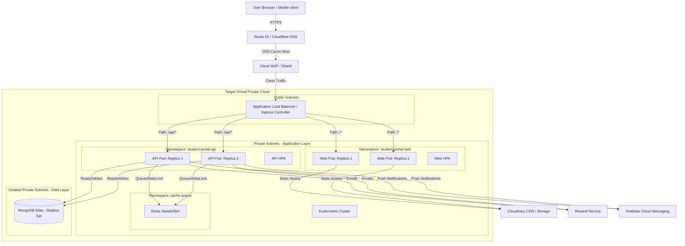
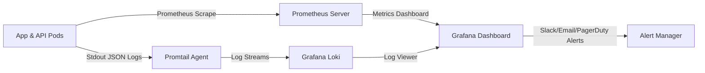

# Production Deployment & DevOps Infrastructure Plan

This document details the production-ready infrastructure architecture, containerization strategy, CI/CD pipeline, Kubernetes deployment files, monitoring strategy, and production checklist to prepare the MERN-style Next.js 16 and NestJS 11 monorepo for stable, scalable deployment.

## Goal Description
Provide a production-ready containerized setup, a fully automated CI/CD pipeline, robust monitoring guidelines, and Kubernetes manifests to deploy, scale, and secure the Student Portal application under high availability.

---

## User Review Required

> [!IMPORTANT]
> **Key Architecture Decisions**
> 1. **Next.js Standalone Mode**: We will modify [next.config.ts](file:///d:/BIS/bhi47a-full-stack-web/apps/web/next.config.ts) to set `output: "standalone"`. This reduces the frontend container image size from ~1GB to ~120MB by bundling only runtime dependencies.
> 2. **Monorepo Containerization**: We leverage `pnpm --filter deploy` for the NestJS API server. This isolates `@student-portal/api` and its production dependencies (including `@student-portal/shared`) into a minimal footprint.
> 3. **Database and Redis Management**: We recommend MongoDB Atlas (Managed Serverless/Dedicated Cluster) for production rather than self-hosting in Kubernetes to guarantee 99.99% availability, automated backups, and sharding. For Redis, we configure a clustered K8s StatefulSet for local queues/rate limiting, or recommend Upstash Redis / AWS ElastiCache.
> 4. **Unified Ingress Routing**: Nginx Ingress routes `/api/*` to the NestJS API container and all other paths `/` to the Next.js Frontend container.

---

## Open Questions

> [!NOTE]
> **Clarifications & Intent**
> - **Kubernetes Provider**: We assume a generic cloud provider (like AWS EKS, GCP GKE, or Azure AKS) using Nginx Ingress Controller. Do you have a specific cloud provider you'd like to target?
> - **Secrets Manager**: For Kubernetes, secrets are injected via dry-run manifests or external secret managers (like AWS Secrets Manager, HashiCorp Vault, or sealed-secrets). In this plan, we provide standard base base64 `secrets.yaml` templates for local/standard K8s execution.
> - **CI/CD runner**: The GitHub Actions pipeline is configured to build Docker images and push them to GitHub Container Registry (GHCR). Do you prefer another registry (like AWS ECR or DockerHub)?

---

## Proposed Changes

### Configuration Modifications

#### [MODIFY] [next.config.ts](file:///d:/BIS/bhi47a-full-stack-web/apps/web/next.config.ts)
- Add `output: "standalone"` to the NextConfig to compile only the necessary runner files.

#### [MODIFY] [11-deployment-devops.md](file:///d:/BIS/bhi47a-full-stack-web/docs/11-deployment-devops.md)
- Update with reference commands and Kubernetes configurations.

### New Container & Orchestration Files

#### [NEW] [Dockerfile.api](file:///d:/BIS/bhi47a-full-stack-web/Dockerfile.api)
- Multi-stage build for `@student-portal/api`.
- Security hardens the image by using `node:20-alpine`, dropping root privileges (`USER node`), and using `pnpm deploy` to prune dev dependencies.

#### [NEW] [Dockerfile.web](file:///d:/BIS/bhi47a-full-stack-web/Dockerfile.web)
- Multi-stage build for `@student-portal/web`.
- Compiles the Next.js standalone runner.
- Security hardens the container and keeps the footprint tiny.

#### [NEW] [docker-compose.yml](file:///d:/BIS/bhi47a-full-stack-web/docker-compose.yml)
- Sets up NestJS, Next.js, MongoDB, and Redis in local production mode.
- Includes container healthchecks and dependency startup orders.

### CI/CD Workflow

#### [NEW] [ci-cd.yml](file:///d:/BIS/bhi47a-full-stack-web/.github/workflows/ci-cd.yml)
- Runs on push/PR to `main` or `release/*`.
- Configures workspace linting and test validation.
- Builds Docker images for `api` and `web`, and tags them using GitHub SHA and git tags.

### Kubernetes Manifests

#### [NEW] [configmap.yaml](file:///d:/BIS/bhi47a-full-stack-web/k8s/configmap.yaml)
- Declarative non-sensitive environment configuration.

#### [NEW] [secrets.yaml](file:///d:/BIS/bhi47a-full-stack-web/k8s/secrets.yaml)
- Encrypted credentials template (base64).

#### [NEW] [redis-deployment.yaml](file:///d:/BIS/bhi47a-full-stack-web/k8s/redis-deployment.yaml)
- Highly available Redis pod and service with dynamic PVC volume binding for caching/queue jobs.

#### [NEW] [api-deployment.yaml](file:///d:/BIS/bhi47a-full-stack-web/k8s/api-deployment.yaml)
- K8s Deployment, ClusterIP Service, and Horizontal Pod Autoscaler (HPA) for `@student-portal/api`.
- Implements rolling updates, readiness/liveness probes, and resource limitations.

#### [NEW] [web-deployment.yaml](file:///d:/BIS/bhi47a-full-stack-web/k8s/web-deployment.yaml)
- K8s Deployment, ClusterIP Service, and HPA for `@student-portal/web`.
- Implements rolling updates, readiness/liveness probes, and resource constraints.

#### [NEW] [ingress.yaml](file:///d:/BIS/bhi47a-full-stack-web/k8s/ingress.yaml)
- Ingress rule using Nginx controller, enforcing SSL redirection and path-based routing.

---

## Infrastructure Architecture Diagram

The recommended target infrastructure uses a secure multi-tier virtual private cloud (VPC):



---

## Monitoring Strategy

We recommend deploying Prometheus and Grafana inside the cluster to capture core metrics, alongside structured logging with Winston shipped to Grafana Loki or Elasticsearch.



---

## Verification Plan

### Automated Verification
- Verify build scripts execute locally inside individual workspace containers:
  `pnpm build`
- Validate formatting and lint rules:
  `pnpm lint`

### Manual Verification
1. **Docker Build Validation**:
   Build API and Web images:
   ```bash
   docker build -t student-portal-api -f Dockerfile.api .
   docker build -t student-portal-web -f Dockerfile.web .
   ```
2. **Local Production Simulation**:
   Spin up the application using docker-compose:
   ```bash
   docker compose up -d
   ```
   Check that services are healthy and running:
   ```bash
   docker compose ps
   ```
3. **Ingress and Path Mapping Validation**:
   - Access `http://localhost:3000` (should render Next.js frontend).
   - Access `http://localhost:4000/api/auth/me` (should hit NestJS backend API and return 401/Unauthorized).
