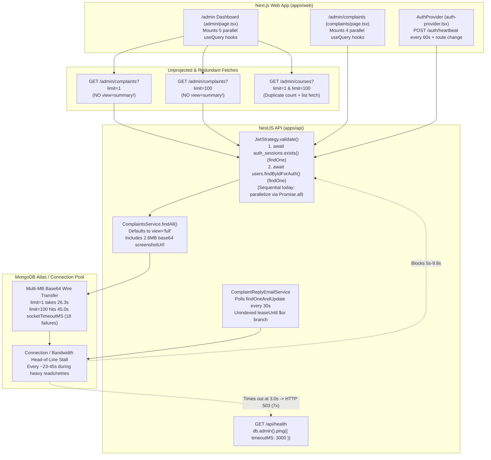

# Post-Deploy Performance Review & Comprehensive Optimization Plan (2026-11-14)

## 1. Executive Summary & Telemetry Snapshot

This review analyzes the production Prometheus metrics export (`prometheus-metrics-2026-11-14-18-03-33.txt`), the slow-query and route CSV exports (`unified-database.csv`, `unified-routes_(1).csv`), and the 4 production monitoring screenshots captured approximately **10 minutes 57 seconds** after container boot (`process_start_time_seconds = 1794678756`, `2026-11-14T17:52:36Z` to `18:03:33Z`).

### Key Headline Findings

1. **Node.js CPU & Memory Are Completely Healthy (Not CPU/Memory Bound):**
   - **Event Loop Utilization:** `3.89%` (`0.03894`)
   - **Event Loop Lag:** `p50 = 10.37 ms`, `p90 = 12.17 ms`, `p99 = 31.62 ms`, `max = 294.9 ms`
   - **Memory Footprint:** Heap used `81.9 MiB` (`85,915,984 B`), Resident Set Size (RSS) `189.0 MiB` (`198,230,016 B`)
   - **Conclusion:** Every latency spike and `5xx` fault is **100% database I/O, payload transfer, and connection-stall bound**.

2. **Smoking Gun #1 — Why `GET /api/admin/complaints` Took `26.25s–27.18s` (and Triggered `18` Failed MongoDB `find` Commands at `45.01s`):**
   - In `unified-database.csv`, `complaints:find` was recorded **4 times**:
     - **3 calls took `26,393 ms`, `26,248 ms`, and `26,257 ms`** (`limit=1 skip=0 sort={"createdAt":-1,"_id":-1} select={"replyEmailEvents":0} docs=1`).
     - **1 call took only `262 ms`** (`limit=20 skip=0 sort={"createdAt":-1,"_id":-1} select={"description":0,"screenshotUrl":0,"replies":0,"internalNotes":0,"statusHistory":0...} docs=20`).
   - **Why the 100x difference?**
     - The `/admin/complaints` page ([apps/web/src/features/complaints/api.ts](file:///d:/BIS/bhi47a-full-stack-web/apps/web/src/features/complaints/api.ts#L128-L130)) passes `view: 'summary'`, which strips `description`, `screenshotUrl`, `replies`, `internalNotes`, and `statusHistory` — completing the 20-row query in **`262 ms`**.
     - However, the main **Admin Dashboard** ([apps/web/src/app/[locale]/admin/page.tsx](file:///d:/BIS/bhi47a-full-stack-web/apps/web/src/app/%5Blocale%5D/admin/page.tsx#L481-L525)) fires **two parallel `/admin/complaints` requests without `view: 'summary'`** on every dashboard load:
       1. `complaintsCountQuery` (lines 481–493): `GET /admin/complaints?limit=1` (solely to read `res.data?.total`).
       2. `complaintsAnalyticsQuery` (lines 511–525): `GET /admin/complaints?limit=100` (to compute client-side dashboard charts).
     - Similarly, [apps/web/src/features/students/api.ts](file:///d:/BIS/bhi47a-full-stack-web/apps/web/src/features/students/api.ts#L173-L177) (`listStudentComplaints`) calls `GET /admin/complaints?search=${studentCode}&limit=50` without `view: 'summary'`.
     - Because [CreateComplaintDto](file:///d:/BIS/bhi47a-full-stack-web/apps/api/src/modules/complaints/dto/complaint.dto.ts#L102-L117) allows `screenshotUrl` to store **up to 2.8 MB of raw base64 image data directly inside each MongoDB document**, and [QueryComplaintDto](file:///d:/BIS/bhi47a-full-stack-web/apps/api/src/modules/complaints/dto/complaint.dto.ts#L257-L262) defaults `view` to `'full'`, omitting `view=summary` forces MongoDB to read and transmit multi-megabyte base64 strings over the wire.
     - While `limit=1` took **~26.3 seconds**, the concurrent `limit=100` query (`complaintsAnalyticsQuery`) attempted to transfer up to 100 full complaint documents with base64 screenshots, saturating the MongoDB link and hitting the **45-second `socketTimeoutMS: 45000` cutoff** ([apps/api/src/database/database.module.ts](file:///d:/BIS/bhi47a-full-stack-web/apps/api/src/database/database.module.ts#L170)) — accounting for the **18 failed `find` commands** in `student_portal_mongodb_command_duration_seconds` (`810.175s / 18 = 45.01s` average!).

3. **Smoking Gun #2 — Why `/admin/complaints/stats`, `/settings`, `/assignees`, and `/admin/control/*` Took `7s–10s`, and Why `GET /api/health` Logged `7` `503` Faults:**
   - All **7 `5xx` responses** in the entire scrape were `GET /api/health` returning `503` when `conn.db.admin().ping({ timeoutMS: 3000 })` ([apps/api/src/health.controller.ts](file:///d:/BIS/bhi47a-full-stack-web/apps/api/src/health.controller.ts#L53)) timed out at `3.00s` (`21.071s / 7 = 3.01s`). Zero application routes returned `5xx`.
   - For `GET /api/admin/complaints/stats` (`9,992.9 ms`), `/settings` (`10,027.8 ms`), `/assignees` (`10,030.2 ms`), and the 4th `GET /api/admin/complaints?view=summary` (`10,266.9 ms`, `requestId = 0f35af32-9765-45fd-97d6-d851d0d5496a`), stage metrics prove that **97%–99.6% of the latency (`9.88s–9.99s`) was spent waiting inside `auth.session` and `auth.user`** ([apps/api/src/modules/auth/strategies/jwt.strategy.ts](file:///d:/BIS/bhi47a-full-stack-web/apps/api/src/modules/auth/strategies/jwt.strategy.ts#L51-L59)) during a MongoDB connection stall at `17:58:41Z–17:58:51Z` (coinciding to the exact second with the `/api/health` 503 at `17:58:46Z`).
   - Once `JwtStrategy.validate` resolved, the actual complaint handlers and DB stages completed in:
     - `GET /api/admin/complaints/stats`: **`91.9 ms`** handler + DB (`70.9 ms` `complaints.aggregate`)
     - `GET /api/admin/complaints/settings`: **`38.2 ms`** handler + DB (`30.3 ms` `system_settings.findOne`)
     - `GET /api/admin/complaints/assignees`: **`148.1 ms`** handler + DB (`141.0 ms` `users.find`, `docs=20`)
     - `GET /api/admin/complaints?view=summary&limit=20`: **`306.5 ms`** post-auth handler time (`263.4 ms` `complaints.page` + `45.6 ms` `complaints.count` executed in `Promise.all`, plus `25.8 ms` `complaints.enrichment` + `4.0 ms` `response.serialization`)

---

## 2. Complete Route & Database Telemetry Analysis

### 2.1 All 17 Recorded HTTP Routes (`unified-routes_(1).csv` & Prometheus Histograms)

| Route | Status | Count | Avg (ms) | Max (ms) | `auth.session` + `auth.user` Overhead (Prometheus Sum) | Handler / DB Stage Breakdown & Bottleneck |
| :--- | :---: | :---: | :---: | :---: | :--- | :--- |
| `GET /api/admin/complaints` | `200` | `4` | `22,775.8` | `27,179.4` | `5,125.6ms` (`auth.session`) + `5,002.1ms` (`auth.user`) across 4 calls (`9,960.4ms` on 1 stalled call) | **3 calls from `/admin` dashboard used `limit=1` without `view=summary` (`26.25s–26.39s` each in `complaints.page`)**. 1 call (`0f35af32-9765-45fd-97d6-d851d0d5496a`) from `/admin/complaints` used `limit=20&view=summary` and took **`306.5ms`** post-auth (`263.4ms` page + `45.6ms` count in `Promise.all`, `25.8ms` enrichment, `4.0ms` serialization). |
| `GET /api/admin/complaints/assignees` | `200` | `1` | `10,030.2` | `10,030.2` | `9,755.9ms` (`auth.session`) + `126.2ms` (`auth.user`) = `9,882.1ms` (`98.5%`) | Handler + DB took **`148.1ms`** (`users:find` took `141.0ms` with `limit=NONE`, `docs=20`, and no cache). |
| `GET /api/admin/complaints/settings` | `200` | `1` | `10,027.8` | `10,027.8` | `9,862.3ms` (`auth.session`) + `127.3ms` (`auth.user`) = `9,989.6ms` (`99.6%`) | Handler + DB (`system_settings.findOne`) took **`38.2ms`** (`30.3ms` DB). |
| `GET /api/admin/complaints/stats` | `200` | `1` | `9,992.9` | `9,992.9` | `9,864.2ms` (`auth.session`) + `36.8ms` (`auth.user`) = `9,901.0ms` (`99.1%`) | Handler + `complaints.aggregate` took **`91.9ms`** (`70.9ms` DB `$group` scan, uncached). |
| `GET /api/admin/control/me` | `200` | `1` | `6,978.9` | `6,978.9` | `6,913.4ms` (`auth.session`) + `60.9ms` (`auth.user`) = `6,974.4ms` (`99.9%`) | Pure synchronous permission check (`4.5ms`); stalled entirely in `auth.session` at `17:59:14Z`. |
| `GET /api/admin/academic-emails` | `200` | `1` | `3,941.8` | `3,941.8` | `3,863.5ms` (`auth.session`) + `25.1ms` (`auth.user`) = `3,888.7ms` (`98.7%`) | Handler (`find` + `countDocuments`) took **`53.1ms`** (`54.1ms` DB); stalled in `auth.session` at `17:59:36Z`. |
| `GET /api/auth/me` | `200` | `3` | `3,081.9` | `9,112.1` | `5,097.0ms` (`auth.session`) + `4,103.4ms` (`auth.user`) across 3 calls | 2 calls completed in `<100ms`; 1 call at `18:03:06Z` stalled `5.05s` in `auth.session` + `4.05s` in `auth.user`. |
| `GET /api/admin/control/courses` | `200` | `3` | `2,636.8` | `7,231.0` | `6,937.4ms` (`auth.session`) + `99.6ms` (`auth.user`) across 3 calls | 1 call stalled `6.90s` in `auth.session` at `17:59:14Z`. Each call runs **4 Mongoose queries + 1 native `control_release_pointers.find` query** (`courses.find` `limit=501`, `control_sheets.find` `limit=NONE`, `grades.aggregate`, `course_registrations.aggregate` `$unwind`), taking ~`300–340ms` per call. |
| `POST /api/auth/heartbeat` | `200` | `12` | `877.8` | `6,938.5` | `9,422.5ms` (`auth.session`) + `416.8ms` (`auth.user`) across 12 calls | 10 of 12 calls finished in `100–250ms`; 2 calls stalled in `auth.session` (`6,827.0ms` and `2,345.7ms`). Runs `users.updateOne` on every heartbeat (`12` times in 10m). |
| `GET /api/health` | `200` / `503` | `33` (`26` OK, `7` 503) | `667.2` (`36.4ms` OK / `3,010.2ms` 503) | `3,020.0` | Public route (no auth) | `26` healthy pings averaged `36.4ms` (`0.9453s / 26`; `32` calls in CSV averaged `685.0ms`). `7` pings hit the `3,000ms` timeout during MongoDB connection stalls and threw `503 ServiceUnavailableException`. |
| `GET /api/admin/students-stats` | `200` | `3` | `388.0` | `686.4` | `127.8ms` (`auth.session`) + `94.7ms` (`auth.user`) across 3 calls | 6 DB queries on cold miss (`student_profiles.aggregate` `143ms`, `student_academic_profiles.aggregate` `141ms`, plus 2x `users.countDocuments` with `$expr` taking `472ms` max). Even on cache hits, re-runs both `$expr` `users.countDocuments` queries! |
| `GET /api/admin/notifications` | `200` | `3` | `379.1` | `456.2` | `107.1ms` (`auth.session`) + `89.3ms` (`auth.user`) across 3 calls | Runs `notifications.find` with **3x `.populate()`** (`sentBy`, `targetStudentId`, `readBy.userId`), taking `242ms` avg / `336ms` max (`5` DB queries per request). |
| `GET /api/admin/courses` | `200` | `3` | `275.7` | `356.1` | `108.8ms` (`auth.session`) + `155.2ms` (`auth.user`) across 3 calls | `courses.find` + `courses.countDocuments` (`126ms` max) + `hydrateCoursesStaff` (`users.find`). Called twice on `/admin` mount (`limit=1` and `limit=100`). |
| `GET /api/admin/grades` | `200` | `2` | `229.4` | `254.6` | `36.4ms` (`auth.session`) + `45.4ms` (`auth.user`) across 2 calls | `grades.find` (`121ms–175ms`, `148ms` avg) + `grades.countDocuments` + enrichment (`7.5` DB queries/req). |
| `GET /api/admin/students/active-sessions` | `200` | `1` | `135.4` | `135.4` | `19.8ms` (`auth.session`) + `21.3ms` (`auth.user`) | `users.find` (`53ms`) with `$expr` filter on `lastActiveAt` / `lastLogoutAt`. |
| `GET /api/admin/exam-schedules` | `200` | `1` | `116.8` | `116.8` | `18.1ms` (`auth.session`) + `30.4ms` (`auth.user`) | `exam_schedules.find` (`39ms`). |
| `GET /api/admin/admissions/requests` | `200` | `1` | `91.8` | `91.8` | `18.7ms` (`auth.session`) + `22.7ms` (`auth.user`) | `admission_requests.find` + `countDocuments` (`18ms`). |

> [!NOTE]
> **Metrics Self-Observation Queries (`countLockedAccounts`):** In addition to the 17 tracked routes above, `GET /api/metrics/summary` (and its alias `GET /api/admin/metrics`, which is intentionally excluded from HTTP route metrics by [http-metrics.middleware.ts](file:///d:/BIS/bhi47a-full-stack-web/apps/api/src/core/metrics/http-metrics.middleware.ts#L27-L30) to avoid self-observation) invokes `UsersService.countLockedAccounts()` on every metrics dashboard poll, while `GET /api/admin/metrics/locked-accounts` invokes `UsersService.findLockedAccounts()`.

---

### 2.2 All Slow Database Operations (`unified-database.csv` & Driver Metrics)

| Collection & Operation | Slow Count (`>=100ms`) / Total | Slow Avg (ms) | Max (ms) | Observed Query Shape & Root Cause |
| :--- | :---: | :---: | :---: | :--- |
| **`complaints:find`** | `4 / 4` | `19,790.0` | `26,393` | **3 calls (`26,393ms`, `26,248ms`, `26,257ms`):** `filter="{}" limit=1 skip=0 sort={"createdAt":-1,"_id":-1} select={"replyEmailEvents":0} docs=1` (from `/admin` dashboard `complaintsCountQuery`, loading full complaint doc with base64 `screenshotUrl`).<br>**1 call (`262ms`):** `limit=20 select={"description":0,"screenshotUrl":0,...} docs=20` (from `/admin/complaints` with `view=summary`). |
| **MongoDB Wire `find` (Failed)** | `18` failures | `45,009.7` | `~45,010` | Recorded by `attachMongoDriverMetrics` (`commandFailed`). Triggered by unprojected `GET /admin/complaints?limit=100` (`complaintsAnalyticsQuery` on `/admin`) timing out at `socketTimeoutMS: 45000` while streaming base64 screenshots, invisible to Mongoose success-only `.post()` hooks. |
| **`auth_sessions:findOne`** | `19 / 118` | `5,011.2` | `9,862` | `filter={"_id":"?","userId":"?","tokenVersion":"?","revokedAt":null,"expiresAt":{"$gt":"[date]"}} select={"_id":1}`. Normal latency is `35–40ms`, but stalls for `5.0s–9.86s` when pooled connections block behind large transfers or stale sockets. Called on **every** authenticated request. |
| **`complaints:findOneAndUpdate`** | `3 / 22` | `1,768.0` | `4,305` | Background poller in [ComplaintReplyEmailService](file:///d:/BIS/bhi47a-full-stack-web/apps/api/src/modules/complaints/complaint-reply-email.service.ts#L85-L110) running every 30s (`docs=0`). `$elemMatch` `$or` branch `{ status: 'processing', leaseUntil: { $lte: now } }` is not covered by `{ 'replyEmailEvents.status': 1, 'replyEmailEvents.nextAttemptAt': 1 }`. |
| **`users:findOne`** | `8 / 118` | `1,729.0` | `4,908` | `JwtStrategy.validate` (`auth.user` stage) running **sequentially after** `auth.session` on every request (`118` calls in 10m). Stalls up to `4.91s` during connection congestion. |
| **`users:countDocuments`** | `4 / 66` | `222.0` | `472` | 3 slow calls (`113ms–472ms`) from `countActiveOnlineStudents` / `countActiveOnlineStaff` using `$expr: { $or: [...] }`, preventing a pure `COUNT_SCAN`. 1 slow call (`136ms`) from `countLockedAccounts` (called by `/api/metrics/summary`) using an unindexed 4-branch `$or`. |
| **`notifications:find`** | `3 / 3` | `242.0` | `336` | `limit=20 sort={"createdAt":-1} populate=sentBy,targetStudentId,readBy.userId`. Triggers 3 separate `users.find` `.populate()` queries on every call. |
| **`grades:find`** | `2 / 2` | `148.0` | `175` | `limit=10 skip=0 sort={"studentCode":1} populate=studentId docs=10` (`121ms` and `175ms`). |
| **`control_sheets:find`** | `1 / 3` | `152.0` | `152` | `filter={"courseId":{"$in":[...]},"academicYear":"?","semester":"?","component":{"$in":[...]}} limit=NONE docs=7` in `ControlSheetsService.listCourses`. |
| **`course_registrations:aggregate`** | `3 / 3` | `136.0` | `147` | `$match` -> `$unwind: '$courses'` -> `$match` -> `$group` in `ControlSheetsService.listCourses`, recomputed on every `/admin/control/courses` request without caching. |
| **`student_profiles:aggregate`** | `1 / 1` | `143.0` | `143` | Cold-cache `$group` in `StudentsService.getStats()`. |
| **`student_academic_profiles:aggregate`** | `1 / 1` | `141.0` | `141` | Cold-cache `$bucket` on `gpa` in `StudentsService.getStats()`. |
| **`users:find`** | `1 / 17` | `141.0` | `141` | `ComplaintsService.findAssignableStaff()` (`role: { $in: ['admin', 'staff'] }, isActive: true`, `sort: { role: 1, name: 1 }`, `limit=NONE`, `docs=20`). |
| **`courses:countDocuments`** | `1 / 7` | `126.0` | `126` | `CoursesService.findAll` count query. |
| **`courses:find`** | `3 / 7` | `113.0` | `115` | `limit=501 skip=0 sort={"code":1} select={"code":1,"name":1,"nameAr":1,"nameEn":1,"level":1} docs=50` in `ControlSheetsService.listCourses`. |
| **`users:updateOne`** | `1 / 12` | `111.0` | `111` | `UsersService.recordUserActivity` triggered by `POST /api/auth/heartbeat`. |

---

## 3. Architectural Root-Cause Diagram & Scope Definition



### 3.1 Goals & Non-Goals

#### Goals
1. **Eliminate Multi-Megabyte List Queries & 45-Second Socket Timeouts:** Default `QueryComplaintDto.view` to `'summary'`, always exclude `-screenshotUrl` from `ComplaintsService.findAll()` list queries, bound public ticket tracking (`queryPublicTicket`), and eliminate redundant `/admin` dashboard fetches (`coursesCountQuery`, unprojected `complaintsCountQuery` / `complaintsAnalyticsQuery`).
2. **Cut Per-Request Auth Latency Without Weakening Security Boundaries:** Parallelize `auth.session` and `auth.user` lookups via `Promise.all` in `JwtStrategy.validate` while preserving strict per-request session revocation and lockout enforcement across replicas.
3. **Eliminate Connection Pool Stalls & False-Positive `503` Health Alerts:** Tune Mongoose connection pool timeouts (`socketTimeoutMS: 30000`, `maxIdleTimeMS: 60000`, `waitQueueTimeoutMS: 10000`, `connectTimeoutMS: 10000`, `heartbeatFrequencyMS: 10000`) and coalesce concurrent in-flight `/api/health` pings.
4. **Remove Unindexed `$expr` / `$elemMatch` Scans & 3x `.populate()` Waterfalls:** Add targeted MongoDB indexes for `ComplaintReplyEmailService`, `UsersService` online/locked counts, and `findAssignableStaff()`, reuse the existing `@Global() CacheService` for read-heavy aggregations, and batch-resolve user lookups in `NotificationsService.listSentHistory()`.
5. **Close Observability Blind Spots & Prevent Future BSON Bloat:** Record failed/timed-out Mongoose queries (`queryMethods`, `aggregate`, `save`) in `mongoose-metrics.plugin.ts` and offload new base64 complaint screenshots to Cloudinary when configured.

#### Non-Goals
1. **No Cross-Request Auth Session or User Policy Caching:** We explicitly do not cache `AuthSessionStore.assertActive` or `UsersService.findByIdForAuth` across HTTP requests, preserving immediate multi-worker session revocation and account lockout invariants.
2. **No Historical Database Migration of Legacy Base64 Screenshots in This Change Set:** Offloading or re-encoding historical `data:image/...` strings already stored in MongoDB `complaints.screenshotUrl` is out of scope for this runtime optimization change set (list queries will exclude `-screenshotUrl` immediately, and new uploads will offload to Cloudinary when configured).
3. **No Schema-Breaking Renames of Legacy Lock Fields:** Consolidating `lockedUntil`/`loginAttempts` and `lockUntil`/`failedLoginAttempts` via a database migration is out of scope; instead, sparse/partial indexes will cover the existing fields safely.

---

## 4. Phased File-by-File Optimization Plan

> [!IMPORTANT]
> **Implementation Order:** Execute **Phase 0 (P0)** first to immediately stop the 26.3s–45.0s complaint payload transfers, then **Phase 1 (P1)** to parallelize `auth.session`/`auth.user` and harden the MongoDB connection pool, followed by **Phase 2 (P2)** for complaints route caching/indexing, and **Phase 3 (P3)** for secondary query, Cloudinary offloading, and observability hardening.

### 4.1 Consolidated Target Scope & File Boundary

All implementation changes across Phases 0–3 are strictly bounded to the following **19 repository files** (no other files may be modified during implementation):

1. [apps/api/src/modules/complaints/dto/complaint.dto.ts](file:///d:/BIS/bhi47a-full-stack-web/apps/api/src/modules/complaints/dto/complaint.dto.ts)
2. [apps/api/src/modules/complaints/complaints.controller.ts](file:///d:/BIS/bhi47a-full-stack-web/apps/api/src/modules/complaints/complaints.controller.ts)
3. [apps/api/src/modules/complaints/complaints.service.ts](file:///d:/BIS/bhi47a-full-stack-web/apps/api/src/modules/complaints/complaints.service.ts)
4. [apps/api/src/modules/complaints/complaints.service.spec.ts](file:///d:/BIS/bhi47a-full-stack-web/apps/api/src/modules/complaints/complaints.service.spec.ts)
5. [apps/api/src/modules/complaints/complaint-reply-email.service.ts](file:///d:/BIS/bhi47a-full-stack-web/apps/api/src/modules/complaints/complaint-reply-email.service.ts)
6. [apps/api/src/modules/complaints/schemas/complaint.schema.ts](file:///d:/BIS/bhi47a-full-stack-web/apps/api/src/modules/complaints/schemas/complaint.schema.ts)
7. [apps/api/src/modules/auth/strategies/jwt.strategy.ts](file:///d:/BIS/bhi47a-full-stack-web/apps/api/src/modules/auth/strategies/jwt.strategy.ts)
8. [apps/api/src/modules/users/users.service.ts](file:///d:/BIS/bhi47a-full-stack-web/apps/api/src/modules/users/users.service.ts)
9. [apps/api/src/modules/users/schemas/user.schema.ts](file:///d:/BIS/bhi47a-full-stack-web/apps/api/src/modules/users/schemas/user.schema.ts)
10. [apps/api/src/modules/students/students.service.ts](file:///d:/BIS/bhi47a-full-stack-web/apps/api/src/modules/students/students.service.ts)
11. [apps/api/src/modules/control/services/control-sheets.service.ts](file:///d:/BIS/bhi47a-full-stack-web/apps/api/src/modules/control/services/control-sheets.service.ts)
12. [apps/api/src/modules/notifications/notifications.service.ts](file:///d:/BIS/bhi47a-full-stack-web/apps/api/src/modules/notifications/notifications.service.ts)
13. [apps/api/src/database/database.module.ts](file:///d:/BIS/bhi47a-full-stack-web/apps/api/src/database/database.module.ts)
14. [apps/api/src/database/mongoose-metrics.plugin.ts](file:///d:/BIS/bhi47a-full-stack-web/apps/api/src/database/mongoose-metrics.plugin.ts)
15. [apps/api/src/database/mongoose-metrics.plugin.spec.ts](file:///d:/BIS/bhi47a-full-stack-web/apps/api/src/database/mongoose-metrics.plugin.spec.ts)
16. [apps/api/src/health.controller.ts](file:///d:/BIS/bhi47a-full-stack-web/apps/api/src/health.controller.ts)
17. [apps/web/src/app/[locale]/admin/page.tsx](file:///d:/BIS/bhi47a-full-stack-web/apps/web/src/app/%5Blocale%5D/admin/page.tsx)
18. [apps/web/src/features/students/api.ts](file:///d:/BIS/bhi47a-full-stack-web/apps/web/src/features/students/api.ts)
19. [apps/web/src/providers/auth-provider.tsx](file:///d:/BIS/bhi47a-full-stack-web/apps/web/src/providers/auth-provider.tsx)

---

### Phase 0 (P0): Stop Multi-Megabyte Complaint Scans, Redundant Dashboard Queries & 45s Socket Timeouts

#### 0.1 Default `GET /api/admin/complaints` to Summary Projection, Optimize `GET /api/students/complaints`, and Bound `POST /api/public/complaints/query`
- **Files to Modify:**
  - [apps/api/src/modules/complaints/dto/complaint.dto.ts](file:///d:/BIS/bhi47a-full-stack-web/apps/api/src/modules/complaints/dto/complaint.dto.ts#L257-L262)
  - [apps/api/src/modules/complaints/complaints.controller.ts](file:///d:/BIS/bhi47a-full-stack-web/apps/api/src/modules/complaints/complaints.controller.ts#L67-L106)
  - [apps/api/src/modules/complaints/complaints.service.ts](file:///d:/BIS/bhi47a-full-stack-web/apps/api/src/modules/complaints/complaints.service.ts#L465-L606)
  - [apps/api/src/modules/complaints/complaints.service.ts](file:///d:/BIS/bhi47a-full-stack-web/apps/api/src/modules/complaints/complaints.service.ts#L960-L968)
  - [apps/api/src/modules/complaints/complaints.service.spec.ts](file:///d:/BIS/bhi47a-full-stack-web/apps/api/src/modules/complaints/complaints.service.spec.ts#L8-L202)
- **Exact Changes:**
  1. In [complaint.dto.ts](file:///d:/BIS/bhi47a-full-stack-web/apps/api/src/modules/complaints/dto/complaint.dto.ts#L258-L261), change the default of `QueryComplaintDto.view` from `'full'` to `'summary'`.
  2. In [complaints.service.ts](file:///d:/BIS/bhi47a-full-stack-web/apps/api/src/modules/complaints/complaints.service.ts#L466-L478) (`findAll`), **always exclude `-screenshotUrl`** from paginated admin list queries even when `query.view === 'full'` (because admin full screenshots are fetched via `GET /api/admin/complaints/:id` in `useComplaintDetail`), and default to `-description -screenshotUrl -replies -internalNotes -statusHistory` whenever `query.view !== 'full'`:
     ```ts
     const projection =
       query.view === 'full'
         ? '-screenshotUrl'
         : '-description -screenshotUrl -replies -internalNotes -statusHistory';
     ```
  3. Add `.maxTimeMS(10_000)` to `this.complaintModel.find(filter)` inside `findAll()` so no list query can hang a socket for 45 seconds.
  4. In `findAll()` lines 484–511 (`complaints.enrichment`): execute the `this.userModel.find({ _id: { $in: missingNationalIds } }).select({ _id: 1, nationalId: 1 }).lean()` lookup **only when `query.view === 'full'`** (summary table views only display `nationalIdMasked`, which is already stored on each complaint document).
  5. In [complaints.controller.ts](file:///d:/BIS/bhi47a-full-stack-web/apps/api/src/modules/complaints/complaints.controller.ts#L98-L106) (`getMyTickets` at `GET /api/students/complaints`) and [complaints.service.ts](file:///d:/BIS/bhi47a-full-stack-web/apps/api/src/modules/complaints/complaints.service.ts#L574-L606) (`findByStudent`):
     - Pass `@CurrentUser('studentCode') studentCode?: string` from `ComplaintsController.getMyTickets` to `this.complaintsService.findByStudent(studentId, query, studentCode)`.
     - In `findByStudent(studentId: string, query: QueryComplaintDto = {}, studentCode?: string)`, only call `this.userModel.findById(studentId).select('studentCode').lean()` when `studentCode` is not already provided by `@CurrentUser('studentCode')`.
     - **Keep `screenshotUrl` in `findByStudent()`** (do **not** exclude `-screenshotUrl` here, because `/dashboard/complaints` at [apps/web/src/app/[locale]/dashboard/complaints/page.tsx](file:///d:/BIS/bhi47a-full-stack-web/apps/web/src/app/%5Blocale%5D/dashboard/complaints/page.tsx#L593-L605) renders `selectedTicket.screenshotUrl` directly from the list response without a separate student single-ticket detail endpoint), and add `.maxTimeMS(10_000)` to `this.complaintModel.find(filter)`.
  6. In [complaints.service.ts](file:///d:/BIS/bhi47a-full-stack-web/apps/api/src/modules/complaints/complaints.service.ts#L962-L965) (`queryPublicTicket` for `POST /api/public/complaints/query`): add `.limit(50).maxTimeMS(10_000)` to `this.complaintModel.find(filter).sort({ createdAt: -1 })` so public ticket tracking cannot trigger an unbounded scan.
  7. In [complaints.service.spec.ts](file:///d:/BIS/bhi47a-full-stack-web/apps/api/src/modules/complaints/complaints.service.spec.ts):
     - Add `maxTimeMS: jest.fn().mockReturnThis()` to the `find` query chain mocks in `findAll` and `findByStudent` tests.
     - Update line 30 (`requests only the selected page...`) to assert `expect(chain.select).toHaveBeenCalledWith('-description -screenshotUrl -replies -internalNotes -statusHistory')`.
     - Update line 132 (`enriches missing national IDs...`) to call `service.findAll({ limit: 20, page: 1, view: 'full' })`.
     - Add an assertion verifying that `view: 'full'` passes `'-screenshotUrl'` to `chain.select`.

#### 0.2 Fix Admin Dashboard (`/admin`) Redundant & Unprojected `/admin/complaints` and `/admin/courses` Fetches
- **Files to Modify:**
  - [apps/api/src/modules/complaints/complaints.service.ts](file:///d:/BIS/bhi47a-full-stack-web/apps/api/src/modules/complaints/complaints.service.ts#L516-L572)
  - [apps/web/src/app/[locale]/admin/page.tsx](file:///d:/BIS/bhi47a-full-stack-web/apps/web/src/app/%5Blocale%5D/admin/page.tsx#L468-L614)
  - [apps/web/src/features/students/api.ts](file:///d:/BIS/bhi47a-full-stack-web/apps/web/src/features/students/api.ts#L173-L177)
- **Exact Changes:**
  1. In [complaints.service.ts](file:///d:/BIS/bhi47a-full-stack-web/apps/api/src/modules/complaints/complaints.service.ts#L520-L571) (`getStats`):
     - Add `closed: countWhen({ $eq: ['$status', 'closed'] })` to the `$group` stage (and `closed: 0` to the empty fallback object) so `GET /api/admin/complaints/stats` returns exact collection-wide counts for all 5 statuses (`open`, `review`, `working`, `resolved`, `closed`) plus `total` and `high`.
  2. In [apps/web/src/app/[locale]/admin/page.tsx](file:///d:/BIS/bhi47a-full-stack-web/apps/web/src/app/%5Blocale%5D/admin/page.tsx#L468-L614):
     - **Remove `coursesCountQuery` (`GET /admin/courses?limit=1` at lines 468–479)** and update `coursesAnalyticsQuery` (lines 495–509) so `queryFn` returns `{ items: res.data?.items ?? [], total: res.data?.total ?? 0 }`. Update its 3 downstream consumers:
       - Line 528: `return (coursesAnalyticsQuery.data?.items ?? []).map((c) => ({ ... }))`
       - Line 540: `const totalCourses = coursesAnalyticsQuery.isLoading ? "..." : String(coursesAnalyticsQuery.data?.total ?? 0);`
       - Line 547: `const courses = React.useMemo(() => coursesAnalyticsQuery.data?.items ?? [], [coursesAnalyticsQuery.data]);`
     - **Replace `complaintsCountQuery` (`GET /admin/complaints?limit=1` at lines 481–493)** with a call to `GET /admin/complaints/stats` (`queryKey: ["admin-stats-complaints"]`), returning `{ total, open, review, working, resolved, closed, high }`.
     - **Pass `view: 'summary'` to `complaintsAnalyticsQuery` (lines 511–525):** `params: { limit: 100, view: 'summary' }` so the 7-day trend chart (`weeklyTrendData`) fetches only lightweight summary rows without base64 screenshots or descriptions.
     - **Use collection-wide stats from `complaintsCountQuery` (`GET /admin/complaints/stats`) for KPI cards and status breakdown (lines 543–613):**
       - Line 543: `const activeComplaints = complaintsCountQuery.isLoading ? "..." : String(complaintsCountQuery.data?.total ?? 0);`
       - Lines 580–592 (`complaintStatusData`): when `complaintsCountQuery.data` is present, map `open -> data.open`, `in_progress -> (data.working ?? 0) + (data.review ?? 0)`, `resolved -> data.resolved`, and `closed -> data.closed ?? 0`.
       - Lines 599–613: derive `urgentComplaints` from `complaintsCountQuery.data?.high ?? 0`, `resolvedComplaints` from `(complaintsCountQuery.data?.resolved ?? 0) + (complaintsCountQuery.data?.closed ?? 0)`, and `resolutionRate` using `complaintsCountQuery.data?.total ?? 0` as the denominator.
  3. In [apps/web/src/features/students/api.ts](file:///d:/BIS/bhi47a-full-stack-web/apps/web/src/features/students/api.ts#L173-L177) (`listStudentComplaints`):
     - Add `view: 'summary'` to `params: { search: studentCode, limit, view: 'summary' }`.

---

### Phase 1 (P1): Parallelize Per-Request Auth Lookups, Throttle Heartbeat Writes & Harden Connection Pool

#### 1.1 Parallelize `auth.session` and `auth.user` Lookups in `JwtStrategy.validate`
- **Files to Modify:**
  - [apps/api/src/modules/auth/strategies/jwt.strategy.ts](file:///d:/BIS/bhi47a-full-stack-web/apps/api/src/modules/auth/strategies/jwt.strategy.ts#L48-L62)
- **Why:**
  - Currently, `JwtStrategy.validate` awaits `this.sessions.assertActive(...)` (`auth.session`) and **then** awaits `this.usersService.findByIdForAuth(...)` (`auth.user`) sequentially. Running them concurrently via `Promise.all` cuts per-request auth DB wall-clock latency in half while strictly preserving the security invariant at lines 55–56 (`// Load current account policy for every request, including across replicas`).
- **Exact Changes:**
  - In [jwt.strategy.ts](file:///d:/BIS/bhi47a-full-stack-web/apps/api/src/modules/auth/strategies/jwt.strategy.ts#L48-L62), retain the fail-closed `if (!this.sessions)` guard at lines 49–50 and execute `auth.session` and `auth.user` concurrently via `Promise.all`:
    ```ts
    if (!this.sessions)
      throw new UnauthorizedException('Session store unavailable');
    const [, user] = await Promise.all([
      measureDatabaseStage('auth.session', () =>
        this.sessions!.assertActive(payload, req.cookies?.access_token),
      ),
      measureDatabaseStage('auth.user', () =>
        this.usersService.findByIdForAuth(payload.sub),
      ),
    ]);
    ```

#### 1.2 Throttle `POST /api/auth/heartbeat` Writes & Optimize Frontend Heartbeat Cadence
- **Files to Modify:**
  - [apps/web/src/providers/auth-provider.tsx](file:///d:/BIS/bhi47a-full-stack-web/apps/web/src/providers/auth-provider.tsx#L340-L375)
  - [apps/api/src/modules/users/users.service.ts](file:///d:/BIS/bhi47a-full-stack-web/apps/api/src/modules/users/users.service.ts#L52-L61)
  - [apps/api/src/modules/users/users.service.ts](file:///d:/BIS/bhi47a-full-stack-web/apps/api/src/modules/users/users.service.ts#L359-L404)
- **Exact Changes:**
  1. In [users.service.ts](file:///d:/BIS/bhi47a-full-stack-web/apps/api/src/modules/users/users.service.ts#L56-L58) (`findByIdForAuth`), retain all 22 existing projected fields and append `lastActionRoute` to the `.select(...)` string:
     ```ts
     .select(
       '_id role staffType titlePrefix name nameAr email phone studentCode googleEmail googleLinkedAt googleLinkPending permissions mustChangePassword tokenVersion isActive lockUntil lockedUntil lastLoginAt lastActiveAt sessionStartedAt lastLogoutAt lastActionRoute',
     )
     ```
     *(Currently `lastActionRoute` is omitted from `findByIdForAuth`, which would otherwise make `existing.lastActionRoute` always `undefined` when `recordUserActivity` reuses the request-scoped auth read).*
  2. In [users.service.ts](file:///d:/BIS/bhi47a-full-stack-web/apps/api/src/modules/users/users.service.ts#L359-L404) (`recordUserActivity`):
     - When `existing` has a valid `lastActiveAt` and `now.getTime() - new Date(existing.lastActiveAt).getTime() < 45_000` and `(!data.route || existing.lastActionRoute === data.route)`, return early without executing `this.userModel.updateOne(...)`.
  3. In [auth-provider.tsx](file:///d:/BIS/bhi47a-full-stack-web/apps/web/src/providers/auth-provider.tsx#L349-L358):
     - Change the minimum non-forced debounce threshold on line 349 from `now - lastHeartbeatTimeRef.current < 30_000` to `now - lastHeartbeatTimeRef.current < 60_000`.
     - Change line 357 from `setInterval(() => sendHeartbeat(true), 60_000)` to `setInterval(() => sendHeartbeat(false), 120_000)` so periodic ticks respect the 60s gap after route changes.

#### 1.3 Harden MongoDB Connection Pool, Timeouts & Single-Flight Health Probe Coalescing
- **Files to Modify:**
  - [apps/api/src/database/database.module.ts](file:///d:/BIS/bhi47a-full-stack-web/apps/api/src/database/database.module.ts#L165-L194)
  - [apps/api/src/health.controller.ts](file:///d:/BIS/bhi47a-full-stack-web/apps/api/src/health.controller.ts#L41-L81)
- **Exact Changes:**
  1. In [database.module.ts](file:///d:/BIS/bhi47a-full-stack-web/apps/api/src/database/database.module.ts#L168-L194):
     - Reduce `socketTimeoutMS` from `45000` to `30000` (30s — fast enough to recycle hung sockets while still allowing bulk XLSX imports to finish) and add `waitQueueTimeoutMS: 10000` and `connectTimeoutMS: 10000` at line 170 **before** the `...(process.env.NODE_ENV === 'test' ? { connectTimeoutMS: 3000, socketTimeoutMS: 5000, waitQueueTimeoutMS: 5000 } : {})` spread (lines 173–182) so E2E/test timeout overrides are preserved.
     - Reduce `maxIdleTimeMS` from `300000` (5m) to `60000` (60s) so idle sockets are closed cleanly before NAT gateways or cloud firewalls silently drop them.
     - Add `heartbeatFrequencyMS: 10000` so SDAM detects topology/network hiccups promptly.
  2. In [health.controller.ts](file:///d:/BIS/bhi47a-full-stack-web/apps/api/src/health.controller.ts#L41-L65):
     - Add a private `inFlightPing?: Promise<number>` field on `HealthController` to coalesce concurrent in-flight `db.admin().ping({ timeoutMS: 3000 })` requests so simultaneous health checks (load balancer + uptime monitor + metrics page) share a single active ping promise and clean up `this.inFlightPing = undefined` in `.finally()`, without caching stale `200 OK` state after a disconnect or extending outage response times beyond `3,000 ms`.

---

### Phase 2 (P2): Optimize Complaints Sub-Routes (`/stats`, `/assignees`) & Background Email Poller

#### 2.1 Cache `/api/admin/complaints/stats` and `/assignees` via `CacheService` + Add Compound Staff Index
- **Files to Modify:**
  - [apps/api/src/modules/complaints/complaints.service.ts](file:///d:/BIS/bhi47a-full-stack-web/apps/api/src/modules/complaints/complaints.service.ts#L34-L55)
  - [apps/api/src/modules/complaints/complaints.service.ts](file:///d:/BIS/bhi47a-full-stack-web/apps/api/src/modules/complaints/complaints.service.ts#L516-L617)
  - [apps/api/src/modules/users/schemas/user.schema.ts](file:///d:/BIS/bhi47a-full-stack-web/apps/api/src/modules/users/schemas/user.schema.ts#L191-L202)
- **Exact Changes:**
  1. **Inject `@Optional() CacheService` in `ComplaintsService` ([complaints.service.ts](file:///d:/BIS/bhi47a-full-stack-web/apps/api/src/modules/complaints/complaints.service.ts#L34-L55)):**
     - Append `@Optional() private readonly cacheService?: CacheService` to `ComplaintsService` constructor (`CacheModule` is already `@Global()`).
     - Keep `getSettings()` (`system_settings.findOne`, which took only `30.3 ms` in DB and returns a mutable `SystemSettingsDocument` used by `updateSettings()`) as a direct uncached Mongoose document query to preserve its return type contract and multi-worker consistency.
  2. **`getStats()` Caching & Explicit Invalidation ([complaints.service.ts](file:///d:/BIS/bhi47a-full-stack-web/apps/api/src/modules/complaints/complaints.service.ts#L516-L572)):**
     - Wrap the `getStats()` aggregation in `this.cacheService ? this.cacheService.wrap('complaints:stats', () => this.computeStats(), 30) : this.computeStats()` (30-second TTL).
     - Call `await this.cacheService?.del('complaints:stats')` in all **8** complaint mutation methods in `ComplaintsService`: `create()`, `createPublic()` (or inside their shared `createForStudent()` helper at line 186), `updateStatus()`, `addReply()`, `publicReply()`, `delete()`, `bulkDelete()`, and `clearAll()`.
  3. **`findAssignableStaff()` Bounding, Caching & Indexing ([complaints.service.ts](file:///d:/BIS/bhi47a-full-stack-web/apps/api/src/modules/complaints/complaints.service.ts#L608-L617)):**
     - Add `.limit(200)` to `findAssignableStaff()` (fixing `limit=NONE` in `unified-database.csv`) and wrap it in `this.cacheService.wrap('complaints:assignable-staff', ..., 60)` (60-second TTL).
     - Add compound index `UserSchema.index({ role: 1, isActive: 1, name: 1 })` in [user.schema.ts](file:///d:/BIS/bhi47a-full-stack-web/apps/api/src/modules/users/schemas/user.schema.ts#L192) to support `.find({ role: { $in: ['admin', 'staff'] }, isActive: true }).sort({ role: 1, name: 1 })` without an in-memory sort stage.

#### 2.2 Fix `ComplaintReplyEmailService` Unindexed `$elemMatch` Scan & 30-Second Idle Polling
- **Files to Modify:**
  - [apps/api/src/modules/complaints/schemas/complaint.schema.ts](file:///d:/BIS/bhi47a-full-stack-web/apps/api/src/modules/complaints/schemas/complaint.schema.ts#L239-L242)
  - [apps/api/src/modules/complaints/complaint-reply-email.service.ts](file:///d:/BIS/bhi47a-full-stack-web/apps/api/src/modules/complaints/complaint-reply-email.service.ts#L24-L115)
  - [apps/api/src/modules/complaints/complaints.service.ts](file:///d:/BIS/bhi47a-full-stack-web/apps/api/src/modules/complaints/complaints.service.ts#L34-L55)
  - [apps/api/src/modules/complaints/complaints.service.ts](file:///d:/BIS/bhi47a-full-stack-web/apps/api/src/modules/complaints/complaints.service.ts#L760-L815)
- **Exact Changes:**
  1. In [complaint.schema.ts](file:///d:/BIS/bhi47a-full-stack-web/apps/api/src/modules/complaints/schemas/complaint.schema.ts#L239-L242), add the compound multikey index covering the second `$or` branch (`status: 'processing', leaseUntil: { $lte: now }`) while preserving the existing 2-branch `$or` query shape tested by `complaint-reply-email.service.spec.ts:85`:
     ```ts
     ComplaintSchema.index({
       'replyEmailEvents.status': 1,
       'replyEmailEvents.leaseUntil': 1,
     });
     ```
  2. In [complaint-reply-email.service.ts](file:///d:/BIS/bhi47a-full-stack-web/apps/api/src/modules/complaints/complaint-reply-email.service.ts#L24-L60):
     - Add `private pendingWakeup = false;` and a public method `triggerImmediateDrain(): void` that sets `if (this.running) { this.pendingWakeup = true; return; } this.start();`.
     - In `start()`'s `.finally()` block, if `this.pendingWakeup && !this.stopping`, clear `this.pendingWakeup = false` and immediately invoke `this.start()` so no wake-up signal is ever dropped if `addReply()` fires while a background `drain()` pass is finishing.
     - Increase the fallback recovery timer in `onModuleInit()` (line 37) from `30_000` (30s) to `120_000` (120s), cutting idle background `findOneAndUpdate` polling by 75%.
  3. In [complaints.service.ts](file:///d:/BIS/bhi47a-full-stack-web/apps/api/src/modules/complaints/complaints.service.ts#L760-L815):
     - Inject `@Optional() private readonly replyEmailService?: ComplaintReplyEmailService` in `ComplaintsService` constructor and call `this.replyEmailService?.triggerImmediateDrain()` right after `await complaint.save()` in `addReply()` when an admin/staff reply enqueues a `replyEmailEvents` entry.

---

### Phase 3 (P3): Optimize Remaining Slow Routes (`students-stats`, `control/courses`, `notifications`, `metrics/summary`), Offload New Screenshots & Harden Observability

#### 3.1 Replace `$expr` Scans in Online Session & Locked Account Queries (`users:countDocuments`)
- **Files to Modify:**
  - [apps/api/src/modules/users/users.service.ts](file:///d:/BIS/bhi47a-full-stack-web/apps/api/src/modules/users/users.service.ts#L87-L115)
  - [apps/api/src/modules/users/users.service.ts](file:///d:/BIS/bhi47a-full-stack-web/apps/api/src/modules/users/users.service.ts#L641-L696)
  - [apps/api/src/modules/users/schemas/user.schema.ts](file:///d:/BIS/bhi47a-full-stack-web/apps/api/src/modules/users/schemas/user.schema.ts#L191-L202)
  - [apps/api/src/modules/students/students.service.ts](file:///d:/BIS/bhi47a-full-stack-web/apps/api/src/modules/students/students.service.ts#L583-L594)
- **Exact Changes:**
  1. In [users.service.ts](file:///d:/BIS/bhi47a-full-stack-web/apps/api/src/modules/users/users.service.ts#L87-L115) (`countActiveOnlineStudents` and `countActiveOnlineStaff`) and `getActiveUsersForSessions` (line 641):
     - Because `updateLastLogin` (line 354) and `resetAttemptsAndUpdateLastLogin` (line 592) always `$unset: { lastLogoutAt: 1 }` on login, and `recordUserActivity` (line 382) never updates `lastActiveAt` when `lastLogoutAt` is set, an online user always has `lastLogoutAt: null`.
     - Replace the `$expr` filter in `countActiveOnlineStudents`, `countActiveOnlineStaff`, and `getActiveUsersForSessions` with `lastLogoutAt: null`.
  2. In [user.schema.ts](file:///d:/BIS/bhi47a-full-stack-web/apps/api/src/modules/users/schemas/user.schema.ts#L191-L202):
     - Add `UserSchema.index({ role: 1, isActive: 1, lastLogoutAt: 1, lastActiveAt: -1 })` (covering `countActiveOnlineStudents` and `countActiveOnlineStaff`) and `UserSchema.index({ isActive: 1, lastLogoutAt: 1, lastActiveAt: -1 })` (covering `getActiveUsersForSessions`, which does not filter by `role`).
     - Remove the duplicate `UserSchema.index({ role: 1, isActive: 1, lastLoginAt: -1 })` declaration at line 201 (already declared at line 196).
     - Add `UserSchema.index({ lockedUntil: 1 }, { sparse: true })`, `UserSchema.index({ failedLoginAttempts: 1 }, { partialFilterExpression: { failedLoginAttempts: { $gt: 0 } } })`, and `UserSchema.index({ loginAttempts: 1 }, { partialFilterExpression: { loginAttempts: { $gt: 0 } } })` (alongside the existing `lockUntil` index at line 199) so all 4 branches of the top-level `$or` in `countLockedAccounts()` (lines 686–696) and `findLockedAccounts()` (lines 665–681) are index-covered for a MongoDB `SUBPLAN` index union, and add `.limit(200)` to `findLockedAccounts()` at lines 665–681.
  3. In [students.service.ts](file:///d:/BIS/bhi47a-full-stack-web/apps/api/src/modules/students/students.service.ts#L585-L593):
     - Add `private cachedLiveOnline: { liveOnline: number; liveOnlineStaff: number; expiresAt: number } | null = null;` (15,000 ms TTL, cleared in `invalidateStatsCache()`) on `StudentsService` so warm calls to `GET /api/admin/students-stats` within 15 seconds reuse `cachedLiveOnline` instead of re-running two `users.countDocuments` queries on every request.

#### 3.2 Optimize `GET /api/admin/control/courses` (`control_sheets:find` & `course_registrations:aggregate`)
- **Files to Modify:**
  - [apps/api/src/modules/control/services/control-sheets.service.ts](file:///d:/BIS/bhi47a-full-stack-web/apps/api/src/modules/control/services/control-sheets.service.ts#L45-L155)
- **Exact Changes:**
  1. Add `.limit(2505)` (500 courses x 5 components + 5) and `.select('courseId component slug locked workflowState')` to `this.sheetModel.find(...)` at line 103 so it never triggers an unbounded `limit=NONE` full-document scan.
  2. Inject `@Optional() private readonly cacheService?: CacheService` into `ControlSheetsService` and cache the term-wide approved registration counts per course code under key `control:roster-counts:${query.academicYear}:${query.semester}` for 60 seconds (`ttl = 60`).
  3. **Prevent Cache Poisoning Across Scopes/Levels:** Inside the cached `registrationModel.aggregate` pipeline (lines 133–145), match `{ academicYear: query.academicYear, semester: query.semester, status: 'approved' }` **without** filtering by the caller's `codes` array (`courses: { $in: codes }`), so the cached `Array<{ _id: string; n: number }>` contains accurate counts for the entire term regardless of whether the first caller was a scoped staff member, a level-filtered query, or an unrestricted admin.

#### 3.3 Optimize `GET /api/admin/notifications` (Eliminate 3x `.populate()` & Fix Truncated `readCount`)
- **Files to Modify:**
  - [apps/api/src/modules/notifications/notifications.service.ts](file:///d:/BIS/bhi47a-full-stack-web/apps/api/src/modules/notifications/notifications.service.ts#L418-L441)
- **Exact Changes:**
  1. In `NotificationsService.listSentHistory()` (lines 418–441), replace the 3 `.populate()` calls and `.slice('readBy', -5)` with a server-side projection that computes the true `readCount` before slicing `readBy` to the latest 5 entries:
     ```ts
     this.notificationModel
       .find()
       .select({
         title: 1,
         body: 1,
         targetType: 1,
         targetLevel: 1,
         targetStudentId: 1,
         sentBy: 1,
         deliveryStatus: 1,
         pushSuccessCount: 1,
         pushFailureCount: 1,
         sentAt: 1,
         queuedAt: 1,
         meta: 1,
         createdAt: 1,
         updatedAt: 1,
         readCount: { $size: { $ifNull: ['$readBy', []] } },
         readBy: { $slice: ['$readBy', -5] },
       })
       .sort({ createdAt: -1 })
       .skip(skip)
       .limit(limit)
       .lean()
     ```
  2. Collect all unique user ObjectIds referenced in `sentBy`, `targetStudentId`, and `readBy[].userId` across the page of items, execute **one** `this.userModel.find({ _id: { $in: allUserIds } }).select('_id name email studentCode').lean()`, and map:
     - `sentBy` -> `{ _id, name, email }` (when present)
     - `targetStudentId` -> `{ _id, name, studentCode }` (when present)
     - `readBy[i].userId` -> `{ _id, name, studentCode }` (when present)
     This preserves the exact response shape consumed by `/admin/notifications` while fixing `readCount > 5` and cutting DB round-trips from 5 to 3.

#### 3.4 Capture Failed/Timed-Out Mongoose Queries in `mongoose-metrics.plugin.ts`
- **Files to Modify:**
  - [apps/api/src/database/mongoose-metrics.plugin.ts](file:///d:/BIS/bhi47a-full-stack-web/apps/api/src/database/mongoose-metrics.plugin.ts#L172-L289)
  - [apps/api/src/database/mongoose-metrics.plugin.spec.ts](file:///d:/BIS/bhi47a-full-stack-web/apps/api/src/database/mongoose-metrics.plugin.spec.ts#L69-L146)
- **Exact Changes:**
  1. In [mongoose-metrics.plugin.ts](file:///d:/BIS/bhi47a-full-stack-web/apps/api/src/database/mongoose-metrics.plugin.ts#L175-L289):
     - Extend the existing 3-argument error post-hook `schema.post([...queryMethods, 'aggregate'] as any, function (this, error, _result, next) { ... })` at lines `175–212` (which currently records `metricsService?.mongoDiagnostics?.failure(...)` using `this._startTime`) to also call `metricsService?.recordDbQuery(collectionName, op, durationSec, ...)` and slow-query `logger?.warn(...)` (when `durationMs >= thresholdMs`) with `error=${error?.name || 'Error'} docs=0` appended to `options`.
     - Add a matching 3-argument error post-hook on `'save'` after line `288` using `this._saveStartTime` that records `metricsService?.recordDbQuery(collectionName, 'save', durationSec, ...)` with `error=${error?.name || 'Error'} docs=0` and calls `next(error)`.
  2. In [mongoose-metrics.plugin.spec.ts](file:///d:/BIS/bhi47a-full-stack-web/apps/api/src/database/mongoose-metrics.plugin.spec.ts#L69-L146):
     - Keep the existing `if (Array.isArray(methods) && callback && callback.length <= 1) post = callback;` mock guards at lines `73–76` and `115–118`, and add a new unit test that captures the 3-argument error hook (`callback.length === 3`) and verifies `metricsService.recordDbQuery` is invoked with `error=MongoNetworkTimeoutError docs=0`.

#### 3.5 Offload New Complaint Screenshots to Cloudinary (Following `ExamSchedulesService` Pattern)
- **Files to Modify:**
  - [apps/api/src/modules/complaints/complaints.service.ts](file:///d:/BIS/bhi47a-full-stack-web/apps/api/src/modules/complaints/complaints.service.ts#L34-L55)
  - [apps/api/src/modules/complaints/complaints.service.ts](file:///d:/BIS/bhi47a-full-stack-web/apps/api/src/modules/complaints/complaints.service.ts#L186-L360)
- **Exact Changes:**
  1. Append `@Optional() private readonly configService?: ConfigService` as the final parameter of `ComplaintsService`'s constructor (so existing positional unit tests in `complaints.service.spec.ts` remain 100% compatible).
  2. Add a private helper `resolveScreenshotUrl(raw?: string): Promise<string | undefined>` in `ComplaintsService` (called in `createForStudent()` at line 348) modeled directly on `getCloudinaryConfig` / `createCloudinarySignature` / `uploadImage` in [exam-schedules.service.ts](file:///d:/BIS/bhi47a-full-stack-web/apps/api/src/modules/exam-schedules/exam-schedules.service.ts#L52-L151):
     - If `raw` starts with `data:image/` and `CLOUDINARY_CLOUD_NAME`, `CLOUDINARY_API_KEY`, and `CLOUDINARY_API_SECRET` are configured via `this.configService`, sign and `fetch()`-POST the image to `https://api.cloudinary.com/v1_1/${cloudName}/image/upload` in folder `student-portal/complaints` with `signal: AbortSignal.timeout(8000)`.
     - On success, store the compact `secure_url` (`https://res.cloudinary.com/...`) in `screenshotUrl`; if Cloudinary env vars are unset or the upload times out/fails, log a warning and fall back to storing `raw` so ticket submission never fails.

---

## 5. Alternatives Considered & Rejection Rationales

1. **Cross-Request In-Memory Micro-Cache (`3,000 ms` TTL) for `auth.session` and `auth.user` (Rejected):**
   - *Why Considered:* Would reduce `auth_sessions:findOne` and `users:findOne` calls across parallel dashboard requests from the same tab.
   - *Why Rejected:* Violates explicit codebase security invariants in [jwt.strategy.ts](file:///d:/BIS/bhi47a-full-stack-web/apps/api/src/modules/auth/strategies/jwt.strategy.ts#L55-L56) (`// Load current account policy for every request, including across replicas`) and [request-query-context.ts](file:///d:/BIS/bhi47a-full-stack-web/apps/api/src/core/metrics/request-query-context.ts#L74) (`/** Only immutable reads within this HTTP request. Never a cross-request policy cache. */`). In a multi-worker PM2 or multi-replica deployment, in-memory auth caching creates a window where revoked sessions, deactivated accounts, or locked users remain authorized on sibling workers. Parallelizing `auth.session` and `auth.user` via `Promise.all` (Phase 1.1) plus eliminating the 26s–45s complaint queries (Phase 0) resolves the latency without weakening auth security.
2. **Collapsing `ComplaintReplyEmailService.drain()`'s 2-Branch `$or` into a Single `nextAttemptAt` Predicate (Rejected):**
   - *Why Considered:* Would allow using a single compound index on `(status, nextAttemptAt)` by overloading `nextAttemptAt` as `leaseUntil`.
   - *Why Rejected:* Conflates two distinct domain timestamps (`nextAttemptAt` vs `leaseUntil`) and breaks the existing unit test contract in [complaint-reply-email.service.spec.ts](file:///d:/BIS/bhi47a-full-stack-web/apps/api/src/modules/complaints/complaint-reply-email.service.spec.ts#L85) (`expect(...$elemMatch.$or).toHaveLength(2)`). Adding `{ 'replyEmailEvents.status': 1, 'replyEmailEvents.leaseUntil': 1 }` (Phase 2.2) covers the second `$or` branch cleanly without altering domain semantics.
3. **Caching `ComplaintsService.getSettings()` as a `.lean()` Plain Object (Rejected):**
   - *Why Considered:* Would avoid a `system_settings.findOne` read on `GET /api/admin/complaints/settings`.
   - *Why Rejected:* `system_settings.findOne` took only `30.3 ms` in production, `getSettings()` returns a hydrated `SystemSettingsDocument` mutated and `.save()`d by `updateSettings()`, and caching it across workers could delay emergency complaint-window closures.
4. **Caching Positive `/api/health` Pings for 5 Seconds + Retrying Timed-Out Pings (Rejected):**
   - *Why Considered:* Would mask transient socket hiccups from health monitors.
   - *Why Rejected:* Retrying a 3s timeout with a 2s retry blocks `/api/health` for 5 seconds during real outages, and caching positive health responses can report `200 OK` after a database disconnect. Single-flight in-flight promise coalescing (`inFlightPing` in Phase 1.3) prevents concurrent health probes from stacking without serving stale health state.

---

## 6. Risks, Constraints & Mitigations

| Risk / Constraint | Affected Phase | Mitigation Strategy |
| :--- | :---: | :--- |
| **Student Complaint Screenshot Regression:** Excluding `-screenshotUrl` from `findByStudent()` would break screenshot previews in `/dashboard/complaints` because no student single-ticket endpoint exists. | P0.1 | Keep `screenshotUrl` in `findByStudent()` and only exclude `-screenshotUrl` in `findAll()` (admin list, where detail drawer fetches `GET /api/admin/complaints/:id`). |
| **Cache Poisoning on `/admin/control/courses`:** Caching `rosterCounts` with a scoped `courses: { $in: codes }` `$match` would poison the cache for subsequent admin or cross-level requests. | P3.2 | Compute `rosterCounts` across all approved registrations in `{ academicYear, semester, status: 'approved' }` without filtering by `codes`. |
| **Dropped Email Wake-Up Signal During Concurrent Drain:** Calling `start()` while `this.running === true` returns early and could delay a newly added reply email by up to 120s. | P2.2 | Add `private pendingWakeup = false` and `triggerImmediateDrain()` so `.finally()` immediately runs a follow-up drain pass if a wake-up arrived mid-flight. |
| **Global `socketTimeoutMS` Killing Bulk XLSX Imports:** Setting `socketTimeoutMS` too low (`<20s`) could abort large student/grade import transactions. | P1.3 | Set global `socketTimeoutMS: 30000` (30s) and enforce stricter `10,000 ms` limits on list reads via `.maxTimeMS(10_000)`. |
| **Positional Constructor Instantiation in Unit Tests:** `new ComplaintsService(...)` is called positionally in `complaints.service.spec.ts`. | P2.1, P2.2, P3.5 | Append all new dependencies (`@Optional() cacheService`, `@Optional() replyEmailService`, `@Optional() configService`) at the end of the constructor parameter list. |

---

## 7. Expected Impact Summary & Verification Plan

### 7.1 Baseline vs. Target Metrics

| Metric / Endpoint | Current Baseline (2026-11-14 Scrape) | Target After P0–P3 Implementation |
| :--- | :--- | :--- |
| `GET /api/admin/complaints` (`p95` / `max`) | `26,955 ms` / `27,179 ms` | **`< 350 ms` / `< 600 ms`** |
| `complaints:find` slow query (`limit=1` / `limit=100`) | `26,393 ms` + `18` x `45.0s` socket timeouts | **Eliminated (`0` unprojected list queries; `0` socket timeouts)** |
| `GET /api/admin/complaints/{stats,settings,assignees}` | `9,993 ms – 10,030 ms` (stalled in `auth.session`) | **`< 50 ms` (cached) / `< 180 ms` (cold)** |
| `GET /api/health` `503` Fault Rate | `7 / 33` (`21.2%` of health checks, `100%` of 5xx) | **`0%` (`0` false-positive 503s)** |
| `auth_sessions:findOne` + `users:findOne` per request | Sequential DB queries (`5s–9.8s` under stall) | **Parallelized pair via `Promise.all` (`< 40 ms`, `0` head-of-line stalls)** |
| `POST /api/auth/heartbeat` DB write rate | Every 60s + every route change | **Coalesced `>= 60s–120s` + route-aware write skip (50%+ reduction)** |
| `GET /api/admin/students-stats` (`users:countDocuments`) | `388 ms` avg / `686 ms` max (`472 ms` `$expr` count) | **`< 20 ms` (warm) / `< 180 ms` (cold, index-only count)** |
| `GET /api/admin/notifications` | `379 ms` avg / `456 ms` max (3x `.populate()`) | **`< 100 ms` (single batched user lookup + accurate `readCount`)** |
| `GET /api/admin/control/courses` | `2,637 ms` avg / `7,231 ms` max (`limit=NONE` sheets) | **`< 180 ms` (bounded sheets + cached term-wide roster aggregation)** |

### 7.2 Verification Gates & Unit Test Plan

When implementation begins, every phase must pass all repository CI/CD gates:
1. `pnpm run lint` — 0 errors across `@student-portal/shared`, `@student-portal/api`, and `@student-portal/web`.
2. `pnpm run typecheck` — all 4 TypeScript targets pass.
3. `pnpm --filter @student-portal/api test` — all unit test suites pass, including the following updated/added unit test cases:
   - [complaints.service.spec.ts](file:///d:/BIS/bhi47a-full-stack-web/apps/api/src/modules/complaints/complaints.service.spec.ts):
     - Verify `QueryComplaintDto` defaults `view` to `'summary'`.
     - Verify `ComplaintsService.findAll()` uses `'-description -screenshotUrl -replies -internalNotes -statusHistory'` by default, uses `'-screenshotUrl'` when `view === 'full'`, applies `.maxTimeMS(10_000)`, and only runs `userModel.find` nationalId enrichment when `view === 'full'`.
     - Verify `ComplaintsService.findByStudent()` skips `userModel.findById` when `studentCode` is passed from `@CurrentUser('studentCode')` and retains `screenshotUrl`.
   - [mongoose-metrics.plugin.spec.ts](file:///d:/BIS/bhi47a-full-stack-web/apps/api/src/database/mongoose-metrics.plugin.spec.ts#L69-L146):
     - Verify existing 1-argument `post` success hook tests (`callback.length <= 1` at lines 73–76 and 115–118) pass alongside a new 3-argument error hook test (`callback.length === 3`) verifying `metricsService.recordDbQuery` is called with `error=MongoNetworkTimeoutError docs=0`.
4. `pnpm run build` — clean production build across all workspaces.
5. Post-deploy `/api/metrics` verification confirming `student_portal_mongodb_command_duration_seconds_count{command="find",outcome="failure"} == 0` and `GET /api/admin/complaints` `p95 < 500ms`.
