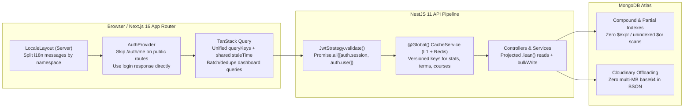

# Comprehensive Website Performance Master Plan: All Pages, Fetching & Backend Endpoints

**Date:** 2026-11-15  
**Scope:** End-to-end performance audit and phased optimization plan covering **all 56 frontend pages**, **all 4 app layouts & global providers**, **all 22 frontend feature modules**, and **all 31 backend controllers (~185 endpoints across 24 NestJS modules)** in the Student Portal monorepo (`@student-portal/web`, `@student-portal/api`, `@student-portal/shared`).

---

## 1. Executive Summary & What Has Already Been Done vs. What Remains

### Implementation review (2026-11-15; supersedes unverified assumptions below)

The timings and percentage reductions in this proposal are targets, not measured acceptance results. Each change must preserve the existing API contract, staff course scope, session revocation, result publication, tuition blocking, audit history and transaction/revision rules. The numbered route inventory reaches 58 despite the original 56-page heading.

| Area | Current implementation / decision |
| :--- | :--- |
| Auth validation | Session and current-user reads now run concurrently. Both must succeed; permissions and token versions are still read on every request. No cross-request auth cache. First focused regression run: 14 tests passed for auth, heartbeat and readiness. |
| Heartbeats and readiness | Recent identical route heartbeats skip writes; action/device changes still persist. Client cadence is 60s minimum / 120s periodic. Health and metrics share only an in-flight, bounded ping; completed healthy responses are not cached. |
| Database indexes and online counts | Added missing lockout/assignee/outbox lease indexes. Warm student statistics coalesce online counts for 15s. Retained logout-aware comparisons: simply replacing them with `lastLogoutAt: null` would change existing session/history semantics. |
| Dashboard and analytics | Removed the separate course count request; reused the list's exact total. Complaint count uses the summary endpoint. Overview uses four parallel collection summaries (not the proposed three: courses are a fourth collection). Indexed aggregate membership retains both ObjectId and legacy string references. |
| Course-list caching | Hydration moved inside the cache factory. Cache keys include caller identity and role; course/staff profile/permission changes invalidate course lists. No global staff result cache was introduced. |
| Notifications | Header reads are permission-gated and cached items are not rendered after permission loss. Admin history computes the full read count before slicing to five readers and batches reference hydration. Student target-level caching is deferred until profile/import invalidation covers every writer. |
| Frontend requests and bundles | Marketing routes skip session probes; login, password-change and attendance check-in retain bootstrap. Removed passkey capability polling. Unified registration/quiz keys and exam/email freshness. Settings panels, chat, PDF libraries and Excel inspection load separately/on demand. Idle Control course polling removed; release history retains explicit refresh controls. |
| Control preview | Previews use batches of four independent reads, retaining order, limits and activation digests. No parallel operations were added inside MongoDB transactions. |

**Corrections required before the remaining proposals can be marked implemented:**

- Keep post-login cookie verification until same-origin versus third-party-cookie behavior has dedicated acceptance coverage. A successful login JSON response alone does not prove that the browser stored a session.
- Keep session bootstrap on the public complaint form: it switches between authenticated-student submission and visitor identity verification. Public access does not mean that account state is unused.
- Do not cache visibility/tuition decisions or remove result polling until the version signal covers result changes as well as visibility changes. Scheduled closing and fee blocking must remain effective on an already-open student page.
- Shared analytics/roster/registration caches need explicit scope keys and invalidation for course assignments, profile/import changes, approvals and resets. Caller ID alone is insufficient when permissions change.
- `lucide-react`, `recharts` and `date-fns` are already optimized by the installed Next.js version. The config addition targets other packages. The grades visibility modal already stops its timer when closed; no timer fix is needed there. Schedule export already loads image/PDF dependencies dynamically.
- Control entry already preloads existing grades and audit operation IDs for each batch. A further `bulkWrite` conversion must retain row-specific revision conflicts, idempotency, permission checks and audit snapshots; replacing the loop blindly is unsafe.
- Do not remove canvas libraries merely because their names overlap: export behavior/CSS support differs. The current change defers them without changing export rendering.
- Namespace splitting, public static rendering, unified dashboard responses, the remaining batch writers and Cloudinary storage migration remain pending implementation and dedicated acceptance. No new live cache, index migration or deployment is claimed here.

Verification for the current changes is in progress; this table does not mark all four original phases complete.

Latest gates: workspace lint passed all three tasks; workspace TypeScript passed all four tasks; public-route/retry/metrics tests passed 7/7. The final full API unit run passed **103 suites / 986 tests**, including the real AuthService heartbeat path; separate API E2E TypeScript passed. The earlier fixture failures and an incorrectly named targeted staff-test path were corrected/superseded by the complete unit run. Shared/API/web production builds passed, including Next TypeScript and 17 static pages; the API artifact is being refreshed for the final heartbeat comparison. Real AuthProvider browser acceptance passed marketing/auth route separation, admin/staff/student navigation, hybrid complaint identity and blocked-cookie rejection. Control release browser acceptance and Arabic/English PDF/print acceptance passed. All 18 deployment/report/auth-readiness tests passed on repeat with their original deadlines; the earlier report-generator deadline failure was local contention. Final lint and database integration results are recorded in `../ci-reports.md` when complete.

Authentication incident follow-up: read-only public probes initially confirmed database-unavailable health (503) and capability-read failure (500) after the reported Atlas Free-to-Flex upgrade. MongoDB's upgrade guidance requires restarting application clients. Public health and anonymous auth-readiness probes subsequently recovered at 22:07 UTC on 15 November without an agent-issued restart or deployment. See [recovery instructions and exact evidence](ATLAS_FLEX_RECOVERY.md). Real-account login is not proven by anonymous smoke tests.

### 1.1 Already Implemented (Verified in Codebase as of 2026-11-14)
1. **MongoDB Driver & Mongoose Failure Diagnostics:** Implemented in [mongodb-driver-metrics.ts](file:///d:/BIS/bhi47a-full-stack-web/apps/api/src/database/mongodb-driver-metrics.ts) and [mongoose-metrics.plugin.ts](file:///d:/BIS/bhi47a-full-stack-web/apps/api/src/database/mongoose-metrics.plugin.ts) with process-local checkout/waiter/pool-clear counters and bounded failure ring buffer surfaced on `/admin/metrics`.
2. **Complaints Client Read Timeouts & Summary Opt-In on Dashboard/Profile:**
   - [apps/web/src/features/complaints/api.ts](file:///d:/BIS/bhi47a-full-stack-web/apps/web/src/features/complaints/api.ts) passes a 10s Axios timeout and `AbortSignal` to admin complaints reads.
   - [apps/web/src/app/[locale]/admin/page.tsx](file:///d:/BIS/bhi47a-full-stack-web/apps/web/src/app/%5Blocale%5D/admin/page.tsx#L487-L523) and [apps/web/src/features/students/api.ts](file:///d:/BIS/bhi47a-full-stack-web/apps/web/src/features/students/api.ts#L173-L177) now pass `view: 'summary'`.
3. **Narrow Projection on Control Course Sheets & Student Complaint Lookup:**
   - [control-sheets.service.ts](file:///d:/BIS/bhi47a-full-stack-web/apps/api/src/modules/control/services/control-sheets.service.ts#L103) projects `_id courseId component slug locked workflowState`.
   - [complaints.service.ts](file:///d:/BIS/bhi47a-full-stack-web/apps/api/src/modules/complaints/complaints.service.ts#L574) projects `studentCode` on its user lookup and removed the duplicate index in [user.schema.ts](file:///d:/BIS/bhi47a-full-stack-web/apps/api/src/modules/users/schemas/user.schema.ts).

### 1.2 Top 12 System-Wide Bottlenecks Remaining Across the Entire Website

| # | Layer | Bottleneck | Exact Source Location | Impact |
| :-: | :--- | :--- | :--- | :--- |
| **1** | **Global Auth & Middleware** | **`JwtStrategy.validate` runs `auth.session` and `auth.user` sequentially** on *every* authenticated API request (2 sequential MongoDB round-trips before any controller runs). | [jwt.strategy.ts](file:///d:/BIS/bhi47a-full-stack-web/apps/api/src/modules/auth/strategies/jwt.strategy.ts#L51-L59) | Adds `35–80ms` baseline (and `5s–10s` under socket contention) to **100% of protected endpoints**. |
| **2** | **Global Frontend Auth** | **`AuthProvider` fires `GET /api/auth/me` unconditionally on public pages** (`/ar`, `/about`, `/news`, `/admission`, `/complaints`) and **blocks login on a second sequential `GET /auth/me`** after `POST /auth/*/login`. | [auth-provider.tsx](file:///d:/BIS/bhi47a-full-stack-web/apps/web/src/providers/auth-provider.tsx#L113-L125), [L439-L441](file:///d:/BIS/bhi47a-full-stack-web/apps/web/src/providers/auth-provider.tsx#L439-L441) | Unnecessary 401 API traffic on every public visit; adds 1 full RTT to every login. |
| **3** | **Global RSC / I18n Payload** | **`LocaleLayout` serializes the entire `messages/{locale}.json` (`135 KB` Arabic / `99 KB` English)** into `NextIntlClientProvider` on every page load. | [app/[locale]/layout.tsx](file:///d:/BIS/bhi47a-full-stack-web/apps/web/src/app/%5Blocale%5D/layout.tsx#L111-L124) | Adds `100–135 KB` of JSON to initial HTML/RSC payload on every route. |
| **4** | **Frontend Bundle Weight** | **Missing `optimizePackageImports` in `next.config.ts`**, duplicate `html2canvas` + `html2canvas-pro` dependencies, and static imports of `recharts`, `framer-motion`, `qrcode`, `read-excel-file`, `jspdf` in 2,000+ line `'use client'` pages (`201/359` files are client components). | [next.config.ts](file:///d:/BIS/bhi47a-full-stack-web/apps/web/next.config.ts), [apps/web/package.json](file:///d:/BIS/bhi47a-full-stack-web/apps/web/package.json#L221-L225) | Bloats First Load JS by `250–450 KB` across Admin and Student dashboards. |
| **5** | **Admin Dashboard (`/admin`)** | **Fires 6–9 requests on mount**, including duplicate `/admin/courses?limit=1` + `/admin/courses?limit=100`, `/admin/complaints?limit=1` + `/admin/complaints?limit=100`, plus `<DeferredAnalyticsSummary>` which triggers `GET /admin/analytics/overview` (**20+ DB queries/aggregations in one request**). | [admin/page.tsx](file:///d:/BIS/bhi47a-full-stack-web/apps/web/src/app/%5Blocale%5D/admin/page.tsx#L303-L525), [analytics-query.service.ts](file:///d:/BIS/bhi47a-full-stack-web/apps/api/src/modules/analytics/services/analytics-query.service.ts#L859-L975) | Burst of 25–35 MongoDB operations when an admin opens `/admin`. |
| **6** | **Student Dashboard (`/dashboard`)** | **Fires 8 parallel page queries + 3 layout queries = 11 API requests on mount**,even though `GET /api/students/me/dashboard` already exists on the backend (`StudentsController.getMyDashboard`) and is completely unused! | [dashboard/page.tsx](file:///d:/BIS/bhi47a-full-stack-web/apps/web/src/app/%5Blocale%5D/dashboard/page.tsx#L104-L222), [students.controller.ts](file:///d:/BIS/bhi47a-full-stack-web/apps/api/src/modules/students/students.controller.ts) | 11 concurrent HTTP requests (22 auth DB queries + ~18 handler DB queries = ~40 DB ops per student dashboard load). |
| **7** | **Admin Students List (`GET /api/admin/students`)** | **`StudentQueryService.findAll` runs 6–8 DB queries per page load**: `courses.find` + `registrations.find` (for doctors), `student_profiles.find` (with `.populate('userId')`), `countDocuments`, `registration_terms.find`, `registrations.find`, `advising_cases.find`, and `academic_profiles.find`. | [student-query.service.ts](file:///d:/BIS/bhi47a-full-stack-web/apps/api/src/modules/students/services/student-query.service.ts#L236-L480) | Uncached `registration_terms.find({ isCurrent: true })` and 7-branch unanchored `$regex` search across 6 fields. |
| **8** | **Analytics Endpoints (`/api/admin/analytics/*`)** | **`AnalyticsQueryService.getOverview` executes 13 separate `countDocuments()` calls + 6 full collection aggregations/scans** (`quizzes`, `submissions`, `attempts`, `registrations`, `courses`, `grades`) with **zero caching** and `$expr: { $in: [{ $toString: '$courseId' }, ...] }` full collection scans. | [analytics-query.service.ts](file:///d:/BIS/bhi47a-full-stack-web/apps/api/src/modules/analytics/services/analytics-query.service.ts#L168-L920) | Heavy multi-second MongoDB CPU/IO spike every time `/admin` scrolls to the analytics section. |
| **9** | **Notifications (`AdminHeader` & `/admin/notifications`)** | **`NotificationsService.listSentHistory` runs 3x `.populate()` (`sentBy`, `targetStudentId`, `readBy.userId`)** on every admin header mount, and computes `readCount` *after* `.slice('readBy', -5)` (capping `readCount` at 5). Student feed runs `buildStudentNotificationFilter` (`users.findById` + `student_profiles.findOne`) on every poll. | [notifications.service.ts](file:///d:/BIS/bhi47a-full-stack-web/apps/api/src/modules/notifications/notifications.service.ts#L148-L188), [L418-L441](file:///d:/BIS/bhi47a-full-stack-web/apps/api/src/modules/notifications/notifications.service.ts#L418-L441) | 5 DB queries on every admin page load; 4 DB queries every 120s per online student. |
| **10** | **Complaints BSON Bloat & Poller** | **Base64 screenshots (`up to 2.8 MB`) stored inline in MongoDB `complaints` documents**; `ComplaintReplyEmailService` polls `findOneAndUpdate` every 30s with an unindexed `$or` branch (`status: 'processing', leaseUntil: { $lte: now }`); `/stats` and `/assignees` are uncached. | [complaints.service.ts](file:///d:/BIS/bhi47a-full-stack-web/apps/api/src/modules/complaints/complaints.service.ts), [complaint-reply-email.service.ts](file:///d:/BIS/bhi47a-full-stack-web/apps/api/src/modules/complaints/complaint-reply-email.service.ts#L85-L110) | Multi-MB wire transfers when `view=full` is used; `1.7s–4.3s` background poller stalls. |
| **11** | **Online & Locked User Counts (`$expr` Scans)** | **`countActiveOnlineStudents`, `countActiveOnlineStaff`, `getActiveUsersForSessions`, and `countLockedAccounts`** use `$expr` or unindexed 4-branch `$or`, forcing collection/index document fetches on every `/admin/students-stats` and `/api/metrics/summary` poll. | [users.service.ts](file:///d:/BIS/bhi47a-full-stack-web/apps/api/src/modules/users/users.service.ts#L87-L115), [L641-L696](file:///d:/BIS/bhi47a-full-stack-web/apps/api/src/modules/users/users.service.ts#L641-L696) | `113ms–472ms` per count query; re-executed even on warm `StudentsService.getStats()` cache hits. |
| **12** | **Control & Grades N+1 Loops** | **`ControlSheetsService.listCourses`** runs 5 queries including an uncached `$unwind: '$courses'` registration aggregation; **`GradesService.syncPublishedAcademicProgress`** and **`previewControlRelease`** run `await` inside `for` loops per student/sheet. | [control-sheets.service.ts](file:///d:/BIS/bhi47a-full-stack-web/apps/api/src/modules/control/services/control-sheets.service.ts#L45-L155), [grades.service.ts](file:///d:/BIS/bhi47a-full-stack-web/apps/api/src/modules/grades/grades.service.ts#L328-L347), [L851-L862](file:///d:/BIS/bhi47a-full-stack-web/apps/api/src/modules/grades/grades.service.ts#L851-L862) | Linear `O(N)` DB round-trips during grade recalculation, release preview, and control hub loads. |

---

## 2. Global Architecture & Shell Optimization Plan



### 2.1 Next.js Configuration & Bundle Optimization ([apps/web/next.config.ts](file:///d:/BIS/bhi47a-full-stack-web/apps/web/next.config.ts))
1. **Add `experimental.optimizePackageImports`:**
   ```ts
   experimental: {
     optimizePackageImports: [
       'lucide-react',
       'recharts',
       'framer-motion',
       'date-fns',
       '@xyflow/react',
       '@radix-ui/react-dialog',
       '@radix-ui/react-dropdown-menu',
       '@radix-ui/react-select',
       '@radix-ui/react-popover',
       '@radix-ui/react-tabs',
       '@radix-ui/react-tooltip',
     ],
   },
   ```
2. **Consolidate Duplicate Canvas/PDF Libraries in [apps/web/package.json](file:///d:/BIS/bhi47a-full-stack-web/apps/web/package.json):**
   - Currently the web app ships **three** DOM-to-image libraries: `html-to-image`, `html2canvas`, and `html2canvas-pro`, plus `jspdf`.
   - Dynamically `import()` `jspdf` and `html-to-image` / `html2canvas` inside the click handlers of [registration-print.ts](file:///d:/BIS/bhi47a-full-stack-web/apps/web/src/lib/registration-print.ts), [result-certificate.ts](file:///d:/BIS/bhi47a-full-stack-web/apps/web/src/lib/result-certificate.ts), and [export-schedule-image.ts](file:///d:/BIS/bhi47a-full-stack-web/apps/web/src/features/course-schedules/export-schedule-image.ts) so they are **0 KB** in initial page bundles (`/dashboard/registration`, `/dashboard/results`, `/dashboard/schedules`, `/admin/schedules`).
3. **Scope `NextIntlClientProvider` Messages in [apps/web/src/app/[locale]/layout.tsx](file:///d:/BIS/bhi47a-full-stack-web/apps/web/src/app/%5Blocale%5D/layout.tsx#L111-L124):**
   - `messages/ar.json` is **135 KB** and `messages/en.json` is **99 KB**.
   - Provide shared shell namespaces (`common`, `nav`, `header`, `footer`, `auth`, `errors`, `status`) at root `[locale]/layout.tsx`, and provide route-group namespaces (`admin`, `studentPortal`, `control`, `admissions`) in `admin/layout.tsx` and `dashboard/layout.tsx`.
4. **Convert Duplicate Static JPG/WEBP Assets in `apps/web/public/images/institutional/`:**
   - Remove unused duplicate `.jpg` files where `.webp` is already used, and ensure all institutional sections use `next/image` with explicit `sizes` and `priority` only on `HeroSection`.

### 2.2 Global Providers & Layout Fetch Deduplication
1. **`AuthProvider` ([apps/web/src/providers/auth-provider.tsx](file:///d:/BIS/bhi47a-full-stack-web/apps/web/src/providers/auth-provider.tsx)):**
   - **Skip `/auth/me` on Public Marketing Routes:** Set `enabled: !isLoggingOut && !isPublicMarketingRoute(pathname)` (where marketing routes like `/ar`, `/ar/about`, `/ar/academics`, `/ar/news`, `/ar/events`, `/ar/gallery`, `/ar/activities`, `/ar/downloads`, `/ar/contact` do not need an authenticated session check).
   - **Eliminate Double-RTT on Login (`lines 433–453`):** `POST /api/auth/{student,admin,google,passkeys}/login` already sets the `access_token` cookie and returns `{ user }`. Instead of blocking router navigation on a sequential `await api.get('/auth/me')`, seed `queryClient.setQueryData(queryKeys.auth.me, res.data.user)` and navigate immediately, running cookie verification non-blockingly or only when third-party cookie mode is detected.
   - **Coalesce Heartbeat Calls (`lines 623–657`):** Increase minimum gap between non-forced heartbeats from `30_000` to `60_000` ms and periodic interval to `120_000` ms; skip `users.updateOne` on the backend when `lastActiveAt` is `< 45s` old and `route` is unchanged.
2. **`StudentHeader` + `StudentSidebar` + `StudentChatWidget` ([apps/web/src/app/[locale]/dashboard/layout.tsx](file:///d:/BIS/bhi47a-full-stack-web/apps/web/src/app/%5Blocale%5D/dashboard/layout.tsx)):**
   - **Cache `getChatStatus()` via TanStack Query:** In [student-chat-widget.tsx](file:///d:/BIS/bhi47a-full-stack-web/apps/web/src/features/ai/components/student-chat-widget.tsx#L51-L62), replace the raw `useEffect` fetch of `GET /api/student/chat/status` with `useQuery({ queryKey: ['student-chat-status'], queryFn: getChatStatus, staleTime: 5 * 60_000 })` (or defer fetching until the user hovers/clicks the chat launcher button!).
   - **Lazy-Load `StudentChatWidget`:** Dynamically import `StudentChatWidget` with `next/dynamic(..., { ssr: false })` in `dashboard/layout.tsx` so `framer-motion` and chat UI do not block initial student page hydration.
3. **`AdminHeader` ([apps/web/src/components/admin/header.tsx](file:///d:/BIS/bhi47a-full-stack-web/apps/web/src/components/admin/header.tsx#L103-L107)):**
   - Gate `notificationsQuery` (`GET /api/admin/notifications`) on `hasPerm('notifications.read')` (currently it fires even for staff roles without notification permissions!) and pass `limit: 10` for the header drawer instead of pulling 20 heavily populated records.

---

## 3. Page-by-Page Performance Audit & Optimization Plan (All 56 Pages)

### 3.1 Public Institutional & Utility Pages (17 Pages)

| # | Page Route & File | Render Mode | Current Endpoints Fired on Load | Key Bottlenecks Found | Concrete Optimization Plan |
| :-: | :--- | :---: | :--- | :--- | :--- |
| 1 | `/` ([app/page.tsx](file:///d:/BIS/bhi47a-full-stack-web/apps/web/src/app/page.tsx)) | Server | None (redirects to `/ar`) | Handled by `proxy.ts` 308 redirect + page fallback. | Keep lightweight server redirect. |
| 2 | `/[locale]` ([app/[locale]/page.tsx](file:///d:/BIS/bhi47a-full-stack-web/apps/web/src/app/%5Blocale%5D/page.tsx)) | Server (SSR) | `GET /api/auth/me` (via `AuthProvider`!) | Renders 13 sections synchronously; `ScrollReveal` wraps 11 sections in `framer-motion` client boundaries; `AuthProvider` fires unnecessary `/auth/me` 401; 135 KB i18n JSON serialized. | 1. Add `export const revalidate = 3600` (ISR).<br>2. Skip `/auth/me` on public marketing routes.<br>3. Replace `framer-motion` in `ScrollReveal` with CSS `IntersectionObserver` classes (`content-visibility: auto` on below-fold sections). |
| 3 | `/[locale]/about` ([about/page.tsx](file:///d:/BIS/bhi47a-full-stack-web/apps/web/src/app/%5Blocale%5D/about/page.tsx)) | Server | `GET /api/auth/me` (unneeded) | Static institutional content rendered dynamically without ISR cache header; `/auth/me` 401 call. | Add `export const revalidate = 86400`; disable `/auth/me` probe on marketing routes. |
| 4 | `/[locale]/academics` ([academics/page.tsx](file:///d:/BIS/bhi47a-full-stack-web/apps/web/src/app/%5Blocale%5D/academics/page.tsx)) | Server | `GET /api/auth/me` (unneeded) | Same as `/about` — static curriculum data rendered without ISR. | Add `export const revalidate = 86400`; skip `/auth/me`. |
| 5 | `/[locale]/activities` ([activities/page.tsx](file:///d:/BIS/bhi47a-full-stack-web/apps/web/src/app/%5Blocale%5D/activities/page.tsx)) | Server | `GET /api/auth/me` (unneeded) | Static activities page without ISR; check image `sizes` attributes. | Add `export const revalidate = 86400`; skip `/auth/me`. |
| 6 | `/[locale]/contact` ([contact/page.tsx](file:///d:/BIS/bhi47a-full-stack-web/apps/web/src/app/%5Blocale%5D/contact/page.tsx)) | Server + Client Form | `GET /api/auth/me` (unneeded) | Static contact info + `ContactForm` client island. | Add `export const revalidate = 86400`; skip `/auth/me`. |
| 7 | `/[locale]/downloads` ([downloads/page.tsx](file:///d:/BIS/bhi47a-full-stack-web/apps/web/src/app/%5Blocale%5D/downloads/page.tsx)) | Server | `GET /api/auth/me` (unneeded) | Static downloads catalog without ISR. | Add `export const revalidate = 86400`; skip `/auth/me`. |
| 8 | `/[locale]/events` ([events/page.tsx](file:///d:/BIS/bhi47a-full-stack-web/apps/web/src/app/%5Blocale%5D/events/page.tsx)) | Server | `GET /api/auth/me` (unneeded) | Static events list without ISR. | Add `export const revalidate = 3600`; skip `/auth/me`. |
| 9 | `/[locale]/gallery` ([gallery/page.tsx](file:///d:/BIS/bhi47a-full-stack-web/apps/web/src/app/%5Blocale%5D/gallery/page.tsx)) | Server | `GET /api/auth/me` (unneeded) | Multiple campus photos loaded on one page; needs strict `sizes="(max-width: 768px) 100vw, 33vw"` and lazy loading. | Add `export const revalidate = 86400`; ensure all gallery images except first row are lazy-loaded with responsive `sizes`. |
| 10 | `/[locale]/news` ([news/page.tsx](file:///d:/BIS/bhi47a-full-stack-web/apps/web/src/app/%5Blocale%5D/news/page.tsx)) | Server | `GET /api/auth/me` (unneeded) | Static news index without `revalidate`. | Add `export const revalidate = 3600`; skip `/auth/me`. |
| 11 | `/[locale]/news/[slug]` ([news/[slug]/page.tsx](file:///d:/BIS/bhi47a-full-stack-web/apps/web/src/app/%5Blocale%5D/news/%5Bslug%5D/page.tsx)) | Server | `GET /api/auth/me` (unneeded) | Article detail page; verify `generateStaticParams` pre-renders known slugs for both `ar` and `en`. | Ensure `generateStaticParams` + `revalidate = 3600`; skip `/auth/me`. |
| 12 | `/[locale]/portal` ([portal/page.tsx](file:///d:/BIS/bhi47a-full-stack-web/apps/web/src/app/%5Blocale%5D/portal/page.tsx)) | Server | None (redirects to `/login`) | 2-line redirect utility page. | Keep server redirect (`redirect('/ar/login')`). |
| 13 | `/[locale]/admission` ([admission/page.tsx](file:///d:/BIS/bhi47a-full-stack-web/apps/web/src/app/%5Blocale%5D/admission/page.tsx)) | Server wrapper -> Client (`public-admission-page.tsx`, 824 lines) | `POST /api/public/admissions/validate`, `POST /api/public/admissions/requests`, `POST /api/public/admissions/status` (on user action) | `public-admission-page.tsx` is a single 824-line client component bundling application form + status inquiry + file upload steps together; `AuthProvider` fires `/auth/me` unnecessarily. | 1. Split `StatusInquiryPanel` and `ApplicationWizard` into lazy tabs via `next/dynamic`.<br>2. Skip `/auth/me` on `/admission`. |
| 14 | `/[locale]/complaints` ([complaints/page.tsx](file:///d:/BIS/bhi47a-full-stack-web/apps/web/src/app/%5Blocale%5D/complaints/page.tsx)) | `'use client'` (723 lines) | `GET /api/public/complaints/settings` (raw `useEffect` fetch on mount) + `GET /api/auth/me` | 1. Uses raw `useEffect` + `useState` instead of `useQuery` for `/public/complaints/settings` (no cache across tab switches).<br>2. Converts uploaded screenshot to base64 data URL up to 2.8 MB in browser.<br>3. Statically imports `PublicTicketInquiry`. | 1. Wrap `/public/complaints/settings` in `useQuery` (`staleTime: 5 * 60_000`) or pass from Server Component.<br>2. Compress client images via Canvas (`max 1280px, WebP 0.8`) before base64 encoding.<br>3. Lazy-load `PublicTicketInquiry`. |
| 15 | `/[locale]/attendance/check-in` ([attendance/check-in/page.tsx](file:///d:/BIS/bhi47a-full-stack-web/apps/web/src/app/%5Blocale%5D/attendance/check-in/page.tsx)) | `'use client'` (411 lines) | `GET /api/auth/me`, then `POST /api/attendance/check-in` | Imports `framer-motion` on a time-critical mobile QR check-in landing page where students scan a 25-second rotating QR token on cellular data. | Remove `framer-motion` from `/attendance/check-in` (use lightweight CSS transitions) and parallelize geolocation acquisition with `/auth/me` bootstrap. |
| 16 | `/[locale]/forgot-password` ([forgot-password/page.tsx](file:///d:/BIS/bhi47a-full-stack-web/apps/web/src/app/%5Blocale%5D/forgot-password/page.tsx)) | `'use client'` (527 lines) | `POST /api/auth/forgot-password`, `POST /api/auth/reset-password-otp` (on submit) | Fires `GET /api/auth/me` on mount even when user is unauthenticated. | Skip `/auth/me` when no session indicator cookie exists or on `/forgot-password`. |
| 17 | `/[locale]/[...notFound]` ([...notFound/page.tsx](file:///d:/BIS/bhi47a-full-stack-web/apps/web/src/app/%5Blocale%5D/%5B...notFound%5D/page.tsx)) | Server | None | Calls `notFound()`. | None needed. |

---

### 3.2 Authentication & Login Pages (4 Pages)

| # | Page Route & File | Render Mode | Current Endpoints Fired on Load | Key Bottlenecks Found | Concrete Optimization Plan |
| :-: | :--- | :---: | :--- | :--- | :--- |
| 18 | `/[locale]/login` ([login/page.tsx](file:///d:/BIS/bhi47a-full-stack-web/apps/web/src/app/%5Blocale%5D/login/page.tsx)) | Server (218 lines) | `GET /api/auth/me` | Role chooser page (`/login/student` vs `/login/admin`). | Skip `/auth/me` unless a session hint cookie is present. |
| 19 | `/[locale]/login/student` ([login/student/page.tsx](file:///d:/BIS/bhi47a-full-stack-web/apps/web/src/app/%5Blocale%5D/login/student/page.tsx)) | `'use client'` (652 lines) | 1. `GET /api/auth/me`<br>2. `GET /api/auth/passkeys/capabilities` (`refetchInterval: 30_000`, `staleTime: 0`!)<br>3. Google GIS script + `POST /api/auth/google/nonce` every 60s (`use-google-signin.ts:202`) | 1. **`PasskeyLoginButton` (`passkey-login-button.tsx:35`) sets `staleTime: 0, refetchInterval: 30000`** — polling `/api/auth/passkeys/capabilities` every 30s on the login screen!<br>2. **`useGoogleSignIn` (`use-google-signin.ts:202`) polls `/api/auth/google/nonce` every 60s** even when the user is typing a student code/password!<br>3. On login submit, `AuthProvider` awaits `POST /auth/student/login` and then awaits `GET /auth/me` sequentially. | 1. Change `PasskeyLoginButton` capabilities query to `staleTime: 5 * 60_000, refetchInterval: false` (passkey server capabilities do not change every 30s!).<br>2. Fetch Google nonce on-demand or increase refresh interval to matches nonce TTL (5 min), pausing when tab is hidden.<br>3. Eliminate sequential `GET /auth/me` after login in `AuthProvider`. |
| 20 | `/[locale]/login/admin` ([login/admin/page.tsx](file:///d:/BIS/bhi47a-full-stack-web/apps/web/src/app/%5Blocale%5D/login/admin/page.tsx)) | `'use client'` (454 lines) | 1. `GET /api/auth/me`<br>2. `GET /api/auth/passkeys/capabilities` (`staleTime: 0, refetchInterval: 30_000`) | Same `PasskeyLoginButton` 30s polling (`staleTime: 0`) and sequential post-login `GET /auth/me` waterfall. | Set `staleTime: 5 * 60_000, refetchInterval: false` on `PasskeyLoginButton`; remove sequential post-login `/auth/me`. |
| 21 | `/[locale]/login/change-password` ([login/change-password/page.tsx](file:///d:/BIS/bhi47a-full-stack-web/apps/web/src/app/%5Blocale%5D/login/change-password/page.tsx)) | `'use client'` (645 lines) | `GET /api/auth/me`, `POST /api/auth/change-password` (on submit) | Clean single-form page; waits on `/auth/me`. | Prefetch `/dashboard` or `/admin` route upon password validation success. |

---

### 3.3 Student Portal Pages (`/[locale]/dashboard/*` — 14 Pages)

> [!IMPORTANT]
> **Student Layout Overhead (`dashboard/layout.tsx`):** Every student page automatically mounts `StudentHeader` (`GET /api/students/me/notifications`, `refetchInterval: 120s`), `StudentSidebar` (shares `notifications` + fetches `GET /api/portal-settings`), `FcmInitializer` (`POST /api/students/me/fcm-token`), and `StudentChatWidget` (`GET /api/student/chat/status`).

| # | Page Route & File | Render Mode | Current Endpoints Fired on Load (Excluding Layout) | Key Bottlenecks Found | Concrete Optimization Plan |
| :-: | :--- | :---: | :--- | :--- | :--- |
| 22 | `/[locale]/dashboard` ([dashboard/page.tsx](file:///d:/BIS/bhi47a-full-stack-web/apps/web/src/app/%5Blocale%5D/dashboard/page.tsx)) | `'use client'` (1,392 lines) | **8 Parallel Queries:**<br>1. `GET /students/me/profile`<br>2. `GET /students/me/attendance-history`<br>3. `GET /registration/eligibility`<br>4. `GET /attendance/student/live-sessions` (`45s` poll)<br>5. `GET /students/me/syllabi`<br>6. `GET /portal-settings`<br>7. `GET /students/me/academic-email`<br>8. `GET /students/me/exam-assignment`<br>9. `GET /students/me/quizzes` (`60s` poll) | **Fires 8 page queries + 3 layout queries = 11 API requests on initial student login!** Each request runs `JwtStrategy.validate` (2 DB queries) + its own service lookups (`student_profiles.findOne`, `academic_profiles.findOne`, `registrations.findOne` repeated across 5 of the 8 endpoints!). Meanwhile, `GET /api/students/me/dashboard` already exists in `StudentsController`! Also statically imports `CourseMaterialsDialog`. | 1. **Create/Expand Unified `GET /api/students/me/dashboard-bootstrap` (or upgrade `GET /students/me/dashboard`)** to return `{ profile, eligibility, academicEmail, examAssignment, portalSettings }` in **1 HTTP request** and populate the individual TanStack Query caches (`queryClient.setQueryData`) so sub-pages hit warm cache!<br>2. Lazy-load `CourseMaterialsDialog` via `next/dynamic`.<br>3. Standardize query keys (use `registrationKeys.eligibility()` instead of `["registration-eligibility"]` so `/dashboard` and `/dashboard/registration` share cache!). |
| 23 | `/[locale]/dashboard/profile` ([dashboard/profile/page.tsx](file:///d:/BIS/bhi47a-full-stack-web/apps/web/src/app/%5Blocale%5D/dashboard/profile/page.tsx)) | `'use client'` (1,640 lines) | 1. `GET /students/me/profile`<br>2. `GET /students/me/academic-email`<br>3. `GET /auth/passkeys/capabilities`<br>4. `GET /auth/passkeys`<br>5. `GET /auth/sessions`<br>6. `POST /auth/google/nonce` (via `useGoogleSignIn`) | 1. **1,640-line monolith** mounting `PasskeyManager`, `SessionManager`, and `useGoogleSignIn` eagerly on initial render.<br>2. `useGoogleSignIn` loads Google GIS script and requests a nonce on mount even if the student already linked Google or isn't clicking "Link Google". | 1. Lazy-load `PasskeyManager` and `SessionManager` via `next/dynamic` (or behind security section intersection).<br>2. Only initialize `useGoogleSignIn` / `POST /auth/google/nonce` when the user clicks "Link Google Account". |
| 24 | `/[locale]/dashboard/attendance` ([dashboard/attendance/page.tsx](file:///d:/BIS/bhi47a-full-stack-web/apps/web/src/app/%5Blocale%5D/dashboard/attendance/page.tsx)) | `'use client'` (721 lines) | 1. `GET /attendance/student/live-sessions` (`refetchInterval: 30_000`)<br>2. `GET /students/me/attendance-history` (`staleTime: 5m`) | Statically imports `StudentQrScannerDialog` (`jsqr` + camera stream logic) on `/dashboard/attendance` (whereas `/dashboard` used `next/dynamic`!). | Dynamically import `StudentQrScannerDialog` via `next/dynamic(..., { ssr: false })` on `/dashboard/attendance` just like `/dashboard/page.tsx`. |
| 25 | `/[locale]/dashboard/schedule` ([dashboard/schedule/page.tsx](file:///d:/BIS/bhi47a-full-stack-web/apps/web/src/app/%5Blocale%5D/dashboard/schedule/page.tsx)) | Server (6 lines) | None (redirects to `/dashboard/schedules`) | Legacy redirect route. | Keep server redirect. |
| 26 | `/[locale]/dashboard/schedules` ([dashboard/schedules/page.tsx](file:///d:/BIS/bhi47a-full-stack-web/apps/web/src/app/%5Blocale%5D/dashboard/schedules/page.tsx)) | `'use client'` (769 lines) | `GET /api/course-schedules` (`staleTime: 60_000`) | 1. Statically imports `export-schedule-image` (`html-to-image` + `jspdf`) even when student never clicks Export.<br>2. Backend `GET /api/course-schedules` returns all schedules if filter params aren't scoped or runs uncached query. | 1. Lazy-import `export-schedule-image` inside the export button click handler.<br>2. Cache `GET /api/course-schedules` by `(academicYear, semester, level, department, group, section)` in `CacheService` (120s TTL). |
| 27 | `/[locale]/dashboard/registration` ([dashboard/registration/page.tsx](file:///d:/BIS/bhi47a-full-stack-web/apps/web/src/app/%5Blocale%5D/dashboard/registration/page.tsx)) | `'use client'` (417 lines) | **6 Parallel Queries:**<br>1. `GET /registration/eligibility`<br>2. `GET /portal-settings`<br>3. `GET /registration/latest`<br>4. `GET /registration/history`<br>5. `GET /registration/available-courses`<br>6. `GET /registration/advising-status` | 1. **Query key mismatch with `/dashboard`:** `/dashboard` uses `["registration-eligibility"]`, while `/dashboard/registration` uses `registrationKeys.eligibility()` (`['registration', 'eligibility']`) — causing a cache miss when navigating from Dashboard to Registration!<br>2. Fires 6 registration queries simultaneously, each looking up the student's profile, academic profile, and current registration term (`registration_terms.findOne`) 5 times on the backend!<br>3. Statically imports `RegistrationSlipView` (`html-to-image` + `jspdf`). | 1. Unify query key to `registrationKeys.eligibility()` in both `/dashboard` and `/dashboard/registration`.<br>2. Lazy-load `RegistrationSlipView` via `next/dynamic`.<br>3. Cache active `RegistrationTerm` and `GpaRules` in `CacheService` (60s TTL) on the backend so the 5 parallel endpoints don't re-query `registration_terms` and `gpa_rules` 5 times. |
| 28 | `/[locale]/dashboard/academic-advising` ([dashboard/academic-advising/page.tsx](file:///d:/BIS/bhi47a-full-stack-web/apps/web/src/app/%5Blocale%5D/dashboard/academic-advising/page.tsx)) | Server wrapper -> Client (`student-advising-page.tsx`) | 1. `GET /student/advising`<br>2. `GET /student/advising/recommendations`<br>3. `GET /student/advising/approved-plan` | Fires 3 separate requests to `/student/advising/*`, each loading the student's active `AdvisingCase` on the backend. | Combine `/student/advising` response to include `recommendations` and `approvedPlan` (or gate `/recommendations` and `/approved-plan` on `enabled: Boolean(advisingCase)`). |
| 29 | `/[locale]/dashboard/quizzes` ([dashboard/quizzes/page.tsx](file:///d:/BIS/bhi47a-full-stack-web/apps/web/src/app/%5Blocale%5D/dashboard/quizzes/page.tsx)) | `'use client'` (2,379 lines) | 1. `GET /students/me/quizzes` (`staleTime: 60s`)<br>2. `GET /students/me/course-quizzes` (gradebook coursework quizzes) | 1. **Query key mismatch with `/dashboard`:** `/dashboard` uses `["student-quizzes-dashboard"]` while `/dashboard/quizzes` uses `["student-online-quizzes"]` for the exact same `GET /students/me/quizzes` endpoint — causing duplicate fetch on navigation!<br>2. **2,379-line monolith** bundling Quiz List, Live Quiz Taking Engine, Timer, and Quiz Review Modal in one file. | 1. Unify query key to `['student-online-quizzes']` across `/dashboard` and `/dashboard/quizzes`.<br>2. Extract `QuizTakingView` and `QuizReviewModal` into `next/dynamic` components so listing quizzes doesn't parse the entire exam-taking engine. |
| 30 | `/[locale]/dashboard/results` ([dashboard/results/page.tsx](file:///d:/BIS/bhi47a-full-stack-web/apps/web/src/app/%5Blocale%5D/dashboard/results/page.tsx)) | `'use client'` (1,155 lines) | 1. `GET /students/me/results` (`refetchInterval: 60_000`, `refetchOnWindowFocus: true`)<br>2. `GET /students/me/profile` (`staleTime: 30s` default)<br>3. `GET /students/me/results-window` (`refetchInterval: 60_000`) | 1. Polls **both** `/students/me/results` AND `/students/me/results-window` every 60s, even though line 168 already watches `statusQuery.data?.visibilityVersion` to trigger `resultsRefetch()` when visibility changes!<br>2. `result-certificate.ts` (`html2canvas` + `jspdf`) is imported for PDF download. | 1. Remove `refetchInterval: 60_000` from `resultsQuery` (`GET /students/me/results`) and set `staleTime: 5 * 60_000` — keep the lightweight `/students/me/results-window` poll (`60s`), which already triggers `resultsRefetch()` whenever `visibilityVersion` changes! Cuts heavy results DB queries by 90%.<br>2. Lazy-import `result-certificate.ts` on download click. |
| 31 | `/[locale]/dashboard/exam-schedule` ([dashboard/exam-schedule/page.tsx](file:///d:/BIS/bhi47a-full-stack-web/apps/web/src/app/%5Blocale%5D/dashboard/exam-schedule/page.tsx)) | Server wrapper -> Client (`student-exam-schedule-page.tsx`) | `GET /students/me/exam-assignment` (`queryKey: ['student-exam-assignment']`) | Shares `['student-exam-assignment']` with `/dashboard` and `/dashboard/exam-place`, but `student-exam-schedule-page.tsx` doesn't set `staleTime: 10 * 60_000` (defaults to 30s). | Set `staleTime: 10 * 60_000` in `student-exam-schedule-page.tsx` to match `/dashboard`. |
| 32 | `/[locale]/dashboard/exam-place` ([dashboard/exam-place/page.tsx](file:///d:/BIS/bhi47a-full-stack-web/apps/web/src/app/%5Blocale%5D/dashboard/exam-place/page.tsx)) | `'use client'` (239 lines) | `GET /students/me/exam-assignment` (`queryKey: ['student-exam-assignment']`) | Defaults to `staleTime: 30_000` instead of `10 * 60_000`. | Set `staleTime: 10 * 60_000` so navigating from `/dashboard` or `/dashboard/exam-schedule` is instant (0 network requests). |
| 33 | `/[locale]/dashboard/academic-email` ([dashboard/academic-email/page.tsx](file:///d:/BIS/bhi47a-full-stack-web/apps/web/src/app/%5Blocale%5D/dashboard/academic-email/page.tsx)) | `'use client'` (252 lines) | `GET /students/me/academic-email` (`queryKey: ['student-academic-email']`) | Defaults to `staleTime: 30_000` instead of `30 * 60_000` used on `/dashboard`. | Set `staleTime: 30 * 60_000` to reuse the cached response from `/dashboard`. |
| 34 | `/[locale]/dashboard/complaints` ([dashboard/complaints/page.tsx](file:///d:/BIS/bhi47a-full-stack-web/apps/web/src/app/%5Blocale%5D/dashboard/complaints/page.tsx)) | `'use client'` (719 lines) | `GET /students/complaints?page=1&limit=10` | 1. Backend `ComplaintsService.findByStudent` calls `userModel.findById(studentId).select('studentCode')` even though `req.user.studentCode` is already in the JWT.<br>2. Returns full `screenshotUrl` (up to 2.8 MB base64) for all 10 tickets in the list at once. | 1. Pass `@CurrentUser('studentCode')` to `findByStudent()` to skip the extra `users.findById` query.<br>2. Offload new screenshots to Cloudinary (`student-portal/complaints`). |
| 35 | `/[locale]/dashboard/notifications` ([dashboard/notifications/page.tsx](file:///d:/BIS/bhi47a-full-stack-web/apps/web/src/app/%5Blocale%5D/dashboard/notifications/page.tsx)) | `'use client'` (601 lines) | `GET /students/me/notifications` (`queryKeys.notifications.studentList`) | Shares cache key with `StudentHeader` and `StudentSidebar` (0 extra requests on mount), but backend `buildStudentNotificationFilter` queries `users.findById` + `student_profiles.findOne` on every call. | Cache student's `(level, department)` notification target context in `CacheService` (`student:notif-ctx:${userId}`, 5m TTL) to eliminate 2 DB lookups per poll. |

---

### 3.4 Admin & Staff Portal Pages (`/[locale]/admin/*` — 21 Pages)

> [!IMPORTANT]
> **Admin Layout Overhead (`admin/layout.tsx`):** Every admin page mounts `AdminHeader`, which fires `GET /api/admin/notifications` (`queryKeys.notifications.adminList`, `staleTime: 60s`).

| # | Page Route & File | Render Mode | Current Endpoints Fired on Load | Key Bottlenecks Found | Concrete Optimization Plan |
| :-: | :--- | :---: | :--- | :--- | :--- |
| 36 | `/[locale]/admin` ([admin/page.tsx](file:///d:/BIS/bhi47a-full-stack-web/apps/web/src/app/%5Blocale%5D/admin/page.tsx)) | `'use client'` (2,412 lines) | **For Admin (5 + 1 deferred):**<br>1. `GET /admin/students-stats` (`60s` poll)<br>2. `GET /admin/courses?limit=1`<br>3. `GET /admin/courses?limit=100`<br>4. `GET /admin/complaints?limit=1&view=summary`<br>5. `GET /admin/complaints?limit=100&view=summary`<br>6. `GET /admin/analytics/overview` (when `<DeferredAnalyticsSummary>` enters viewport)<br>**For Staff (3 extra):**<br>7. `GET /staff/me/assigned-courses`<br>8. `GET /staff/me/schedule`<br>9. `GET /admin/exam-schedules` | 1. **Duplicate Course Fetches:** Fires `/admin/courses?limit=1` (for `total`) AND `/admin/courses?limit=100` (which already returns `total` in `PaginatedResponse`!).<br>2. **Inaccurate & Redundant Complaint Fetches:** Fires `/admin/complaints?limit=1` for total AND `/admin/complaints?limit=100` to client-side compute status chart (`complaintStatusData`), `urgentComplaints`, and `resolutionRate` (wrong whenever total complaints > 100!), instead of calling `GET /admin/complaints/stats`.<br>3. **7 Chart Components + `recharts` statically imported** at top of `admin/page.tsx` (lines 42–71), bloating initial JS bundle even for Staff/Doctors or before charts scroll into view.<br>4. **`GET /admin/analytics/overview` is uncached** and runs 19+ DB queries/aggregations. | 1. **Delete `coursesCountQuery` (`limit=1`)** and read `total` from `coursesAnalyticsQuery` (`limit=100`).<br>2. **Switch `complaintsCountQuery` to `GET /admin/complaints/stats`** (adding `closed` count to backend `$group`) for exact KPIs & status pie chart.<br>3. **Dynamically import the 7 Recharts chart components** via `next/dynamic` inside `<DeferredDashboardSection>`.<br>4. **Cache `GET /admin/analytics/overview`** in `CacheService` (60s TTL) and replace its 13 `countDocuments` calls with 3 `$facet`/`$group` aggregations. |
| 37 | `/[locale]/admin/students` ([admin/students/page.tsx](file:///d:/BIS/bhi47a-full-stack-web/apps/web/src/app/%5Blocale%5D/admin/students/page.tsx)) | `'use client'` (1,213 lines) | **Tab 1 (Directory):**<br>1. `GET /admin/students?page=1&limit=10`<br>2. `GET /admin/students-must-change-password-summary`<br>**On Student Row Click (`student-detail-dialog.tsx`):**<br>3. `GET /admin/students/:id`<br>4. `GET /admin/grades?studentCode=...&limit=100`<br>5. `GET /admin/complaints?search=...&limit=50&view=summary`<br>6. `GET /admin/academic-emails?search=...&limit=10`<br>7. `GET /courses?limit=500` (`courses-lookup-dialog`)<br>**Tab 2 (Tuition):**<br>8. `GET /admin/students/tuition/stats`<br>9. `GET /admin/students/tuition/list` | 1. **`StudentDetailDialog` fires `GET /courses?limit=500` on mount** (`student-detail-dialog.tsx:263`) even when the dialog is closed (`enabled: open` check needed or shared course cache!).<br>2. **`StudentTuitionManagement` (1,279 lines)** is statically imported at line 36 of `admin/students/page.tsx` even though most admins stay on the Directory tab.<br>3. Backend `StudentQueryService.findAll` queries `registration_terms.find({ isCurrent: true })` on every single page/search request without caching. | 1. Dynamically import `StudentTuitionManagement` with `next/dynamic` when the Tuition tab is selected.<br>2. Ensure `courses-lookup-dialog` in `student-detail-dialog.tsx` is gated on `enabled: open` and shares `queryKeys.courses.all`.<br>3. Cache active `RegistrationTerm` in `CacheService` (60s TTL) inside `StudentQueryService.attachRegistrationSummaries`. |
| 38 | `/[locale]/admin/admissions` ([admin/admissions/page.tsx](file:///d:/BIS/bhi47a-full-stack-web/apps/web/src/app/%5Blocale%5D/admin/admissions/page.tsx)) | Server wrapper -> Client (`admissions-hub.tsx` -> `management-panels.tsx`, 1,295 lines) | Depends on active sub-tab:<br>1. `GET /admin/admissions/periods`<br>2. `GET /public/admissions/requests`<br>3. `GET /public/admissions/access`<br>4. `GET /public/admissions/groups`<br>5. `GET /admin/student-codes/audit` | `admissions-hub.tsx` statically imports all 5 heavy management panels (`PeriodsPanel`, `RequestsPanel`, `AccessPanel`, `GroupsPanel`, `CodeAuditPanel` + `qrcode`) in one bundle. | Dynamically import each tab panel in `admissions-hub.tsx` via `next/dynamic` so opening Admissions only loads the active tab's code. |
| 39 | `/[locale]/admin/student-codes` ([admin/student-codes/page.tsx](file:///d:/BIS/bhi47a-full-stack-web/apps/web/src/app/%5Blocale%5D/admin/student-codes/page.tsx)) | Server wrapper -> Client (`admissions-hub.tsx`) | `GET /admin/student-codes/audit`, `GET /public/admissions/academic-years` | Renders the same `AdmissionsHub` defaulted to the `codes` tab; backend `StudentCodesService.getAudit` scans ranges without caching. | Lazy-load tab panels in `admissions-hub.tsx`; add index coverage and 30s cache on `getCodeAudit` summary metrics. |
| 40 | `/[locale]/admin/academic-advising` ([admin/academic-advising/page.tsx](file:///d:/BIS/bhi47a-full-stack-web/apps/web/src/app/%5Blocale%5D/admin/academic-advising/page.tsx)) | `'use client'` (uses `next/dynamic` for `AdvisorDashboard`) | 1. `GET /admin/advising/cases`<br>2. `GET /admin/advising/students`<br>3. `GET /admin/advising/advisors`<br>4. On case open: `GET /admin/advising/cases/:id`, `/course-map`, `/recommendations`, `/plans`, `/notes`, `/audit-logs` | 1. `@xyflow/react` (`course-map-flow.tsx`) is bundled into the advising detail view even when viewing text tables.<br>2. Backend `AdvisingQueryService.bulkAssignStudents` and `autoDistributeStudents` execute `cases.findOne` + `cases.findOneAndUpdate` inside a sequential `for` loop (`awaitsInLoop: true`) instead of `bulkWrite`. | 1. Wrap `CourseMapFlow` (`@xyflow/react`) in `next/dynamic(..., { ssr: false })`.<br>2. Replace sequential per-student loop in `AdvisingQueryService.bulkAssignStudents` / `autoDistributeStudents` with a single `cases.bulkWrite()`. |
| 41 | `/[locale]/admin/registrations` ([admin/registrations/page.tsx](file:///d:/BIS/bhi47a-full-stack-web/apps/web/src/app/%5Blocale%5D/admin/registrations/page.tsx)) | Server | None (redirects to `/admin/academic-advising`) | Redirect page. | Keep server redirect. |
| 42 | `/[locale]/admin/attendance` ([admin/attendance/page.tsx](file:///d:/BIS/bhi47a-full-stack-web/apps/web/src/app/%5Blocale%5D/admin/attendance/page.tsx)) | `'use client'` (1,063 lines, uses `next/dynamic` for presenter) | 1. `GET /attendance/my-classes`<br>2. `GET /attendance/sessions`<br>3. For Admin: `GET /attendance/admin/overview` (`refetchInterval: 30_000`) + `GET /attendance/sessions/:id/records` (`20_000` when OPEN) | 1. `admin-attendance-overview.tsx` is statically imported at line 31 even for Doctors/TAs who only see their own classes.<br>2. Backend `AttendanceSessionService.getSessionDetails` runs **4 separate `recordModel.countDocuments` queries** (`total`, `present`, `late`, `excused`) instead of 1 `$group` aggregation! | 1. Lazy-load `AdminAttendanceOverview` via `next/dynamic`.<br>2. Collapse the 4 `recordModel.countDocuments` calls in `AttendanceSessionService.getSessionDetails` and `getSessionOverview` into a single `$group` aggregation. |
| 43 | `/[locale]/admin/courses` ([admin/courses/page.tsx](file:///d:/BIS/bhi47a-full-stack-web/apps/web/src/app/%5Blocale%5D/admin/courses/page.tsx)) | `'use client'` (2,233 lines) | 1. `GET /admin/courses?page=1&limit=12`<br>2. `GET /admin/staff?limit=200` (`staff-options-for-courses`, `staleTime: 5m`) | 1. **2,233-line monolith** that statically imports `CourseStudentEnrollmentDialog` (which imports `read-excel-file`), `CourseMaterialsDialog`, `CourseEnrolledStudentsDialog`, and `DataUploadDialog`.<br>2. `staff-options-for-courses` fetches `/admin/staff?limit=200` on page mount even if the user never opens the Create/Edit Course modal!<br>3. Backend `CoursesService.findAll` caches `items` in `CacheService`, but **still runs `this.hydrateCoursesStaff(cached.items)` (`users.find`) on every cache hit** (line 300)! | 1. Gate `staff-options-for-courses` query on `enabled: isAddOpen \|\| isEditOpen` (saves a 200-row staff fetch on every `/admin/courses` visit).<br>2. Lazy-load `CourseStudentEnrollmentDialog`, `CourseMaterialsDialog`, and `CourseEnrolledStudentsDialog` via `next/dynamic`.<br>3. Move `hydrateCoursesStaff()` **inside** the `cacheService.wrap(...)` factory in `CoursesService.findAll` so cache hits do 0 DB queries! |
| 44 | `/[locale]/admin/schedules` ([admin/schedules/page.tsx](file:///d:/BIS/bhi47a-full-stack-web/apps/web/src/app/%5Blocale%5D/admin/schedules/page.tsx)) | `'use client'` (2,054 lines) | 1. `GET /admin/course-schedules`<br>2. `GET /admin/courses?limit=200` (`admin-courses-dropdown`)<br>3. `GET /admin/staff?limit=200` (`admin-staff-dropdown`) | 1. Fetches `/admin/courses?limit=200` and `/admin/staff?limit=200` on initial mount even when viewing the timetable read-only.<br>2. Statically imports `export-schedule-image` (`html-to-image` + `jspdf`).<br>3. Backend `CourseSchedulesService.importFromExcel` runs `scheduleModel.findOne` + `scheduleModel.create` inside a sequential `for` loop (`awaitsInLoop: true`). | 1. Lazy-import `export-schedule-image` on click.<br>2. Set `staleTime: 5 * 60_000` on `admin-courses-dropdown` and `admin-staff-dropdown`.<br>3. Convert `CourseSchedulesService.importFromExcel` loop to `scheduleModel.bulkWrite()`. |
| 45 | `/[locale]/admin/quizzes` ([admin/quizzes/page.tsx](file:///d:/BIS/bhi47a-full-stack-web/apps/web/src/app/%5Blocale%5D/admin/quizzes/page.tsx)) | `'use client'` (2,783 lines — largest file in web app!) | 1. `GET /admin/quizzes?page=1&limit=10`<br>2. `GET /admin/courses?limit=200` or `/staff/me/assigned-courses` (`quiz-course-options`)<br>3. On modal open: `GET /admin/quizzes/:id`, `GET /admin/quizzes/:id/submissions` | 1. **2,783-line monolith** statically importing `recharts` (for quiz analytics drawer), `QuizPreviewModal`, question builder, and Excel parser.<br>2. Backend `QuizzesService.findAll` runs `submissionModel.aggregate` across all quizzes on the page without caching. | 1. Split Quiz Analytics Drawer (`recharts`), Question Builder Dialog, and Submissions Dialog into `next/dynamic` components.<br>2. Add `staleTime: 30_000` to `admin-quizzes` list and `5 * 60_000` to `quiz-course-options`. |
| 46 | `/[locale]/admin/control` ([admin/control/page.tsx](file:///d:/BIS/bhi47a-full-stack-web/apps/web/src/app/%5Blocale%5D/admin/control/page.tsx)) | `'use client'` (907 lines) | 1. `GET /admin/control/me`<br>2. `GET /admin/control/courses?academicYear=...&semester=...` | Backend `ControlSheetsService.listCourses` runs **5 DB operations** (`courses.find`, `control_sheets.find` with `limit=NONE`, `grades.aggregate`, `course_registrations.aggregate` with `$unwind`, and `control_release_pointers.find`) with no caching on registration roster counts. | 1. Bound `control_sheets.find` and cache term-wide `course_registrations` roster counts per `(academicYear, semester)` in `CacheService` (60s TTL, invalidated on registration changes).<br>2. Lazy-load `GradingSchemeDialog` via `next/dynamic`. |
| 47 | `/[locale]/admin/control/[sheetId]` ([admin/control/[sheetId]/page.tsx](file:///d:/BIS/bhi47a-full-stack-web/apps/web/src/app/%5Blocale%5D/admin/control/%5BsheetId%5D/page.tsx)) | `'use client'` (340 lines) | 1. `GET /admin/control/sheets/:sheetId`<br>2. `GET /admin/control/sheets/:sheetId/workbook` (or `/entries`) | 1. Fires `/sheets/:sheetId` AND `/sheets/:sheetId/workbook` (which already loads the sheet internally on the backend!).<br>2. Statically imports `ControlAuditDrawer` and `GradingSchemeDialog`. | 1. Lazy-load `ControlAuditDrawer` and `GradingSchemeDialog` via `next/dynamic`.<br>2. Seed or share sheet metadata from workbook response when available. |
| 48 | `/[locale]/admin/grades` ([admin/grades/page.tsx](file:///d:/BIS/bhi47a-full-stack-web/apps/web/src/app/%5Blocale%5D/admin/grades/page.tsx)) | `'use client'` (664 lines) | 1. `GET /admin/grades?page=1&limit=10`<br>2. `GET /admin/courses?limit=100` (`grade-courses`)<br>3. `ControlReleasePanel` mounts and polls `GET /admin/control/courses` (`refetchInterval: 30_000` at `control-release-panel.tsx:170`!) + `GET /admin/grades/settings` | 1. **`ControlReleasePanel` (`control-release-panel.tsx:170`) polls `/admin/control/courses` every 30 seconds** while the admin is on `/admin/grades`!<br>2. Statically imports `RecalculateLevelsModal`, `AuditWarningsModal`, `GradesPublishingModal`, and `DataUploadDialog`.<br>3. `GradesPublishingModal` (`grades-publishing-modal.tsx:82`) runs a `1000ms` `setInterval(() => setNow(Date.now()), 1000)` even when the modal is closed if mounted! | 1. Only poll in `ControlReleasePanel` when `pendingJobs > 0` (change `refetchInterval: (query) => query.state.data?.some(c => c.pendingJobs > 0) ? 15_000 : false`).<br>2. Lazy-load `RecalculateLevelsModal`, `AuditWarningsModal`, `GradesPublishingModal`, and `DataUploadDialog` via `next/dynamic`. |
| 49 | `/[locale]/admin/exam-schedules` ([admin/exam-schedules/page.tsx](file:///d:/BIS/bhi47a-full-stack-web/apps/web/src/app/%5Blocale%5D/admin/exam-schedules/page.tsx)) | `'use client'` -> `admin-exam-schedules-manager.tsx` (582 lines) | `GET /admin/exam-schedules` | Fast (`39ms` DB, cached in `ExamSchedulesService`). | Add `staleTime: 2 * 60_000` to `['exam-schedules']` query on frontend. |
| 50 | `/[locale]/admin/academic-emails` ([admin/academic-emails/page.tsx](file:///d:/BIS/bhi47a-full-stack-web/apps/web/src/app/%5Blocale%5D/admin/academic-emails/page.tsx)) | `'use client'` (492 lines) | `GET /admin/academic-emails?page=1&limit=10` | Backend `AcademicEmailsService.syncFromStudentProfiles` uses `awaitsInLoop`; `findAll` uses unanchored `$regex` on search. | Anchor `studentCode` search regex (`^${search}`) when numeric; lazy-load `DataUploadDialog`. |
| 51 | `/[locale]/admin/complaints` ([admin/complaints/page.tsx](file:///d:/BIS/bhi47a-full-stack-web/apps/web/src/app/%5Blocale%5D/admin/complaints/page.tsx)) | `'use client'` (1,517 lines) | **4 Parallel Queries:**<br>1. `GET /admin/complaints?page=1&limit=20&view=summary`<br>2. `GET /admin/complaints/stats`<br>3. `GET /admin/complaints/settings`<br>4. `GET /admin/complaints/assignees` | 1. Fires `/settings` and `/assignees` eagerly on page load even if the user never opens the Settings panel or Assignee dropdown.<br>2. Backend `/stats` (`complaints.aggregate`) and `/assignees` (`users.find` `limit=NONE`) are uncached.<br>3. Statically imports `ComplaintSettingsPanel` and `ImageLightbox`. | 1. Cache `GET /admin/complaints/stats` (30s TTL, invalidated on mutations) and `GET /admin/complaints/assignees` (60s TTL + `{ role: 1, isActive: 1, name: 1 }` index) on the backend.<br>2. Lazy-load `ComplaintSettingsPanel` and `ImageLightbox` via `next/dynamic`. |
| 52 | `/[locale]/admin/notifications` ([admin/notifications/page.tsx](file:///d:/BIS/bhi47a-full-stack-web/apps/web/src/app/%5Blocale%5D/admin/notifications/page.tsx)) | `'use client'` (848 lines) | `GET /admin/notifications` (shared `queryKeys.notifications.adminList` with `AdminHeader`) | Backend `NotificationsService.listSentHistory` runs **3x `.populate()`** (`sentBy`, `targetStudentId`, `readBy.userId`) = 5 DB queries per call, and truncates `readCount` to max 5 because `.slice('readBy', -5)` runs before `item.readBy.length`. | Replace 3x `.populate()` in `NotificationsService.listSentHistory` with `$size: '$readBy'` + `$slice: ['$readBy', -5]` projection and a single batched `userModel.find({ _id: { $in: allUserIds } })` lookup. |
| 53 | `/[locale]/admin/uploads` ([admin/uploads/page.tsx](file:///d:/BIS/bhi47a-full-stack-web/apps/web/src/app/%5Blocale%5D/admin/uploads/page.tsx)) | `'use client'` (1,067 lines) | `GET /admin/uploads/wipe-summary` (when danger zone/wipe is accessed) | Statically imports `pre-flight-inspector.ts` (`read-excel-file/browser`) and `ExcelPreviewGrid` on page load. Backend `UploadsService` executes per-row DB lookups in loops for some upload types. | Dynamically import `pre-flight-inspector` when a file is dropped/selected; batch DB lookups in `UploadsService` via `$in` + `bulkWrite`. |
| 54 | `/[locale]/admin/staff` ([admin/staff/page.tsx](file:///d:/BIS/bhi47a-full-stack-web/apps/web/src/app/%5Blocale%5D/admin/staff/page.tsx)) | `'use client'` -> `staff-management-page.tsx` (942 lines) | 1. `GET /admin/staff` (`staleTime: 0` in `features/staff/queries.ts:38`!)<br>2. `GET /admin/courses?limit=500`<br>3. `GET /admin/course-schedules` | 1. **`useStaffList` (`features/staff/queries.ts:38`) sets `staleTime: 0`**, forcing a refetch on every mount!<br>2. Fetches all courses (`limit=500`) and all schedules eagerly on page mount to compute staff teaching loads client-side. | 1. Change `useStaffList` `staleTime` from `0` to `30_000` (mutations already invalidate `staffKeys.all`).<br>2. Lazy-load `StaffFormDialog` via `next/dynamic`. |
| 55 | `/[locale]/admin/settings` ([admin/settings/page.tsx](file:///d:/BIS/bhi47a-full-stack-web/apps/web/src/app/%5Blocale%5D/admin/settings/page.tsx)) | `'use client'` (281 lines) | Mounts active tab panel (`PortalControlsPanel`, `RegistrationTermsPanel`, `GpaRulesPanel`, `AdvisingRulesPanel`, `ComplaintRoutingPanel`, `AiSettingsPanel`) | Statically imports all 6 settings panels (totaling **3,721 lines of code** across the 6 panel files!) into the initial `/admin/settings` bundle even though only 1 tab is visible at a time. | Convert all 6 settings panels in `admin/settings/page.tsx` to `next/dynamic` imports so only the active tab's panel is loaded. |
| 56 | `/[locale]/admin/security` ([admin/security/page.tsx](file:///d:/BIS/bhi47a-full-stack-web/apps/web/src/app/%5Blocale%5D/admin/security/page.tsx)) | Server wrapper -> Client (`PasskeyManager`, `SessionManager`, `PasskeySettings`) | 1. `GET /auth/passkeys/capabilities`<br>2. `GET /auth/passkeys`<br>3. `GET /auth/passkeys/settings`<br>4. `GET /auth/sessions` | Fires 4 auth security queries in parallel on mount; `PasskeySettings` and `PasskeyManager` both query `passkeyKeys.capabilities` (deduped by React Query). | Add `staleTime: 60_000` to `/auth/sessions` and `/auth/passkeys/settings`. |
| 57 | `/[locale]/admin/chat-audit` ([admin/chat-audit/page.tsx](file:///d:/BIS/bhi47a-full-stack-web/apps/web/src/app/%5Blocale%5D/admin/chat-audit/page.tsx)) | `'use client'` (269 lines) | `GET /admin/ai/chat-sessions?page=1&limit=20` | Backend `ChatAuditService` uses `$lookup` / `$regex` on chat sessions without excluding full `messages` arrays in list view. | Project `-messages` (or `$size: '$messages'`) in `ChatAuditService` list query; fetch full messages only in `GET /admin/ai/chat-sessions/:sessionId`. |
| 58 | `/[locale]/admin/metrics` ([admin/metrics/page.tsx](file:///d:/BIS/bhi47a-full-stack-web/apps/web/src/app/%5Blocale%5D/admin/metrics/page.tsx)) | `'use client'` (965 lines) | 1. `GET /metrics/summary?window=...` (`refetchInterval: 15s–60s`)<br>2. `GET /metrics` (only when Raw Prometheus drawer is open)<br>3. `GET /admin/metrics/locked-accounts` (only when modal is open) | Every poll of `GET /metrics/summary` calls `UsersService.countLockedAccounts()` (unindexed 4-branch `$or` taking up to `136ms`) and runs its own `db.admin().ping()`. | 1. Add sparse/partial indexes for `lockedUntil`, `failedLoginAttempts`, and `loginAttempts` on `users`.<br>2. Share the single-flight health ping helper between `HealthController` and `MetricsController`. |

---

## 4. Backend Endpoint-by-Endpoint Performance Audit (All 24 Modules / 31 Controllers)

### 4.1 Cross-Cutting Pipeline (Runs on Every Request)

| Stage | File & Method | Current DB / CPU Cost per Request | Bottleneck | Fix |
| :--- | :--- | :--- | :--- | :--- |
| **Rate Limit** | [rate-limit.service.ts](file:///d:/BIS/bhi47a-full-stack-web/apps/api/src/common/rate-limit/rate-limit.service.ts) | In-memory or Redis increment | Fast (`<1ms` memory / `~2ms` Redis). | Keep as-is. |
| **JWT Session + User Validation** | [jwt.strategy.ts](file:///d:/BIS/bhi47a-full-stack-web/apps/api/src/modules/auth/strategies/jwt.strategy.ts#L51-L59) | **2 sequential DB queries:**<br>1. `auth_sessions.findOne` (`auth.session`)<br>2. `users.findOne` (`auth.user`) | Sequential `await` doubles DB round-trip latency on **every** authenticated request (`118` calls in 10m scrape). | Execute `auth.session` and `auth.user` in parallel via `Promise.all` while keeping fail-closed `if (!this.sessions)` and revocation/lockout checks unchanged. |
| **MongoDB Connection Pool** | [database.module.ts](file:///d:/BIS/bhi47a-full-stack-web/apps/api/src/database/database.module.ts#L168-L193) | Pool `min=5, max=50` (VPS) / `min=1, max=10` (Serverless) | `maxIdleTimeMS: 300000` (5m) allows NAT/firewall-dropped idle sockets to linger; missing `waitQueueTimeoutMS` and `connectTimeoutMS` in prod. | Set `maxIdleTimeMS: 60000`, `connectTimeoutMS: 10000`, `waitQueueTimeoutMS: 10000`, `heartbeatFrequencyMS: 10000`. |

---

### 4.2 Module-by-Module Endpoint Audit & Fixes

#### Module 1: `auth` (`AuthController`, `AuthSecurityController`, `PasskeysController` — 31 Endpoints)

| Endpoints | Service Method | DB Ops / Call | `.lean()` / Projection | Caching | Risk & Bottleneck | Concrete Fix |
| :--- | :--- | :---: | :---: | :---: | :--- | :--- |
| `POST /api/auth/heartbeat` | `UsersService.recordUserActivity` | 1 (`users.updateOne`) + 2 auth queries | Yes | No | **High:** Called every 60s + every route change; writes `users.updateOne` even when user just updated `<45s` ago on the same route. | Include `lastActionRoute` in `findByIdForAuth` projection; skip `updateOne` in `recordUserActivity` if `now - lastActiveAt < 45_000` and `route === existing.lastActionRoute`. |
| `GET /api/auth/me` | `AuthController.getMe` | 2 auth queries (`auth.session` + `auth.user`) | Yes | Client `5m` | **Med:** Called twice on login (`POST /login` then `GET /auth/me`) and on public pages. | Parallelize `JwtStrategy.validate`; skip on public marketing pages; seed cache from `/login` response. |
| `POST /api/auth/{student,admin,google}/login` | `AuthLoginService.*` | 4–6 (`users.findOne`, Argon2/bcrypt verify, `users.findByIdAndUpdate`, `auth_sessions.updateOne`) | Partial | No | **Low:** Password hashing is intentionally CPU-bound (`Argon2id`). | Parallelize post-verify `updateLastLogin` and `sessions.register` via `Promise.all`. |
| `GET /api/auth/sessions` | `AuthSessionService.listForUser` | 1 (`auth_sessions.find`) | `.lean()` | No | **Low:** Fast indexed lookup by `userId`. | None needed. |
| `GET /api/auth/passkeys/capabilities` | `PasskeysService.getSettings` | 1 (`settings.findById`) | `.lean()` | No | **Med:** Polled every 30s (`staleTime: 0`) by `PasskeyLoginButton` on login pages! | Cache passkey settings in `CacheService` (60s TTL, invalidated in `updateSettings`) + remove 30s frontend poll. |

#### Module 2: `complaints` (`ComplaintsController` + `ComplaintReplyEmailService` — 18 Endpoints)

| Endpoints | Service Method | DB Ops / Call | `.lean()` / Projection | Caching | Risk & Bottleneck | Concrete Fix |
| :--- | :--- | :---: | :---: | :---: | :--- | :--- |
| `GET /api/admin/complaints` | `ComplaintsService.findAll` | 2–3 (`complaints.find`, `countDocuments`, optional `users.find` enrichment) | `.lean()`, `view=summary` strips heavy fields | No | **High:** When `view=full` (or omitted), returns `screenshotUrl` (up to 2.8 MB base64 per row!) and runs `users.find` nationalId enrichment. | 1. Exclude `-screenshotUrl` from list queries (`GET /admin/complaints/:id` still returns full `screenshotUrl` for the detail drawer).<br>2. Skip `users.find` nationalId enrichment when `view === 'summary'`. |
| `GET /api/admin/complaints/stats` | `ComplaintsService.getStats` | 1 (`complaints.aggregate` `$group`) | Aggregate | **None** | **Med:** Full collection `$group` scan on every `/admin/complaints` load; missing `closed` count in `$group`. | Add `closed` count to `$group` and wrap in `CacheService.wrap('complaints:stats', ..., 30)`, invalidating in all 8 mutation methods. |
| `GET /api/admin/complaints/assignees` | `ComplaintsService.findAssignableStaff` | 1 (`users.find` `limit=NONE`) | `.lean()`, projected | **None** | **Med:** Took `141ms` in prod; uncached; missing compound index `{ role: 1, isActive: 1, name: 1 }`. | Add `UserSchema.index({ role: 1, isActive: 1, name: 1 })` and cache in `CacheService` (`60s` TTL, invalidated on staff mutations). |
| `GET /api/students/complaints` | `ComplaintsService.findByStudent` | 3 (`users.findById` + `complaints.find` + `countDocuments`) | `.lean()` | No | **Med:** Queries `users.findById` to read `studentCode` even though `req.user.studentCode` is already loaded by `JwtStrategy`. | Pass `@CurrentUser('studentCode')` from controller to skip `users.findById`. |
| `POST /api/public/complaints/query` | `ComplaintsService.queryPublicTicket` | 1 (`complaints.find`) | `.lean()` | No | **Med:** Unbounded `.find(filter).sort({ createdAt: -1 })` without `.limit()`. | Add `.limit(50).maxTimeMS(10_000)` to bound public queries. |
| `POST /api/{students,public}/complaints` | `ComplaintsService.createForStudent` | 3–4 | Document save | No | **High:** Stores raw `data:image/...` base64 strings up to 2.8 MB directly inside MongoDB `complaints` documents. | Offload `data:image/` screenshots to Cloudinary (`student-portal/complaints`, 8s timeout) when configured, storing compact `secure_url`. |
| *Background Poller* | `ComplaintReplyEmailService.drain` | 1 every 30s (`complaints.findOneAndUpdate`) | `.lean()` | N/A | **High:** Second `$or` branch (`status: 'processing', leaseUntil: { $lte: now }`) lacks index, taking `1.7s–4.3s` in prod! | Add index `{ 'replyEmailEvents.status': 1, 'replyEmailEvents.leaseUntil': 1 }`, add `triggerImmediateDrain()` on reply creation, and increase fallback poll interval from `30s` to `120s`. |

#### Module 3: `students` & `users` (`StudentsController`, `StudentsTuitionController`, `StudentsExportController` — 30 Endpoints)

| Endpoints | Service Method | DB Ops / Call | `.lean()` / Projection | Caching | Risk & Bottleneck | Concrete Fix |
| :--- | :--- | :---: | :---: | :---: | :--- | :--- |
| `GET /api/admin/students` | `StudentQueryService.findAll` | **6–8** (`student_profiles.find` + `populate('userId')`, `countDocuments`, `registration_terms.find`, `registrations.find`, `advising_cases.find`, `academic_profiles.find`, +2 for doctors) | `.lean()`, projected | **None** | **High:** `attachRegistrationSummaries` queries `registration_terms.find({ isCurrent: true })` on every single request; search builds 7-branch `$or` regex. | 1. Cache active `RegistrationTerm` in `CacheService` (`reg:active-term`, 60s TTL).<br>2. Cache doctor's assigned course codes (`doctor:courses:${id}`, 60s TTL).<br>3. When `search` is a pure numeric student code (4–7 digits), query `{ studentCode: { $regex: '^' + search } }` + `seatNumber` instead of running Arabic regexes across 3 name fields and `academicEmail`. |
| `GET /api/admin/students-stats` | `StudentsService.getStats` | **4–6** (`student_profiles.aggregate`, `academic_profiles.aggregate`, + 2x `users.countDocuments` with `$expr`) | Aggregate | Partial (`cachedStats` 60s, but **online counts run every time!**) | **High:** Even when `cachedStats` is warm, lines 586–589 re-run `countActiveOnlineStudents` and `countActiveOnlineStaff` using `$expr` (`472ms` max in prod)! | 1. Cache `liveOnline` and `liveOnlineStaff` for 15s (`cachedLiveOnline`).<br>2. Replace `$expr` with `{ role: 'student', isActive: true, lastLogoutAt: null, lastActiveAt: { $gte: cutoff } }` backed by compound index `{ role: 1, isActive: 1, lastLogoutAt: 1, lastActiveAt: -1 }`. |
| `GET /api/admin/students/active-sessions` | `StudentsService.getActiveSessions` | 2 (`users.find` with `$expr` + `student_profiles.find`) | `.lean()` | No | **Med:** Uses `$expr` on `lastActiveAt` vs `lastLogoutAt`. | Use index `{ isActive: 1, lastLogoutAt: 1, lastActiveAt: -1 }` with `lastLogoutAt: null`. |
| `GET /api/students/me/profile` | `StudentsService.getMyProfile` | 4 (`student_profiles.findOne`, `users.findById`, `academic_profiles.findOne`, `admission_requests.findOne` fallback) | `.lean()` | Client `5m` | **Med:** Runs 3 sequential queries instead of `Promise.all`. | Parallelize `student_profiles.findOne`, `users.findById`, and `academic_profiles.findOne` via `Promise.all`. |
| `GET /api/students/me/dashboard` | `StudentsService.getMyDashboard` | 5 (in `Promise.all`) | `.lean()` | No | **High Opportunity:** Endpoint exists on backend (`GET /api/students/me/dashboard`) but `/dashboard/page.tsx` fires 8 separate requests instead! | Upgrade `/api/students/me/dashboard` (or use it in `/dashboard/page.tsx`) to consolidate initial student dashboard reads from 8 requests down to 2–3. |
| `GET /api/admin/students/tuition/stats` & `/list` | `StudentsService.getTuitionStats` / `getTuitionList` | 2 (`aggregate` / `find` + `countDocuments`) | `.lean()` | No | **Med:** `getTuitionStats` runs an uncached `$group` aggregation over `student_profiles`. | Cache `getTuitionStats` in `CacheService` (30s TTL, invalidated on tuition status updates/imports) and ensure index `{ tuitionFeesStatus: 1, level: 1 }`. |
| `GET /api/admin/students/export/excel` | `StudentsExportController` | Cursor (`batchSize: 1000`) | `.lean()`, `secondaryPreferred` | Streamed | **Low (Already Optimized):** Uses cursor streaming. | Keep cursor streaming as the gold standard for other exports. |

#### Module 4: `analytics` (`AnalyticsController` / `AnalyticsQueryService` — 5 Endpoints)

| Endpoints | Service Method | DB Ops / Call | `.lean()` / Projection | Caching | Risk & Bottleneck | Concrete Fix |
| :--- | :--- | :---: | :---: | :---: | :--- | :--- |
| `GET /api/admin/analytics/overview` | `AnalyticsQueryService.getOverview` | **19–22 DB ops!** (13x `countDocuments` + `getQuizzesAnalytics` + `getStaffQuizPerformance` + `getCoursesAnalytics`) | `.lean()` | **None!** | **Critical:** Fires 13 separate `countDocuments()` queries (`student_profiles` x5, `courses` x2, `users` x3, `complaints` x3) PLUS full aggregations over `quizzes`, `quiz_submissions`, `quiz_attempts`, `course_registrations`, and `grades`! | 1. Replace the 5 `student_profiles.countDocuments` with 1 `$group` by `enrollmentStatus`, the 3 `users.countDocuments` with 1 `$group` by `staffType`, and the 3 `complaints.countDocuments` with `ComplaintsService.getStats()`.<br>2. Wrap `getOverview`, `getQuizzesAnalytics`, `getStaffQuizPerformance`, and `getCoursesAnalytics` in `CacheService.wrap` (`60s` TTL keyed by `user._id` + query filter).<br>3. Replace `$expr: { $in: [{ $toString: '$courseId' }, ...] }` in `getQuizzesAnalytics` (`line 168`) with `{ courseId: { $in: [...courseObjectIds, ...courseIdStrings] } }` so MongoDB uses the `{ courseId: 1 }` index instead of a collection scan! |
| `GET /api/admin/analytics/{quizzes,staff-quizzes,courses}` | `AnalyticsQueryService.*` | 4–6 aggregations | `.lean()` | **None** | **High:** `getCoursesAnalytics` and `getStaffQuizPerformance` recompute `getEnrolledCountsMap` (`$unwind: '$courses'`) on every call. | Share cached `getEnrolledCountsMap` (`analytics:enrolled-counts:${year}:${sem}`, 60s TTL) across all analytics methods and `ControlSheetsService`. |
| `GET /api/admin/analytics/report/export` | `AnalyticsExcelService` | 20+ DB ops + workbook build | `.lean()` | No | **High:** `getDetailedSubmissions` (`line 825`) uses `$expr: { $in: [{ $toString: '$quizId' }, ...] }` up to 5,000 rows without index use! | Replace `$expr` in `getDetailedSubmissions` with `{ quizId: { $in: quizIdsBothTypes } }` so `{ quizId: 1, submittedAt: -1 }` index is used. |

#### Module 5: `courses` (`CoursesController` / `CoursesService` — 20 Endpoints)

| Endpoints | Service Method | DB Ops / Call | `.lean()` / Projection | Caching | Risk & Bottleneck | Concrete Fix |
| :--- | :--- | :---: | :---: | :---: | :--- | :--- |
| `GET /api/admin/courses` & `GET /api/courses` | `CoursesService.findAll` | 2–3 (`courses.find`, `countDocuments`, `hydrateCoursesStaff` -> `users.find`) | `.lean()` | Partial (`120s` TTL) | **High:** Even on a cache hit (`courses.service.ts:298-301`), `findAll` calls `await this.hydrateCoursesStaff(cached.items)` which executes `users.find({ _id: { $in: staffIds } })` on **every** cached request! | Move `await this.hydrateCoursesStaff(items)` **inside** the `this.cacheService.wrap(...)` factory (and invalidate `courses:*` when staff names/titles are updated in `StaffManagementService`). |
| `GET /api/students/me/syllabi` | `CoursesService.getStudentSyllabi` | 4 (`student_profiles.findOne`, `registrations.findOne`, `courses.find`, `course_materials.find`) | `.lean()` | Client `15m` | **Med:** Queries `student_profiles` and `registrations` sequentially before querying `courses` and `course_materials`. | Run `student_profiles.findOne` and `registrations.findOne` in `Promise.all`, and cache course materials summary by `courseId` in `CacheService` (120s TTL). |
| `GET /api/staff/me/assigned-courses` | `CoursesService.findDoctorCourses` | 3 (`courses.find`, `registrations.aggregate`, `hydrateCoursesStaff`) | `.lean()` | **None** | **Med:** Scans all active courses and runs an uncached `course_registrations` aggregation on every staff dashboard load. | Cache `findDoctorCourses` per `(staffId)` in `CacheService` (`courses:staff:${staffId}`, 60s TTL). |
| `GET /api/admin/courses/:id/enrolled-students` | `CoursesService.getCourseEnrolledStudents` | 3 (`courses.findById`, `registrations.find`, `student_profiles.find`) | `.lean()` | No | **Low:** Scoped to single course. | Ensure `{ courses: 1, status: 1 }` multikey index on `course_registrations` is used. |

#### Module 6: `control` (`ControlController` / `ControlSheetsService`, `ControlWorkbookService`, `ControlGradesService`, `ControlReportsService` — 20 Endpoints)

| Endpoints | Service Method | DB Ops / Call | `.lean()` / Projection | Caching | Risk & Bottleneck | Concrete Fix |
| :--- | :--- | :---: | :---: | :---: | :--- | :--- |
| `GET /api/admin/control/courses` | `ControlSheetsService.listCourses` | **5** (`courses.find`, `control_sheets.find`, `grades.aggregate`, `course_registrations.aggregate` `$unwind`, `control_release_pointers.find`) | `.lean()`, projected | **None** | **High:** Re-runs `course_registrations.aggregate` (`$unwind: '$courses'`, `136–147ms`) on every request (and every 30s when `ControlReleasePanel` on `/admin/grades` polls it!). | Cache term-wide `rosterCounts` in `CacheService` (`control:roster-counts:${academicYear}:${semester}`, 60s TTL, computed across all approved registrations in the term to prevent scope cache-poisoning). |
| `GET /api/admin/control/sheets/:id/workbook` | `ControlWorkbookService.workbook` | 5–6 (`sheets.findById`, `courses.findById`, `schemes.findOne`, `registrations.find`, `student_profiles.find`, `grades.find`) | `.lean()` | No | **Med:** Loads full workbook roster; independent queries after `requireSheetInScope` can be parallelized further. | Ensure `schemes`, `registrations`, and `grades` run in a single `Promise.all`. |
| `POST /api/admin/control/sheets/:id/import/commit` | `ControlWorkbookService.commit` / `ControlGradesService.applyInTransaction` | Transaction with per-entry loop (`awaitsInLoop: true` in `control-grades.service.ts`) | Transaction | N/A | **High:** `applyInTransaction` in `control-grades.service.ts` queries/updates `gradeModel.findOne` per row inside a transaction loop (up to 500 rows = 500 sequential round-trips inside a MongoDB transaction!). | Pre-load existing grades for the sheet via one `gradeModel.find({ courseId, academicYear, semester, examType, studentId: { $in: studentIds } }).session(session)` before the loop, and apply updates via `gradeModel.bulkWrite(ops, { session })`! |

#### Module 7: `grades` (`GradesController` / `GradesService` — 18 Endpoints)

| Endpoints | Service Method | DB Ops / Call | `.lean()` / Projection | Caching | Risk & Bottleneck | Concrete Fix |
| :--- | :--- | :---: | :---: | :---: | :--- | :--- |
| `GET /api/admin/grades` | `GradesService.findAll` | 3 (`grades.find` with `.populate('studentId', 'name')`, `grades.countDocuments`, `courses.find`) | `.lean()` | No | **Med:** Took `148ms` avg / `175ms` max in prod; `.populate('studentId', 'name')` + `courses.find` run sequentially after `grades.find`. | Cache course lookup map (`courses:code-map`, 5m TTL) in `CacheService` so `GradesService.findAll` doesn't query `courses.find` on every page change. |
| `GET /api/students/me/results` | `GradesService.getStudentResults` | 4–6 (`student_profiles.findOne`, `grades.find`, `courses.find`, `controlReleases.studentMarks`, `system_settings.findOne`) | `.lean()` | No | **High:** Polled every 60s by `/dashboard/results/page.tsx`! | 1. Stop polling `/students/me/results` every 60s on frontend (rely on `/students/me/results-window` `visibilityVersion`).<br>2. Cache `system_settings` grades visibility window for 30s in `CacheService`. |
| `POST /api/admin/grades/recalculate-progress` | `GradesService.recalculateAcademicProgress` -> `syncPublishedAcademicProgress` | **N+1 Loop!** (`lines 328–347` & `528`) | Partial | No | **Critical:** `for (const studentId of objectIds)` awaits `this.controlReleases.studentMarks(studentId)` and `this.controlReleases.policy(...)` **per student** inside the loop, then runs `Promise.all(docsToSave.map(d => d.save()))` (hundreds of individual `updateOne` commands)! | 1. Batch-fetch active control releases and policies once per course/term before the student loop.<br>2. Replace `Promise.all(docsToSave.map(d => d.save()))` with `studentAcademicProfileModel.bulkWrite(...)` and `studentProfileModel.bulkWrite(...)` (matching `auditAcademicWarnings`). |
| `POST /api/admin/grades/release-preview` | `GradesService.previewControlRelease` | **N+1 Loop!** (`lines 851–862`) | `.lean()` | No | **High:** `for (const sheet of sheets)` sequentially awaits `this.controlReleases.preview(sheet)` up to 500 times! | Execute sheet previews in bounded parallel batches (`p-limit(10)` or batched query by `sheetId: { $in: sheetIds }`). |

#### Module 8: `quizzes` (`QuizzesController` / `QuizzesService` — 16 Endpoints)

| Endpoints | Service Method | DB Ops / Call | `.lean()` / Projection | Caching | Risk & Bottleneck | Concrete Fix |
| :--- | :--- | :---: | :---: | :---: | :--- | :--- |
| `GET /api/students/me/quizzes` | `QuizzesService.getStudentQuizzes` | 4 (`registrations.find`, `courses.find`, `quizzes.find`, `Promise.all([submissions.find, attempts.find])`) | `.lean()`, projected (`questions.id` only) | Client `60s` | **Med:** Called on `/dashboard` (every 60s) AND `/dashboard/quizzes` (with different query keys!). `registrations.find` -> `courses.find` -> `quizzes.find` is a 3-step sequential waterfall. | 1. Unify frontend query key so `/dashboard` and `/dashboard/quizzes` share cache.<br>2. Cache student's registered `courseObjectIds` in `CacheService` (`student:reg-courses:${userId}`, 60s TTL, invalidated on registration changes) to eliminate the first 2 sequential DB steps! |
| `GET /api/students/me/quizzes/:id/take` | `QuizzesService.getQuizForTaking` | 2–3 | `.lean()`, strips `correctAnswer` | `quiz:manifest:${id}` cached! | **Low (Already Optimized):** Uses `CacheService` for quiz manifest. | Keep as-is. |
| `GET /api/admin/quizzes` | `QuizzesService.findAll` | 3–4 (`quizzes.find`, `countDocuments`, `submissions.aggregate`) | `.lean()`, excludes `-questions` | No | **Med:** Runs `submissions.aggregate` on every list fetch. | Ensure compound index `{ quizId: 1, isPassed: 1 }` covers submission stats aggregation. |

#### Module 9: `registrations` & `academic-advising` (`RegistrationsController`, `AdminAdvisingController`, `StudentAdvisingController` — 65 Endpoints)

| Endpoints | Service Method | DB Ops / Call | `.lean()` / Projection | Caching | Risk & Bottleneck | Concrete Fix |
| :--- | :--- | :---: | :---: | :---: | :--- | :--- |
| `GET /api/registration/{eligibility,available-courses,latest,history,advising-status}` | `RegistrationsService.*` | 3–6 DB ops **each** (total ~22 DB ops when all 5 fire in parallel on `/dashboard/registration`!) | `.lean()` | Partial | **High:** All 5 endpoints independently query `registration_terms`, `gpa_rules`, `student_profiles`, and `academic_profiles` simultaneously when `/dashboard/registration` mounts! | Cache `RegistrationTerm` (`reg:current-term`, 60s TTL) and `GpaRule` list (`reg:gpa-rules`, 5m TTL) in `CacheService` (invalidated when admin edits terms/GPA rules in `/admin/settings`). |
| `POST /api/admin/advising/advisors/{assign-students,auto-distribute}` | `AdvisingQueryService.bulkAssignStudents` / `autoDistributeStudents` | **N+1 Loop!** (`awaitsInLoop: true`) | Partial | No | **High:** Loops over each student ID and runs `await cases.findOne` + `await cases.findOneAndUpdate` sequentially. | Replace per-student `for` loop with `cases.bulkWrite()` using `updateOne` with `upsert: true`. |
| `GET /api/admin/registrations` | `RegistrationsService.listRegistrations` | 3–4 (`registrations.find` with `.populate()`, `countDocuments`, `student_profiles.find`) | `.lean()` | No | **Med:** Populates `studentId` and `reviewedBy` on every page. | Project only required student/reviewer fields (`name studentCode email`). |

#### Module 10: `attendance` (`AttendanceController` — 20 Endpoints)

| Endpoints | Service Method | DB Ops / Call | `.lean()` / Projection | Caching | Risk & Bottleneck | Concrete Fix |
| :--- | :--- | :---: | :---: | :---: | :--- | :--- |
| `GET /api/attendance/sessions/:id` | `AttendanceSessionService.getSessionDetails` | **6** (`session.findById`, `findByIdAndUpdate`, + **4x `recordModel.countDocuments`**) | `.lean()` | No | **High:** Runs 4 separate `countDocuments` queries on `attendance_records` (`total`, `present`, `late`, `excused`) every 20s during an open session! | Replace the 4 `countDocuments` calls with a single `recordModel.aggregate([{ $match: { sessionId } }, { $group: { _id: '$status', count: { $sum: 1 } } }])` (cuts count queries from 4 to 1). |
| `GET /api/attendance/admin/overview` | `AttendanceSessionService.getSessionOverview` | 4–5 (3x `sessionModel.countDocuments` + `sessions.find` + records summary) | `.lean()` | No | **Med:** Polled every 30s on `/admin/attendance`; runs 3 separate `sessionModel.countDocuments` calls. | Combine the 3 `sessionModel.countDocuments` into 1 `$group` by `status`. |
| `POST /api/attendance/check-in` | `AttendanceCheckinService.performCheckIn` | 4 (`Promise.all` + atomic upsert) | `.lean()` | Uses `CacheService` | **Low (Already Optimized):** Uses atomic index & parallel checks. | Keep as-is. |

#### Module 11: `notifications` (`NotificationsController` — 17 Endpoints)

| Endpoints | Service Method | DB Ops / Call | `.lean()` / Projection | Caching | Risk & Bottleneck | Concrete Fix |
| :--- | :--- | :---: | :---: | :---: | :--- | :--- |
| `GET /api/admin/notifications` | `NotificationsService.listSentHistory` | **5** (`notifications.find` + `countDocuments` + **3x `.populate()`**) | `.lean()` | No | **High:** Called on every `AdminHeader` mount (`242ms` avg / `336ms` max in prod); 3x `.populate()` on `users`; `readCount` bug (capped at 5). | Project `readCount: { $size: { $ifNull: ['$readBy', []] } }` and `readBy: { $slice: ['$readBy', -5] }`, then resolve all referenced user IDs in **one** `userModel.find({ _id: { $in: userIds } })` query. |
| `GET /api/students/me/notifications` | `NotificationsService.getStudentFeed` | **4** (`users.findById`, `student_profiles.findOne`, `notifications.find`, `countDocuments`) | `.lean()`, `$elemMatch` on `readBy` | No | **Med:** Polled every 120s by every online student; `buildStudentNotificationFilter` runs `users.findById` + `student_profiles.findOne` every time just to read `student.level`. | Cache student's notification target filter (`level`) in `CacheService` (`notif:student-level:${userId}`, 5m TTL) so `getStudentFeed` skips 2 DB lookups on every poll! |

#### Module 12: Remaining Modules (`admissions`, `student-codes`, `course-schedules`, `exam-schedules`, `academic-emails`, `staff-management`, `uploads`, `ai`, `faqs`, `emails`, `material-storage`, `health`, `metrics`)

| Module & Endpoints | Current State & Bottleneck | Concrete Fix |
| :--- | :--- | :--- |
| **`health` (`GET /api/health`)** | Runs `conn.db.admin().ping({ timeoutMS: 3000 })` on every call; concurrent probes from load balancer + uptime monitor + metrics stack up during socket congestion (`7` 503s in scrape). | Coalesce concurrent in-flight pings via a shared `inFlightPing?: Promise<number>` promise on `HealthController` (and reuse in `MetricsController.getSummary`). |
| **`metrics` (`GET /api/metrics/summary`, `/admin/metrics/locked-accounts`)** | Calls `UsersService.countLockedAccounts()` on every poll (4-branch unindexed `$or` on `lockUntil`, `lockedUntil`, `failedLoginAttempts`, `loginAttempts`), taking up to `136ms`, and `findLockedAccounts()` has no `.limit()`. | Add sparse/partial indexes on `lockedUntil`, `failedLoginAttempts > 0`, and `loginAttempts > 0` in [user.schema.ts](file:///d:/BIS/bhi47a-full-stack-web/apps/api/src/modules/users/schemas/user.schema.ts), and add `.limit(200)` to `findLockedAccounts()`. |
| **`course-schedules` (`GET /api/course-schedules`, `POST /upload-excel`)** | `findAll` runs uncached on every student/admin schedule view; `importFromExcel` inserts rows sequentially in a `for` loop (`awaitsInLoop: true`). | Cache `CourseSchedulesService.findAll` in `CacheService` (`schedules:list:...`, 120s TTL, invalidated on schedule CRUD/import); replace `importFromExcel` loop with `scheduleModel.bulkWrite()`. |
| **`exam-schedules` (`GET /api/students/me/exam-assignment`, `GET /api/admin/exam-schedules`)** | Already uses `CacheService` (`39ms` in prod) and Cloudinary image upload. | Keep as reference pattern. |
| **`staff-management` (`GET /api/admin/staff`, `GET /course-choices`)** | Uses `CacheService`, but frontend `useStaffList` sets `staleTime: 0`. | Change frontend `useStaffList` `staleTime` to `30_000`. |
| **`admissions` & `student-codes` (`GET /api/public/admissions/*`, `/api/admin/student-codes/*`)** | `AdmissionWorkflowService` uses `.lean()` on 30/31 queries; `AdmissionSpreadsheetsService.apply` processes rows in a loop. | Batch spreadsheet apply lookups where possible; add 30s cache on `getCodeAudit` summary statistics. |
| **`ai` & `faqs` (`POST /api/student/chat/message`, `GET /api/admin/ai/chat-sessions`)** | `RagService.retrieveFaqs` uses 8 `$regex` clauses across FAQ questions/answers; `ChatAuditService` returns full `messages` array in session list. | Cache active FAQs list in memory/Redis (`faqs:active-all`, 5m TTL — there are `<200` FAQs, so in-memory token matching is `<1ms` vs 8 regex DB scans!); exclude `messages` body from `GET /admin/ai/chat-sessions` list projection. |
| **`uploads` (`POST /api/admin/uploads`, `/batch`)** | `UploadsService` parses XLSX workbooks and validates rows in the request thread. | Keep batch size at 250–500 rows (`useBatchUpload`) and ensure all batch upsert handlers use `bulkWrite` instead of per-row `findOne` + `save`. |

---

## 5. Phased Implementation Roadmap & Priority Matrix

### Phase 1 (P0 — Immediate High-Impact Backend & Auth Fast-Path)
**Goal:** Cut per-request auth overhead by ~50%, eliminate the remaining multi-MB complaint list payloads & poller stalls, and stop unindexed `$expr` / `$or` scans.
1. **`JwtStrategy.validate` Parallelization ([jwt.strategy.ts](file:///d:/BIS/bhi47a-full-stack-web/apps/api/src/modules/auth/strategies/jwt.strategy.ts#L49-L60)):** Run `auth.session` and `auth.user` concurrently via `Promise.all`, preserving fail-closed session/lockout/tokenVersion checks.
2. **Heartbeat Coalescing ([users.service.ts](file:///d:/BIS/bhi47a-full-stack-web/apps/api/src/modules/users/users.service.ts#L56-L61), [auth-provider.tsx](file:///d:/BIS/bhi47a-full-stack-web/apps/web/src/providers/auth-provider.tsx#L623-L657)):** Project `lastActionRoute` in `findByIdForAuth`, skip `users.updateOne` when `lastActiveAt < 45s` and route is unchanged, and increase client heartbeat cadence to `60s` debounce / `120s` interval.
3. **Complaints List Projection, Caching & Email Poller Index ([complaints.service.ts](file:///d:/BIS/bhi47a-full-stack-web/apps/api/src/modules/complaints/complaints.service.ts), [complaint.schema.ts](file:///d:/BIS/bhi47a-full-stack-web/apps/api/src/modules/complaints/schemas/complaint.schema.ts), [complaint-reply-email.service.ts](file:///d:/BIS/bhi47a-full-stack-web/apps/api/src/modules/complaints/complaint-reply-email.service.ts)):**
   - Exclude `-screenshotUrl` from `ComplaintsService.findAll()` list queries and skip `users.find` nationalId enrichment when `view === 'summary'`.
   - Pass `@CurrentUser('studentCode')` to `findByStudent()` and bound `queryPublicTicket()` with `.limit(50).maxTimeMS(10_000)`.
   - Add `closed` count to `getStats()`, cache `getStats()` (30s TTL) and `findAssignableStaff()` (60s TTL + `{ role: 1, isActive: 1, name: 1 }` index).
   - Add `{ 'replyEmailEvents.status': 1, 'replyEmailEvents.leaseUntil': 1 }` index and `triggerImmediateDrain()` with `120s` fallback poll.
4. **Online & Locked User Indexes + `StudentsService.getStats` Warm Cache ([user.schema.ts](file:///d:/BIS/bhi47a-full-stack-web/apps/api/src/modules/users/schemas/user.schema.ts), [users.service.ts](file:///d:/BIS/bhi47a-full-stack-web/apps/api/src/modules/users/users.service.ts), [students.service.ts](file:///d:/BIS/bhi47a-full-stack-web/apps/api/src/modules/students/students.service.ts)):**
   - Add sparse/partial indexes for `lockedUntil`, `failedLoginAttempts > 0`, and `loginAttempts > 0` plus compound online indexes `{ role: 1, isActive: 1, lastLogoutAt: 1, lastActiveAt: -1 }`.
   - Cache `liveOnline` and `liveOnlineStaff` for 15s in `StudentsService.getStats()`.
5. **Single-Flight `/api/health` Ping Coalescing ([health.controller.ts](file:///d:/BIS/bhi47a-full-stack-web/apps/api/src/health.controller.ts)):** Share a single in-flight `db.admin().ping()` promise across concurrent health probes.

### Phase 2 (P1 — Admin & Student Dashboard Query Consolidation & Caching)
**Goal:** Eliminate burst queries on `/admin`, `/dashboard`, `/admin/courses`, `/admin/control`, `/admin/notifications`, and `/dashboard/results`.
1. **Admin Dashboard (`/admin` — [admin/page.tsx](file:///d:/BIS/bhi47a-full-stack-web/apps/web/src/app/%5Blocale%5D/admin/page.tsx)):**
   - Remove redundant `coursesCountQuery` (`GET /admin/courses?limit=1`) and use `coursesAnalyticsQuery.data.total`.
   - Switch `complaintsCountQuery` from `GET /admin/complaints?limit=1` to `GET /admin/complaints/stats` and drive KPI cards + status breakdown from exact collection-wide counts.
2. **Analytics Overview & `$expr` Elimination ([analytics-query.service.ts](file:///d:/BIS/bhi47a-full-stack-web/apps/api/src/modules/analytics/services/analytics-query.service.ts)):**
   - Collapse 13 `countDocuments` calls in `getOverview()` into 3 `$group` aggregations.
   - Replace `$expr: { $in: [{ $toString: '$courseId' }, ...] }` and `$expr: { $in: [{ $toString: '$quizId' }, ...] }` with index-friendly `{ $in: [...] }` queries containing both `ObjectId` and `string` representations.
   - Cache `getOverview()` and `getEnrolledCountsMap()` in `CacheService` (60s TTL).
3. **Courses Staff Hydration inside Cache ([courses.service.ts](file:///d:/BIS/bhi47a-full-stack-web/apps/api/src/modules/courses/courses.service.ts#L281-L302)):**
   - Move `hydrateCoursesStaff()` inside `cacheService.wrap()` so cached `/api/admin/courses` and `/api/courses` responses execute **0 DB queries**.
4. **Notifications 3x `.populate()` Removal & Student Filter Cache ([notifications.service.ts](file:///d:/BIS/bhi47a-full-stack-web/apps/api/src/modules/notifications/notifications.service.ts)):**
   - Replace 3x `.populate()` in `listSentHistory()` with `$size` + `$slice` projection and 1 batched `userModel.find` lookup.
   - Cache student notification target level in `CacheService` (`5m` TTL) so 120s student header polls skip `users.findById` + `student_profiles.findOne`.
5. **Control Courses Roster Cache ([control-sheets.service.ts](file:///d:/BIS/bhi47a-full-stack-web/apps/api/src/modules/control/services/control-sheets.service.ts)):**
   - Cache term-wide approved registration counts per course code (`control:roster-counts:${year}:${sem}`, 60s TTL) and stop `ControlReleasePanel` on `/admin/grades` from polling `/admin/control/courses` every 30s when `pendingJobs === 0`.
6. **Student Dashboard & Sub-Pages Query Key Alignment ([dashboard/page.tsx](file:///d:/BIS/bhi47a-full-stack-web/apps/web/src/app/%5Blocale%5D/dashboard/page.tsx), [dashboard/results/page.tsx](file:///d:/BIS/bhi47a-full-stack-web/apps/web/src/app/%5Blocale%5D/dashboard/results/page.tsx), [dashboard/quizzes/page.tsx](file:///d:/BIS/bhi47a-full-stack-web/apps/web/src/app/%5Blocale%5D/dashboard/quizzes/page.tsx), [dashboard/registration/page.tsx](file:///d:/BIS/bhi47a-full-stack-web/apps/web/src/app/%5Blocale%5D/dashboard/registration/page.tsx)):**
   - Unify query keys (`registrationKeys.eligibility()`, `['student-online-quizzes']`) and `staleTime` (`['student-exam-assignment']`, `['student-academic-email']`) so navigating from `/dashboard` to sub-pages hits 100% warm cache.
   - Remove the redundant 60s `refetchInterval` on `GET /students/me/results` (relying on `/students/me/results-window` `visibilityVersion`).
   - Cache active `RegistrationTerm` and `GpaRules` in `CacheService` so `/dashboard/registration` and `/admin/students` don't re-query `registration_terms` on every call.

### Phase 3 (P2 — Frontend Bundle Splitting, Lazy Loading & Public ISR)
**Goal:** Cut First Load JS by 35–50% across all routes and make public pages instant.
1. **Enable `optimizePackageImports` in [next.config.ts](file:///d:/BIS/bhi47a-full-stack-web/apps/web/next.config.ts).**
2. **Auth Bootstrap Optimization ([auth-provider.tsx](file:///d:/BIS/bhi47a-full-stack-web/apps/web/src/providers/auth-provider.tsx), [passkey-login-button.tsx](file:///d:/BIS/bhi47a-full-stack-web/apps/web/src/components/auth/passkey-login-button.tsx), [use-google-signin.ts](file:///d:/BIS/bhi47a-full-stack-web/apps/web/src/hooks/use-google-signin.ts)):**
   - Skip `/api/auth/me` on public marketing pages.
   - Remove sequential `GET /api/auth/me` after `POST /api/auth/*/login`.
   - Remove 30s polling (`refetchInterval: 30000, staleTime: 0`) on `PasskeyLoginButton`.
3. **Code-Split Heavy Modals, Tabs & Export Utilities (`next/dynamic`):**
   - `/admin/page.tsx`: Dynamic import for the 7 Recharts chart components.
   - `/admin/settings/page.tsx`: Dynamic import for all 6 settings tab panels (`3,721` lines).
   - `/admin/students/page.tsx`: Dynamic import for `StudentTuitionManagement` (`1,279` lines) and gate `courses-lookup-dialog` on `enabled: open`.
   - `/admin/courses/page.tsx`: Dynamic import for enrollment/materials/enrolled-students dialogs and gate `staff-options-for-courses` on modal open.
   - `/admin/quizzes/page.tsx` & `/dashboard/quizzes/page.tsx`: Dynamic import for Quiz Analytics (`recharts`), Question Builder, Quiz Taking View, and Quiz Review Modal.
   - `registration-print.ts`, `result-certificate.ts`, `export-schedule-image.ts`, `pre-flight-inspector.ts`: Dynamic `import()` of `jspdf`, `html-to-image`, `html2canvas`, and `read-excel-file` inside action handlers.
4. **Public Institutional Pages ISR (`export const revalidate = 3600` / `86400`):**
   - Add static/ISR revalidation to `/[locale]`, `/about`, `/academics`, `/activities`, `/contact`, `/downloads`, `/events`, `/gallery`, `/news`, and `/news/[slug]`.

### Phase 4 (P3 — Batch Loop Elimination (`bulkWrite`) & Cloudinary Offloading)
**Goal:** Eliminate linear `O(N)` DB loops in administrative batch operations.
1. **`GradesService.syncPublishedAcademicProgress` & `previewControlRelease` ([grades.service.ts](file:///d:/BIS/bhi47a-full-stack-web/apps/api/src/modules/grades/grades.service.ts)):** Batch-load control releases/policies before the student loop and replace `Promise.all(docsToSave.map(d => d.save()))` with `bulkWrite()`.
2. **`ControlGradesService.applyInTransaction` ([control-grades.service.ts](file:///d:/BIS/bhi47a-full-stack-web/apps/api/src/modules/control/services/control-grades.service.ts)):** Pre-fetch sheet grades in one query and apply mark updates via `gradeModel.bulkWrite(ops, { session })`.
3. **`AdvisingQueryService.bulkAssignStudents` & `autoDistributeStudents` ([advising-query.service.ts](file:///d:/BIS/bhi47a-full-stack-web/apps/api/src/modules/academic-advising/services/advising-query.service.ts)):** Replace sequential per-student `findOne` + `findOneAndUpdate` loops with `cases.bulkWrite()`.
4. **`CourseSchedulesService.importFromExcel` ([course-schedules.service.ts](file:///d:/BIS/bhi47a-full-stack-web/apps/api/src/modules/course-schedules/course-schedules.service.ts)):** Replace per-row `findOne` + `create` loop with `scheduleModel.bulkWrite()`.
5. **`RagService.retrieveFaqs` ([rag.service.ts](file:///d:/BIS/bhi47a-full-stack-web/apps/api/src/modules/ai/services/rag.service.ts)):** Cache active FAQs in `CacheService` (`5m` TTL) instead of running 8 `$regex` queries per chatbot message.

---

## 6. Target Performance Benchmarks & Verification Gates

| Metric / Page / Endpoint | Current Baseline | Target After Phases 1–4 |
| :--- | :--- | :--- |
| **Per-Request Auth Overhead (`auth.session` + `auth.user`)** | `35–80 ms` sequential (`5s–9.8s` under stall) | **`18–35 ms` parallel (`Promise.all`), `0` stalls** |
| **Public Marketing Pages (`/ar`, `/about`, `/news`)** | SSR + `/api/auth/me` 401 + `135 KB` i18n JSON | **Static/ISR (`< 50 ms` TTFB), `0` API calls** |
| **Login Flow (`/login/student`, `/login/admin`)** | Polls `/passkeys/capabilities` every 30s + 2 sequential RTTs on submit | **`0` background polls; 1 RTT login redirect** |
| **Admin Dashboard (`/admin`) Initial Load** | 6–9 API requests (`25–35` DB ops; `26s` max before summary fix) | **4 API requests (`< 250 ms` p95; cached stats & overview)** |
| **Student Dashboard (`/dashboard`) Initial Load** | 11 API requests (~40 DB ops) + duplicate refetches on sub-pages | **Unified cache keys + cached terms/courses (`< 200 ms` p95; 0 refetch on sub-page nav)** |
| **`GET /api/admin/analytics/overview`** | 19–22 DB queries/aggregations + `$expr` scans (`1.5s–4s`) | **3 `$group` queries + indexed `$in` (`< 40 ms` warm / `< 300 ms` cold)** |
| **`GET /api/admin/students`** | 6–8 DB queries per page (uncached term lookup + 7-branch regex) | **4–5 DB queries (`< 120 ms` p95; cached term + anchored code search)** |
| **`GET /api/admin/courses`** | Runs `users.find` (`hydrateCoursesStaff`) even on cache hit | **`< 15 ms` on cache hit (`0` DB queries)** |
| **`GET /api/admin/notifications`** | 5 DB queries (`3x .populate()`) + `readCount` capped at 5 | **3 DB queries (`< 90 ms` p95) + exact `$size` `readCount`** |
| **`GET /api/admin/control/courses`** | 5 DB queries + uncached `$unwind` aggregation (`300–340 ms`) | **`< 120 ms` (cached term-wide roster counts)** |

### Required CI/CD Verification Commands Before Every Phase Commit
```powershell
pnpm run lint
pnpm run typecheck
pnpm --filter @student-portal/api test
pnpm run build
node --test apps/web/tests/query-retry-policy.test.mjs apps/web/tests/unified-metrics.test.mjs
```
