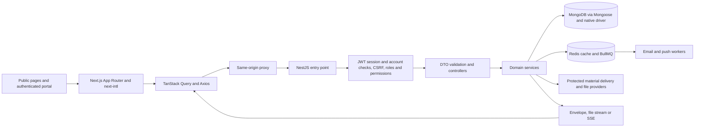

# Student Portal Production Architecture Audit

21 November 2026

Attendance access control and Redis certificate validation are the highest-priority fixes. MongoDB availability and the amount of work triggered by each dashboard visit are the main scale risks. The 14 November production capture recorded MongoDB ping failures and substantial time in session and account checks. That capture supports prioritizing the database path. It predates some current optimizations, so its route timings are historical. This audit uses the current checkout, local verification, and the repository’s historical telemetry. Production query plans, deployed infrastructure configuration, and 10× throughput still need measurement. [Historical production review](POST_DEPLOY_REVIEW_2026-11-14.md) · [Subsequent implementation](POST_DEPLOY_IMPLEMENTATION_2026-11-14.md)

## Architecture and request flow



1. A browser loads `/ar` or `/en`. Next normalizes locale and canonical URLs. The locale layout supplies translations, theme, query context and session context. Admin and student layouts wait for authenticated user state before mounting protected data consumers. Zustand holds UI state such as sidebar visibility. TanStack Query owns remote state, with a default 30-second stale time, five-minute garbage-collection time and bounded retry rules. Sign-out clears cached queries. [Locale layout](../../apps/web/src/app/%5Blocale%5D/layout.tsx) · [Auth provider](../../apps/web/src/providers/auth-provider.tsx) · [Query defaults](../../apps/web/src/lib/query-client.tsx)
2. Axios sends the cookie-based request and attaches CSRF data where required. Production Nginx proxies `/api` to NestJS. A Next rewrite is also available when the web and API are hosted separately. Nest sets trusted proxy ranges and CORS policy. Middleware tracks request metrics, parses cookies and bodies, and applies public rate limits. The JWT strategy verifies the token and reads the current session and account in parallel. CSRF, first-login, role, permission, origin, authenticated rate-limit and recent-auth guards then enforce applicable policies. The global validation pipe transforms and whitelists DTO inputs. [Axios client](../../apps/web/src/lib/api.ts) · [Nginx](../../deploy/nginx/portal.conf) · [API bootstrap](../../apps/api/src/main.ts) · [Guards](../../apps/api/src/modules/auth/auth.module.ts) · [JWT strategy](../../apps/api/src/modules/auth/strategies/jwt.strategy.ts)
3. A controller delegates to a domain service, which constructs typed filters, reads or writes MongoDB, and may use Redis, queues or a file provider. Most successful JSON responses use `{ success, data, timestamp }`. Axios unwraps the HTTP body and the typed API helpers extract its `data`. The exception filter preserves the API error format. File responses and attendance SSE use their dedicated response paths. [Module graph](../../apps/api/src/app.module.ts) · [Database](../../apps/api/src/database/database.module.ts) · [API client](../../apps/web/src/lib/api-client.ts) · [Response interceptor](../../apps/api/src/common/interceptors/transform.interceptor.ts) · [Exception filter](../../apps/api/src/common/filters/all-exceptions.filter.ts)
4. Attendance illustrates both normal reads and real-time writes. The staff/admin list calls `GET /api/attendance/sessions`. The service scopes sessions, pages results, and aggregates attendance counts from `attendance_records`. An ended course row opens the session records endpoint. An active row fetches a rotating QR from the same session, opens the presenter, and subscribes to its live stream. Student check-in validates the QR, session and enrollment, writes the attendance record, publishes a live event and returns the check-in result. The compound unique index on session and student protects against duplicate records. [Attendance UI](../../apps/web/src/features/attendance/components/admin-attendance-overview.tsx) · [Attendance API](../../apps/api/src/modules/attendance/attendance.controller.ts) · [Session service](../../apps/api/src/modules/attendance/services/attendance-session.service.ts) · [Check-in service](../../apps/api/src/modules/attendance/services/attendance-checkin.service.ts)

## Findings by severity

| Severity | Finding and evidence | Change |
| --- | --- | --- |
| Critical | **Attendance session authorization.** Session lists and exports already scope staff to sessions they created. Several direct session reads and manual corrections only checked staff/admin role. The live event includes student and device data. | **Implemented.** Apply the existing session scope to detail, QR, live feed, records, manual mark and direct record correction. Staff access to a session outside that scope returns `404`. Admin access and successful response shapes are preserved. Validate the live-stream ObjectId. Apply the common trusted-proxy IP resolver to student check-in. Review the independent course summary and permission matrix with the established staff policy. [Controller](../../apps/api/src/modules/attendance/attendance.controller.ts) · [Scope](../../apps/api/src/modules/attendance/services/attendance-query.ts) · [Guard](../../apps/api/src/modules/attendance/guards/attendance-session-access.guard.ts) |
| Critical | **Redis peer verification was disabled.** The Redis cache client used encryption without verifying the peer certificate on TLS connections. This affects deployments configured with encrypted Redis endpoints. | **Implemented.** Enable certificate and hostname verification through Node’s TLS trust chain. Validate any private CA in staging before rollout. [Redis cache](../../apps/api/src/core/cache/redis-cache.store.ts) |
| Important | **A cached session could admit a check-in after closure.** The final write checked whether the parent session existed, while the earlier open-state check could use a cached copy. | **Implemented.** Require an open, unexpired session in the record-write transaction for student check-ins. Keep staff corrections available for ended sessions. On standalone MongoDB, the fallback checks current state immediately before inserting. Use a replica set to serialize the parent and record writes with session closure. [Attendance write](../../apps/api/src/modules/attendance/services/attendance-record-write.ts) |
| Important | **Authenticated requests amplify MongoDB degradation.** Session and account lookups occur on each protected request. The 14 November capture observed timeouts and connection stalls in this path. | Correlate command time, checkout delay, pool clears and network locality. Keep immediate account, permission and session revocation semantics. Reduce background requests and use existing request-scoped read reuse. Budget connection pools across API and workers before scaling replicas. [Strategy](../../apps/api/src/modules/auth/strategies/jwt.strategy.ts) · [Mongo diagnostics](../../apps/api/src/database/mongodb-driver-metrics.ts) |
| Important | **Attendance live channels survived their last viewer.** Local subjects were removed by explicit session closure, while disconnect alone left the channel entry. Independent API replicas also have independent subjects. | **Implemented locally.** Tie channel lifetime to active subscriptions. For multi-replica rollout, add Redis pub/sub with reconnect reconciliation through the canonical records API. Test graceful shutdown and verify that proxy buffering and timeouts suit SSE. [Realtime service](../../apps/api/src/modules/attendance/services/attendance-realtime.service.ts) |
| Important | **Bulk notification mutations transferred an unbounded set of IDs before writing.** Concurrent calls could select the same rows and append duplicate state entries. Per-user read and hidden state also grows inside each broadcast. | **Implemented for bulk paths.** Update matching documents directly with targeting and current state in the update predicate. Keep `{ modifiedCount }`. Next, migrate per-user state with dual writes, reconciliation and parity checks before cutover. [Notification service](../../apps/api/src/modules/notifications/notifications.service.ts) · [Schema](../../apps/api/src/modules/notifications/schemas/notification.schema.ts) |
| Important | **Several whole-dataset reads and workbook operations retain data in memory.** Attendance history, Analytics and eligible enrollment inputs can grow with cohort size. Some XLSX paths inflate archives and use complete workbook buffers. | Add projections for audited callers, push grouping to MongoDB where it reduces returned data, and process maintenance work in bounded batches. Keep existing XLSX content, validation and downloads. Measure inflated bytes, live heap and event-loop lag with representative files. [Attendance report](../../apps/api/src/modules/attendance/services/attendance-report.service.ts) · [Analytics](../../apps/api/src/modules/analytics/services/analytics-query.service.ts) · [Spreadsheet parser](../../apps/api/src/modules/uploads/uploads.service.ts) |
| Important | **Attendance export performs one record query per session.** The export closes its cursors and bounds in-memory data, while MongoDB round trips still grow with the number of sessions. The course summary also downloads all matching records to count them in Node. | For export, fetch record batches by page of session IDs and keep the workbook’s session/record ordering. For the summary, group by `sessionId` in MongoDB and retain zero-record sessions. Keep the attendance export snapshot behavior and check heap, query count and workbook parity together. [Attendance report](../../apps/api/src/modules/attendance/services/attendance-report.service.ts) |
| Important | **Several expensive operations compete for API resources.** Queue fallback can await delivery inline. Full workbook regeneration, schedule imports and live dashboards compete with interactive requests. The one-off Redis probe lacked socket cleanup on a failed command. | **Probe cleanup implemented.** Bound connection and command time and close in `finally`. Move provider delivery and CPU-heavy work to dedicated workers when API parity permits. Use admission control and monitor queue age. Maintain stable delivery IDs and reconcile failures. [Queue service](../../apps/api/src/core/queues/queue.service.ts) |
| Important | **Cache misses can cascade, and L1 caches invalidate only within a process.** `CacheService.wrap()` independently invokes each factory on miss. Redis invalidation leaves L1 entries in other replicas until expiration. | Coalesce misses by complete cache key. Use Redis-only or versioned keys for data requiring cross-replica invalidation. Use L1 for bounded-staleness reads. Keep authorization checks authoritative and preserve actor scope on every cache lookup. [Cache service](../../apps/api/src/core/cache/cache.service.ts) |
| Important | **Cache clearing can affect other Redis consumers.** `RedisCacheStore.clear()` issues `FLUSHDB`. The audit found no production caller in API source, but a caller added later could clear jobs if cache and queue share a database. | Use a dedicated cache key namespace with scoped invalidation. Isolate durable queues from cache eviction and administrative commands. [Redis store](../../apps/api/src/core/cache/redis-cache.store.ts) · [Queue configuration](../../apps/api/src/core/queues/queue.service.ts) |
| Important | **Validation and sensitive data boundaries vary.** The heartbeat body is an inline TypeScript type and the notification bulk-delete array is a bare extracted body field. Many queries use escaped literal regex. Global DTO validation applies when runtime DTO metadata exists. | Convert these entry points to class DTOs with compatible shapes and length/array rules. Build Mongo filters from explicit scalars. Compare production CORS origins, proxy trust, secrets source and AI provider settings against configuration. Repo-origin checks use an exact credentialed allowlist. The tracked Kubernetes credential examples contain dummy values. This review establishes no live credential exposure or confirmed NoSQL operator injection. [Heartbeat](../../apps/api/src/modules/auth/auth.controller.ts) · [Notification controller](../../apps/api/src/modules/notifications/notifications.controller.ts) · [CORS](../../apps/api/src/config/cors-origins.ts) |
| Important | **Authenticated pages fan out while public pages share a broad provider tree.** The student dashboard issues multiple independent requests. Locale packs and the material-upload provider sit high in the tree. Several heavy editors and presenter components already load dynamically. | Preserve interactive client islands. Keep public institutional rendering static where route output allows it. Split translation namespaces and scope portal providers after checking route behavior. Reuse matching keys and fetch queries only when their panels need them. Measure per-route client JS, hydration time, LCP and INP before moving data to the server. [Student dashboard](../../apps/web/src/app/%5Blocale%5D/dashboard/page.tsx) · [Locale layout](../../apps/web/src/app/%5Blocale%5D/layout.tsx) · [Next.js Server and Client Components](https://nextjs.org/docs/app/getting-started/server-and-client-components) |
| Minor | **Unrelated sidebar changes triggered entire store subscriptions.** Both protected layouts and several sidebar/header consumers subscribed to all Zustand values. | **Implemented.** Use field selectors for the values and actions each component consumes. No measurable rendering gain is claimed without a profiler trace. [UI store](../../apps/web/src/store/ui-store.ts) · [Admin layout](../../apps/web/src/app/%5Blocale%5D/admin/layout.tsx) · [Student layout](../../apps/web/src/app/%5Blocale%5D/dashboard/layout.tsx) |
| Minor | **Immutable image caching and bundle cost need asset-level review.** Institutional pages already use `next/image`. `/images`, fonts and several fixed-name icons have one-year immutable caching, while large client route modules still merit analysis. | Fingerprint files that will be replaced, retain `sizes` for responsive imagery and prioritize only above-the-fold images. Use installed Next’s bundle analyzer on portal home, quizzes, Control and public landing pages. [Next config](../../apps/web/next.config.ts) · [Next.js package bundling](https://nextjs.org/docs/app/guides/package-bundling) |

A prior local route-bundle report places admin quizzes at 2.21 MB, admin home at 2.11 MB, attendance at 1.82 MB and localized public home at 1.01 MB of first-load JavaScript before compression. These figures include shared chunks and describe a local build artifact. Capture compressed cold transfers and parse/execute cost during the next build comparison. Start by tracing the persistent provider tree and the admin quiz and dashboard import graphs.

The verified production build marks `/` static, while the localized public home, about, academics, contact and news are dynamic. These public pages are the first candidates for prerendering after confirming that their data and locale selection are request-independent. Generate locale parameters for eligible routes and pass the locale into translation lookups. Keep authenticated and session-specific content private, including attendance, results and quiz state. [next-intl static rendering setup](https://next-intl.dev/docs/routing/setup#static-rendering)

Some query keys already match across routes, including student profile, attendance history, live attendance, exams and online quizzes. Keep that reuse and consolidate their query functions and freshness settings. In the admin dashboard, reuse the typed complaint statistics API and its query key where the consuming panels need the same response and freshness. The existing complaint chart’s bounded sample serves a different calculation from the overall statistics. [Student home](../../apps/web/src/app/%5Blocale%5D/dashboard/page.tsx) · [Admin home](../../apps/web/src/app/%5Blocale%5D/admin/page.tsx) · [Complaint API](../../apps/web/src/features/complaints/api.ts)

The QR scanner already stops media tracks, the presenter clears timers and closes its browser event stream, and attendance export closes its MongoDB cursors in `finally`. Grade release and complaint email also have shutdown cleanup. Profile peak heap and release behavior with camera navigation, abandoned exports, socket reconnects and worker shutdown. These checks distinguish retained references from memory held while a large request is still active. [QR scanner](../../apps/web/src/features/attendance/components/student-qr-scanner-dialog.tsx) · [Presenter](../../apps/web/src/features/attendance/components/active-session-presenter.tsx) · [Attendance report](../../apps/api/src/modules/attendance/services/attendance-report.service.ts) · [Grades](../../apps/api/src/modules/grades/grades.service.ts) · [Complaint worker](../../apps/api/src/modules/complaints/complaint-reply-email.service.ts)

## Feature and module review

| Area | UI → API → persistence or provider → response | Scoped follow-up |
| --- | --- | --- |
| Institutional website | Localized home, news, events, activities, about, academics, gallery, downloads, contact and portal landing → Next pages, repository content and assets → HTML/RSC. | Preserve static eligibility, responsive assets and SEO. Isolate marketing providers from portal upload/session code when routes permit. [App routes](../../apps/web/src/app) · [Institutional components](../../apps/web/src/components/institutional) |
| Auth, users and security | Student/admin login, passkeys, recovery and session management → auth controllers → auth/login/password/session services and `UsersService` → users, session and challenge collections, transactional email → cookies, profile or status. | Preserve revocation, recent-auth and first-login checks. Track password worker queue time and narrow heartbeat DTO. Use request-scoped identity reuse. [Auth](../../apps/api/src/modules/auth) · [Users](../../apps/api/src/modules/users) |
| Students, profiles and tuition | Student profile and staff roster/tuition/import-export UI → students controllers → `StudentsService` and `StudentQueryService` → profiles, users and tuition audit logs → scoped views, counts or workbooks. | Consolidate search normalization and keep Arabic and identifier matching. Prefer established summary projections and cursor-based internal exports. Batch tuition updates and keep audit events consistent with writes. [Students](../../apps/api/src/modules/students) |
| Staff management | Staff directory, permissions and assignments → staff management controllers → staff and assignment services → users, courses and staff audit logs → paginated lists and scoped detail. | Preserve permission differences by staff type. Measure assignment hydration and audit count separately. Take advantage of existing batched course/staff hydration. [Staff management](../../apps/api/src/modules/staff-management) |
| Admissions | Public access, requests and status plus admin admissions/import UI → public and admin controllers → workflow and spreadsheet services → admission periods, invitations, requests, groups and import records → masked public status or scoped admin data. | Retain shared public rate limiting, per-invitation protections, receipts and transactional confirmation. Stream large imports and reports with exact rule parity. [Admissions](../../apps/api/src/modules/admissions) · [Admission rate limits](../../apps/api/src/common/rate-limit/rate-limit.rules.ts) |
| Student codes | Code audit, allocation and corrections → student codes controller → registry/store, allocation and admin services → registry/users/profiles under transaction where required → audit or command result. | Support point lookups for single-code corrections and batch or precompute namespace-wide audit snapshots. Preserve aliases, uniqueness and mapping invariants. [Student codes](../../apps/api/src/modules/student-codes) |
| Courses, enrollment and materials | Course admin, student syllabi and enrollment → course/enrollment controllers → course and enrollment logic plus material storage → courses, registrations and protected file storage → JSON metadata or streamed download. | Keep permission and protected download checks. Measure repeated course hydration and use current projections. Verify shared storage visibility before multi-replica rollout. [Courses](../../apps/api/src/modules/courses) · [Material storage](../../apps/api/src/modules/material-storage) · [Storage runbook](../../deploy/materials/README.md) |
| Course schedules | Staff/student timetable and schedule imports → schedule controller/service → schedules plus course/staff lookups → sorted timetable, import result or client export. | Replace repeated per-row array lookups with Maps keyed by normalized course and staff identifiers, carrying primary/fallback precedence. Narrow import projections. Keep complete timetable exports. [Course schedules](../../apps/api/src/modules/course-schedules) |
| Exam schedules and place | Student date/room views and admin schedule UI → exam schedule controller/service → schedules plus assignments/profile context and image storage → student assignment or published/admin list. | Reuse authorized term/cohort cache data, precompute normalized lookup fields and preserve seat ranges and historical fallback. Cache images by versioned URL. [Exam schedules](../../apps/api/src/modules/exam-schedules) |
| Registrations and GPA | Student registration and admin roster/terms/rules UI → registrations controller → registration term, GPA, academic-profile and registration services → registration, grade and course data → eligibility, records and command results. | Preserve prerequisite logic and term limits. Avoid recalculating the same derived grade and course context for every consumer or row. Bound large auto-assignment jobs and measure indexed registration lookups first. [Registrations](../../apps/api/src/modules/registrations) |
| Academic advising | Student plan and admin case/graph UI → student/admin advising controllers → advising query, plan and rules logic → cases, plans, graph, notes, recommendations and academic data → scoped case/plan views. | Reuse batched inputs, keep advisor and note-visibility filters in data access, and invalidate cached plans on relevant rule or academic changes. Defer graph code until its screen is used. [Advising API](../../apps/api/src/modules/academic-advising) · [Advising UI](../../apps/web/src/features/academic-advising) |
| Grades and historical publication | Results, publishing and historical-grade UI → grades/historical controllers → release and publication services → grades, course quizzes, academic profiles and release pointers → published results or batch status. | Keep release visibility atomic. Avoid redundant full result polling outside release windows where existing freshness allows it. Precompute reusable summaries and use bounded idempotent release work. [Grades](../../apps/api/src/modules/grades) |
| Control | Sheet registry and editor → control controller → access, workbook, grades, sheets, checkpoints, attempts and report services → control sheets/imports, audit logs and grade/roster data → workbook, validation or release view. | Split editor rendering cost, virtualize only with keyboard/edit parity, and preserve upload and publish boundaries. Measure existing `$in` and aggregation shapes before index changes. [Control API](../../apps/api/src/modules/control) · [Control UI](../../apps/web/src/features/control) |
| Quizzes | Dashboard and quiz arena or editor → quizzes controller → quiz, attempt and submission paths → quiz/attempt/submission documents → sanitized quiz, saved draft or grade feedback. | Preserve shared dashboard/quiz cache keys, server deadlines, attempt ownership and release rules. Profile question payloads, draft writes, timer render scope and browser lifecycle handlers. [Quizzes API](../../apps/api/src/modules/quizzes) · [Student quiz screen](../../apps/web/src/app/%5Blocale%5D/dashboard/quizzes/page.tsx) |
| Attendance | Staff overview/presenter and student check-in/history → attendance controller → session, check-in, report, token and realtime services → sessions, attendance, attendance records and registrations → QR, record, dashboard aggregate or SSE. | Verify the ownership rule with staff/admin acceptance cases. Push report grouping to MongoDB and remove repeated history scans where contract parity holds. Measure polling alongside SSE before changing freshness. [Attendance](../../apps/api/src/modules/attendance) |
| Academic email | Student lookup and admin management → academic emails controller/service → academic email documents and student mappings → state or paginated list. | Index status-filtered ordering after explain. Retain exact identity lookups and avoid credential fields in projections. [Academic emails](../../apps/api/src/modules/academic-emails) |
| Complaints and settings | Public inquiry and student/admin ticket views → complaints controller/service → complaints, settings and outbox → scoped summary/detail, attachment or message state. | Retain summary queries now used by dashboard/profile callers. Separate newly stored image bytes from ticket documents through a dual-read migration that preserves authorized display and old references. Keep exact dashboard calculations over their existing sample. [Complaints](../../apps/api/src/modules/complaints) |
| Notifications | Student header/feed and admin broadcaster → notifications controller/service → Mongo feed documents, Redis/BullMQ and Firebase → state, history or delivery result. | Migrate broadcast user state out of arrays. Stream token resolution and put bounded recipient batches or notification IDs into jobs. Preserve per-user receipts and published history. [Notifications](../../apps/api/src/modules/notifications) |
| Operational email | Admin email UI and auth/complaint side effects → email controller/service and complaint outbox → logs plus BullMQ/Resend or SMTP → delivery acknowledgement and status. | Track duplicate or delayed sends and provider failures. Make delivery idempotent and avoid retry/fallback sending twice after uncertain enqueue. Verify socket closure and commands against a local SMTP test fixture. [Emails](../../apps/api/src/modules/emails) · [Complaint worker](../../apps/api/src/modules/complaints/complaint-reply-email.service.ts) |
| FAQs | FAQ retrieval and chat → FAQ controller/service → active FAQ collection and local relevance scoring → FAQ page or answer. | Cache the relatively small active corpus with save/update/delete invalidation. Preserve Arabic relevance and ordering. Verify authenticated route boundaries from the actual caller policy. [FAQs](../../apps/api/src/modules/faqs) |
| AI chat, advisor and audit | Student chat and admin settings/advisor/audit screens → AI controllers → retrieval, context and AI services → chats, settings, usage, FAQ/course data and configured AI provider → shaped answer or audit result. | Keep actor scope, minimize student context before provider calls, bound provider time/cost, and review chat retention and staff visibility. Cache approved FAQ/course context separately from private student data. [AI](../../apps/api/src/modules/ai) |
| Uploads | Admin bulk upload, templates and wipe tooling → upload controller → importer dispatch and workbook parsing → target domain collections → previews, per-row outcomes and templates. | Keep domain importers. Consolidate archive preflight, per-entry and total inflated-size limits, row limits and worker memory budgets. Retain existing partial-success and validation semantics. [Uploads](../../apps/api/src/modules/uploads) |
| Analytics | Admin/staff dashboard widgets and exports → analytics controller → query and workbook services → student, course, registration, grade and quiz data → summaries or XLSX. | Keep role/course scope. Measure and incrementally materialize broad cohort reports. Stream exports with the same column order, workbook names and snapshot semantics. [Analytics](../../apps/api/src/modules/analytics) |
| Health and metrics | Operator dashboard, scrape and probes → health/metrics controllers → Mongo readiness and aggregated telemetry → JSON or Prometheus exposition. | Retain low-cardinality route labels and separate pool wait, command time, and HTTP latency. Run liveness independently of dependency readiness when configuring replicas, to avoid restarting healthy processes during a database outage. [Health](../../apps/api/src/health.controller.ts) · [Metrics](../../apps/api/src/core/metrics) |

## MongoDB index and query plan

Check `getIndexes()` in the intended environment first. Schema declarations describe desired indexes. The Nest connection explicitly disables automatic index creation in tests, and schema declarations alone cannot establish which production indexes exist. Test each candidate independently on representative distributions using `explain('executionStats')`, including common filters, optional filter branches and deep pages. Compare keys and documents examined, blocking sorts, `nReturned`, and p95 latency. Materialize only candidates that outperform the current plan without unacceptable write or storage cost. Keep exact public pagination, sort and count semantics. [DB settings](../../apps/api/src/database/database.module.ts) · [Existing index plan](MONGODB_INDEX_PLAN.md) · [MongoDB equality, sort and range guideline](https://www.mongodb.com/docs/v8.0/tutorial/equality-sort-range-guideline/)

| Collection and query | Index candidate or action |
| --- | --- |
| `attendance_sessions`, staff overview | Test `{ createdBy: 1, startsAt: -1, _id: -1 }` against the existing admin sort and staff `createdAt` index. Test `{ createdBy: 1, status: 1, expiresAt: 1 }` for the active staff count only if its pool/query share warrants it. |
| `attendance_records`, session/status and attendee ordering | Keep unique `{ sessionId: 1, studentId: 1 }` and the student history index. Compare `{ sessionId: 1, status: 1, checkedInAt: -1 }` on a frequently filtered record list. Existing `{ sessionId: 1, checkedInAt: 1 }` can be traversed in reverse for the unfiltered case. Aggregate per-session counts in one grouped query and validate totals for unknown and absent statuses. |
| `complaints`, recent and filtered staff tickets | Keep `{ createdAt: -1, _id: -1 }`. If assigned staff and status dominate, test `{ assignedStaffId: 1, status: 1, createdAt: -1, _id: -1 }`. For status-only paging compare `{ status: 1, createdAt: -1, _id: -1 }` against the existing shorter compound index. |
| `academic_emails`, sorted roster | Check `{ studentCode: 1 }` for the unfiltered list and `{ status: 1, studentCode: 1 }` for status-filtered ordering. Preserve the unique student link and the existing text index until usage is established. |
| `faqs`, active list | Test `{ isActive: 1, sortOrder: 1, createdAt: -1 }`. Keep the text index while measuring existing FAQ and retrieval calls. Weighted text or Atlas Search must match the acceptance corpus before replacing literal search. |
| `notifications`, feed and future user state | Keep the target and date compounds. `$ne` on embedded per-user state and exact counts still require work. After schema migration use a unique state identity `{ userId: 1, notificationId: 1 }` and query by the user before looking up point state. Backfill once, compare per-user read/hidden feed results and only then retire old arrays. |
| `email_logs`, filtered delivery history | Test `{ status: 1, createdAt: -1 }` or `{ event: 1, createdAt: -1 }` for the dominant filter. Start with one. Account for writes and compare with the existing single-field indexes. |
| `exam_schedules`, published selection | Compare the existing published-oriented compound to `{ isPublished: 1, createdAt: -1 }` for the exact `isPublished` sorted query. Course schedule sorting includes application hydration and needs projections and measurement before adding an index solely to mirror that sort. |
| Profiles, courses, grades, registrations, quizzes, auth sessions and admission codes | Retain existing unique, TTL, term and relationship indexes. Explain point lookups and each hot roster, release, enrollment, and history filter first. Matching indexes matter more than adding a variant for every optional filter. |

Set projections independently of `.lean()`. Lean avoids Mongoose document hydration, while projection controls returned data. Preserve getters, virtuals, redaction, bilingual fallbacks and response fields before moving a query to lean. Keep literal substring search semantics until a replacement passes Arabic and English fixtures. A case-insensitive collation index cannot accelerate the current case-insensitive regex merely by matching the field. Use existing limits on numbered lists, introduce cursor pagination only as an additive path when authorized, and keep keyset/range cursors for internal batch work. Exact counts should remain exact wherever they are part of the existing response. [MongoDB case-insensitive index behavior](https://www.mongodb.com/docs/manual/core/index-case-insensitive/) · [MongoDB sort indexes](https://www.mongodb.com/docs/manual/tutorial/sort-results-with-indexes/)

## Implemented changes and rationale

The attendance guard applies the scope already used by session lists. It validates the route ID, resolves a direct record to its parent session when needed, and checks ownership before a handler reads sensitive data or changes attendance. Staff queries use MongoDB’s `_id` lookup with the existing creator predicate. [Guard](../../apps/api/src/modules/attendance/guards/attendance-session-access.guard.ts) · [Coverage](../../apps/api/src/modules/attendance/guards/attendance-session-access.guard.spec.ts)

```ts
await this.sessions.exists({
  _id: sessionId,
  ...attendanceSessionScope(user),
});
```

The attendance stream now allocates channels on subscription and releases them when the last subscription ends. Close events still arrive before completion. The course button opens the existing record dialog or QR presenter, including a fallback to records when the session closes between page load and the QR request. [Stream implementation](../../apps/api/src/modules/attendance/services/attendance-realtime.service.ts) · [Course button](../../apps/web/src/features/attendance/components/admin-attendance-overview.tsx) · [Browser coverage](../../apps/web/tests/portal-regressions.browser.mjs)

Moving the unread predicate into `updateMany` avoids copying notification IDs into Node and makes a repeated request skip records already marked read. The hidden-state mutation uses the same approach and still returns MongoDB’s modified count. The single-item mutations and their payloads remain separate. [Notification implementation](../../apps/api/src/modules/notifications/notifications.service.ts) · [Coverage](../../apps/api/src/modules/notifications/notification-request-read.spec.ts)

```ts
const result = await this.notificationModel.updateMany(
  { ...filter, 'readBy.userId': { $ne: userObjectId } },
  { $push: { readBy: { userId: userObjectId, readAt: new Date() } } },
);
return { modifiedCount: result.modifiedCount };
```

The Redis cache verifies TLS certificates. The queue health probe applies its timeouts as Redis connection options and disconnects after either a successful response or failure. Scope sidebar subscriptions to each consumer’s fields to avoid rerendering a protected layout when unrelated mobile navigation state changes. [Redis cache](../../apps/api/src/core/cache/redis-cache.store.ts) · [Queue probe](../../apps/api/src/core/queues/queue.service.ts) · [Sidebar selectors](../../apps/web/src/components/admin/sidebar.tsx)

## Deployment and capacity plan for 10× traffic

Production runs on the VPS. See the [VPS architecture review](vps-architecture-review-2026-11-21.md) for the active deployment design, remaining serverless assumptions, and read-only host checks.

1. **Measure peaks and failures.** Capture the mix of public traffic, student logins, attendance start/check-in, quiz start/draft/submit, grade release, bulk notifications and exports. Replay at 1×, 2×, 5× and 10× in staging using synthetic cohorts and the same deployments and indexes. Add MongoDB and Redis failure drills. Compare HTTP p50/p95/p99, payload size and error rates with pool wait and command time, Node RSS/heap/external buffers, event-loop delay, job age and retries, browser LCP/INP and duplicate API calls. Record the test data size and load when declaring a capacity result. Use [existing stress and DB scripts](../../scripts) with an explicitly isolated test target.
2. **Reduce read amplification.** Cap independent dashboard fan-out and dedupe matching requests through typed TanStack keys. Use Redis for course catalogs, published schedules, routing configuration, FAQ corpus and expensive summaries, with bounded TTL, jitter and actor/role/term scopes where relevant. Coalesce misses and exercise invalidation across replicas. Keep live quiz/attendance windows, revocations and release policy on authoritative paths.
3. **Isolate asynchronous and CPU work.** Use the existing BullMQ integration for durable jobs. Separate API producer and worker bootstrap roles before deployment. Tune worker concurrency by job class, add stable job identities and persist outcome/outbox state for important external effects. Monitor oldest job, depth, failed attempts and recovery time. Set cache and queue memory policies independently. For endpoints that currently return complete XLSX files synchronously, first improve resource use under the existing contract and introduce queued delivery only as an additive workflow. [BullMQ production guidance](https://docs.bullmq.io/guide/going-to-production)
4. **Scale horizontally behind health checks when the VPS measurements justify it.** Move shared attendance events out of process and use storage visible to every API replica for material downloads. Separate liveness from dependency readiness, drain sockets and jobs during termination, and budget MongoDB connections for the maximum API and worker replica counts together. Use latency, concurrency and queue age alongside host resource metrics. Pin deployed image digests and test rollback of both server and cache changes. [VPS Compose](../../docker-compose.prod.yml) · [VPS scaling recommendations](vps-architecture-review-2026-11-21.md#recommended-architecture-for-this-vps)
5. **Release changes in small steps.** Recheck authorization before load tuning. Run contract tests for valid role flows and rejected cross-scope requests. Compare API envelopes, dates, order, XLSX headers, totals, Arabic/English search, quiz deadlines and grade visibility. Deploy indexes individually after explain evidence, watch workload and query-plan shifts, and keep rollback instructions and schema migration checkpoints.

Use a latency budget for each workflow. Interactive list requests should have a smaller budget than exports, and quiz submission and attendance check-in need separate burst and correctness measurements. Align query deadlines with API and browser timeouts, measure aborted requests that continue in MongoDB, and use existing correlation IDs to identify which stage consumed the budget. Establish numerical targets from the measured 1× baseline before judging the 10× run.

## Local verification

Workspace lint and TypeScript checking passed. The NestJS and Next.js production builds passed, along with root-route manifest, deployment runtime configuration and local production redirect checks. The API passed 1,227 unit tests and 42 end-to-end tests using local MongoDB. The web attendance suite passed 26 tests. Chromium verified course-name access for closed, expired, active and just-closed sessions, including the rendered QR and keyboard activation. A local MongoDB check exercised QR and manual attendance writes in the standalone fallback. A local Redis protocol fixture verified probe socket cleanup after both successful and timed-out responses. Production Redis certificate trust, production query plans and replayed capacity remain deployment checks.
