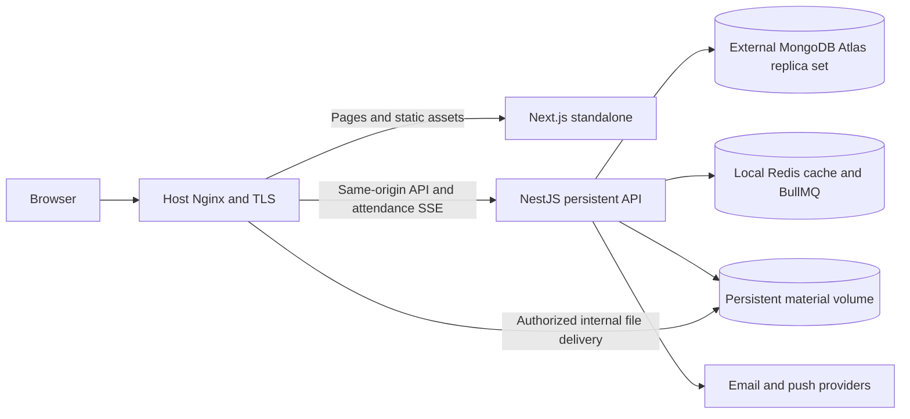

# Student Portal VPS Architecture Review

21 November 2026

The current deployment design uses long-running Next.js and NestJS containers behind host Nginx. In this topology, the MongoDB serverless pool cap and Vercel execution limits are inactive unless old runtime flags were copied into the API container. Some settings and limits from the migration can still affect the VPS. Verify the effective worker flags, the MongoDB path from the VPS to Atlas, and attendance stream behavior before increasing capacity. This review uses the repository and historical telemetry. Live host configuration and utilization are unverified. [VPS Compose](../../docker-compose.prod.yml) · [API Dockerfile](../../Dockerfile.api) · [Web Dockerfile](../../Dockerfile.web) · [VPS deployment workflow](../../.github/workflows/ci-cd.yml)

## Current production topology



The Web and API are bound to host loopback ports `3000` and `4000`. Redis is on the Compose network without a published host port. Nginx routes `/api` directly to NestJS, and Next’s Docker build uses the relative browser base `/api`. Protected course materials use a persistent volume and can be delivered by an internal Nginx redirect after API authorization. The checked-in `portal.conf` is a fresh-host template. Inspect the effective TLS site and included snippets when diagnosing production behavior. [VPS Compose](../../docker-compose.prod.yml) · [Nginx template](../../deploy/nginx/portal.conf) · [Materials deployment notes](../../deploy/materials/README.md) · [Next.js self-hosting](https://nextjs.org/docs/app/guides/self-hosting)

## Serverless carryovers and VPS bottlenecks

| Priority | Evidence and impact | VPS recommendation |
| --- | --- | --- |
| 1 | **Queue workers may still be disabled after cutover.** The VPS env template sets `QUEUE_WORKERS_ENABLED=false`. The queue service uses this flag when deciding whether to create the queue connection. With the flag off, queue-backed email and Firebase push use their inline fallback when called. The same flag also gates the periodic Control release reconciliation. This can add provider latency to requests and delay retry processing. The complaint email dispatcher is gated separately. | Read the effective flag and startup queue status. If the VPS is the only intended worker and Redis is healthy, schedule a reviewed configuration change to enable workers. Confirm queue consumption, delayed releases and a controlled notification after restart. Keep `RUN_STARTUP_TASKS=false` unless index maintenance and academic email reconciliation are planned. `QUEUE_REQUIRED=true` validates configuration in the queue path, while enqueue errors still use inline fallback. [Production env template](../../.env.prod.example) · [Queue service](../../apps/api/src/core/queues/queue.service.ts) · [Grades](../../apps/api/src/modules/grades/grades.service.ts) · [Complaint dispatcher](../../apps/api/src/modules/complaints/complaint-reply-email.service.ts) |
| 1 | **Atlas latency and pool pressure remain after a move to the VPS.** Production code normally uses minimum 5 and maximum 50 connections per pool, with a server selection timeout of 15 seconds and a socket timeout of 45 seconds. The cap of 1/10 and the shorter selection timeout apply only when `VERCEL` is truthy or `AWS_LAMBDA_FUNCTION_NAME` is set. The 14 November snapshot recorded database readiness failures and slow auth/session stages. It provides historical evidence, with the current bottleneck still to be measured. | Check both runtime marker flags and the effective pool values. Compare Atlas CPU/I/O, pool checkout wait, pool clears and command latency at the same time. High command latency points toward query work, Atlas load or its network path. High checkout wait with fast commands points toward concurrency or pool pressure. Size pools across API and worker processes together and check the VPS-to-Atlas network route and region before raising limits. [Runtime flags](../../apps/api/src/common/utils/runtime.util.ts) · [DB configuration](../../apps/api/src/database/database.module.ts) · [Historical telemetry](POST_DEPLOY_REVIEW_2026-11-14.md) · [MongoDB pool sizing](https://www.mongodb.com/docs/drivers/node/current/connect/connection-options/connection-pools/) |
| 2 | **Attendance keeps a serverless polling fallback.** Every open presenter refreshes records every 20 seconds even with working SSE. It also fetches rotating QR data separately. The installed Nest SSE implementation sends `X-Accel-Buffering: no`. The Nginx template times out the API connection after 90 seconds between upstream reads, and the attendance stream has no periodic server heartbeat. An idle stream can reconnect and repeat auth work. | In staging, open the presenter over the real HTTPS route. Verify that a normal attendance event arrives promptly and examine idle reconnects past 90 seconds. Retain polling until event delivery and reconnect reconciliation are proven. If necessary, scope a longer timeout and explicit buffering behavior to the SSE path only. Heartbeats and reducing polling are later application changes. [Presenter](../../apps/web/src/features/attendance/components/active-session-presenter.tsx) · [Realtime service](../../apps/api/src/modules/attendance/services/attendance-realtime.service.ts) · [Nginx template](../../deploy/nginx/portal.conf) · [Nginx upstream read timeout](https://nginx.org/en/docs/http/ngx_http_proxy_module.html#proxy_read_timeout) |
| 2 | **The old Vercel body cap still applies on selected API routes.** The 4 MiB shared upload constant is used for generic imports, course cover images and exam schedule images. JSON and form parsing has a separate 4 MB limit. The Nginx template defaults to 12 MiB. Protected course materials have separate 26 MiB request and 101 MiB syllabus request limits with their own API quotas. A request limit also includes multipart overhead and the sum of files. | Diagnose `413` by finding which layer rejected the request. Keep resource limits and align them per route only when a larger real workflow needs it. Any future application limit increase needs memory and concurrency tests with the matching Nginx value. [API upload constant](../../apps/api/src/common/constants/platform-limits.ts) · [API bootstrap](../../apps/api/src/main.ts) · [Material upload limits](../../packages/shared/src/constants/materials.ts) · [Nginx material locations](../../deploy/nginx/portal-materials-locations.conf) |
| 2 | **The cookie validator still classifies any HTTPS client URL as a Vercel-style deployment.** The template therefore uses `COOKIE_SAME_SITE=none` even when browser requests go to `/api` on the same host. The validator rejects `lax` with an HTTPS `CLIENT_URL`. The student password-reset link can also fall back to a legacy hosting domain when a usable portal origin is unavailable. | Keep the existing cookie setting while auditing. Confirm the deployed `CLIENT_URL`, `WEB_BASE_URL`, cookie scope, CSRF flow and generated links all match the public HTTPS portal. Correcting the validator or removing the legacy email fallback would be a separately reviewed code change. [Cookie validation](../../apps/api/src/config/env.validation.ts) · [Production env template](../../.env.prod.example) · [Student password reset](../../apps/api/src/modules/students/students.service.ts) |
| 2 | **The VPS auth metadata path can call an external service.** A cache miss for a public IP can trigger a geolocation request with a 1.5-second deadline. The Vercel header branch is conditional on `VERCEL=1`. Another network dependency can affect login latency depending on the request path and cache state. | Ensure the API trusts only actual proxy sources, with Nginx overwriting forwarded client IP. Measure geolocation time separately from bcrypt and Atlas. Preserve security session details. Evaluate the optional lookup setting only if its product impact and measured latency justify it. [Session metadata](../../apps/api/src/modules/auth/services/auth-session-metadata.service.ts) · [Nginx template](../../deploy/nginx/portal.conf) |
| 2 | **Builds, runtime services and Redis persistence share the VPS resources.** CI smoke-tests images, while the production deployment script may build the same images again on the VPS. Images can be expensive to build even when steady-state traffic fits. Runtime limits add up to 4 GiB across API, web and Redis, before host services, page cache, backups and builds. The API sets `UV_THREADPOOL_SIZE=64`, V8 old space to 1,536 MiB and semispace to 64 MiB within a 2 GiB container. These settings need measurement on the actual VPS. MongoDB pool size is independent from the libuv thread-pool setting. | Prefer promoting CI-built images by digest. Measure CPU steal, RSS, native and buffer memory, GC, disk writes and OOM/restart counts at peak. Compare concurrency and runtime tuning in staging before changing the values. [Deployment script](../../deploy/deploy.sh) · [VPS Compose](../../docker-compose.prod.yml) · [API Dockerfile](../../Dockerfile.api) · [Node.js runtime options](https://nodejs.org/api/cli.html#uv_threadpool_sizesize) |
| 2 | **Redis serves disposable cache and durable jobs together.** The Compose Redis uses AOF, `noeviction`, `384mb` Redis max memory and a `512m` container limit. Cache growth can exhaust capacity available for jobs. AOF rewrite and buffers also need memory and disk headroom. Docker rotates container output, while the persistent-runtime Winston logger separately writes files under the API container’s `logs` directory without a rotation policy in this logger. | Track Redis memory, write errors, AOF rewrite and queue age, and verify host disk growth from image layers, material files and both log paths. When cache and queue traffic compete, favor distinct instances with separate persistence and eviction policies. Keep `noeviction` for BullMQ. The queue currently checks `REDIS_URL` before `BULLMQ_REDIS_URL`, so a deployment with both needs configuration support before they can reliably point to independent instances. Standardize application log retention when a code change is approved. [VPS Compose](../../docker-compose.prod.yml) · [Queue service](../../apps/api/src/core/queues/queue.service.ts) · [API logger](../../apps/api/src/core/logger/logger.service.ts) · [BullMQ production guidance](https://docs.bullmq.io/guide/going-to-production) |

Vercel configuration files, the extra Vercel cache-control response header and the unused optional Next API rewrite add little overhead on this deployment. The Redis cache also retains a forced IPv4 setting and reconnect behavior originally written for serverless. These are low-priority on the current local Compose network and worth revisiting if Redis moves to a remote endpoint. Keep the same-origin path through Nginx. Verify that the browser is using `/api` and that its requests go directly through the intended host proxy. [API client](../../apps/web/src/lib/api.ts) · [Web Dockerfile](../../Dockerfile.web) · [Next configuration](../../apps/web/next.config.ts) · [API security headers](../../apps/api/src/common/middleware/security-headers.middleware.ts) · [Redis cache](../../apps/api/src/core/cache/redis-cache.store.ts)

## Recommended architecture for this VPS

1. **Run the existing single-host stack first.** Keep Nginx, standalone Next, NestJS and Redis under Compose with Atlas as the managed replica set. Preserve the API’s same-origin routes and protected storage. Use a near-region Atlas deployment where practical once network and data migration costs have been evaluated. Measure a peak period before choosing VPS size. Reserve capacity for Linux, Nginx, monitoring, Redis persistence and backups in addition to application containers. [Docker Compose production guidance](https://docs.docker.com/compose/how-tos/production/) · [Materials backup and restore](../../deploy/materials/README.md)
2. **Move build load off the host and isolate background work as needed.** Promote the tested API and Web images from CI to a registry, pin releases by digest, retain the last good images, and use the existing health/rollback workflow as the starting point. Run the current API and worker together until a separate worker entry point is designed. A duplicate full API container with `QUEUE_WORKERS_ENABLED=false` also disables queue producers today, so worker-only separation needs an application change. Isolate durable notifications and email first if provider latency or queue age affects requests. [Deploy workflow](../../.github/workflows/ci-cd.yml) · [Queue service](../../apps/api/src/core/queues/queue.service.ts)
3. **Scale the specific saturated layer.** Add CPU/RAM when the host is consistently saturated. Add a second API instance only after handling cross-process attendance events, queue worker multiplicity, total Atlas connections, cache invalidation and shared material visibility. The current fixed host port mappings and single-upstream assumptions require a deployment design before adding replicas. Use two release slots or separate hosts when deploy interruptions or single-host failure become unacceptable. A second process on the same VPS still shares the host’s failure domain. [Nginx upstreams](../../deploy/nginx/portal.conf) · [VPS Compose](../../docker-compose.prod.yml) · [Next.js multi-instance hosting](https://nextjs.org/docs/app/guides/self-hosting)
4. **Monitor and restore by layer.** Scrape the restricted Nest Prometheus endpoint, retain host and container metrics, and correlate Nginx upstream timings with API and Atlas metrics. Alert on sustained 5xx, checkout waits and pool clears, queue age, Redis write errors, disk/AOF growth, restarts and OOM events. Keep MongoDB and material backups off-host and verify restoration periodically. Distinguish a database readiness failure from a stopped process when deciding whether to restart a container. [Metrics endpoint](../../apps/api/src/core/metrics/metrics.controller.ts) · [Health endpoint](../../apps/api/src/health.controller.ts) · [MongoDB backup runbook](../backups/weekly-mongodb-backups.md)

## Read-only VPS checks

### تفعيل صور GitHub Actions بعد التحقق

- قارن إعدادات التشغيل الحالية من الأوامر أدناه وسجّل وقت الاستجابة، حالة Redis، وأعمار المهام قبل أي تغيير. لو العمال مقفولين، راجع الرسائل والمهام المؤجلة وتأكد أن أي VPS قديم توقف عن تشغيل العمال. بعدها يمكن تغيير `QUEUE_WORKERS_ENABLED=true` على الـVPS في نافذة صيانة وإعادة إنشاء حاوية API. سيب `RUN_STARTUP_TASKS=false` إلا لو فيه صيانة مخططة للبيانات. جرّب إرسال إشعار تجريبي وافحص طابور المهام بعد التشغيل.
- لمسار الصور الجاهزة، تأكد أن الـVPS يستخدم نفس معمارية CI، وعادةً Linux x86-64، وأن عليه `python3` وDocker Compose يدعم `config --format json`. من **GitHub → Settings → Secrets and variables → Actions → Variables** أضف `VPS_PREBUILT_IMAGES=true`. طابق `VPS_NEXT_PUBLIC_GOOGLE_CLIENT_ID` و`VPS_NEXT_PUBLIC_TURNSTILE_SITE_KEY` و`VPS_APP_VERSION` مع القيم العامة المستخدمة من `.env.prod`. الافتراضي للإصدار `1.0.0`. المفاتيح السرية تفضل على الـVPS.
- الـCI يختبر نفس الصور اللي هينقلها، والـVPS يقارن بصمة إعدادات الواجهة قبل تغيير الحاويات. اختلاف الإعدادات يوقف النشر. لإعادة مسار البناء المحلي، عطّل متغير `VPS_PREBUILT_IMAGES` وشغّل Workflow مرة ثانية. مسار rollback الحالي يستخدم الصور المحلية السابقة.

Run from the deployed project directory with an authorized shell. The commands report running services, pool defaults and flags, Redis memory and runtime status without printing connection strings or passwords. Compare the results at quiet time and during an attendance or results peak. [Docker container metrics](https://docs.docker.com/reference/cli/docker/container/stats)

```bash
dc=(docker compose --env-file .env.prod -f docker-compose.prod.yml)
"${dc[@]}" ps
docker stats --no-stream
free -h
df -h / /var/lib/docker /srv/student-portal/materials

api_id=$("${dc[@]}" ps -q api)
docker inspect --format 'image={{.Config.Image}} restarts={{.RestartCount}} oom={{.State.OOMKilled}} memory_cap={{.HostConfig.Memory}}' "$api_id"
"${dc[@]}" exec -T api node -e '
  const e = process.env;
  const truthy = v => ["1", "true", "yes", "on"].includes(String(v || "").trim().toLowerCase());
  const serverless = truthy(e.VERCEL) || Boolean(e.AWS_LAMBDA_FUNCTION_NAME);
  const workers = e.QUEUE_WORKERS_ENABLED?.trim() ? truthy(e.QUEUE_WORKERS_ENABLED) : !serverless;
  const min = Number(e.MONGODB_MIN_POOL_SIZE || (serverless ? 1 : 5));
  const max = Number(e.MONGODB_MAX_POOL_SIZE || (serverless ? 10 : 50));
  console.log({serverless, workers, queueRequired: e.QUEUE_REQUIRED === "true",
    startupTasks: e.RUN_STARTUP_TASKS?.trim() ? truthy(e.RUN_STARTUP_TASKS) : !serverless,
    minPool: serverless ? Math.min(min, 1) : min,
    maxPool: serverless ? Math.min(max, 10) : max,
    redisConfigured: Boolean(e.REDIS_URL || e.UPSTASH_REDIS_URL || e.BULLMQ_REDIS_URL)});
'
"${dc[@]}" exec -T redis redis-cli INFO memory
"${dc[@]}" exec -T redis redis-cli INFO persistence
curl -sS -o /dev/null -w 'api_http=%{http_code} total=%{time_total}s\n' \
  http://127.0.0.1:4000/api/health
```

To confirm queue processing, compare the effective flags with the API startup queue status and the presence of waiting or failed jobs in protected operational metrics. If response time is still high with queue processing confirmed, compare Nginx upstream duration, API auth stages and Atlas checkout/command times before changing Nginx timeouts, MongoDB pool size or hardware.
