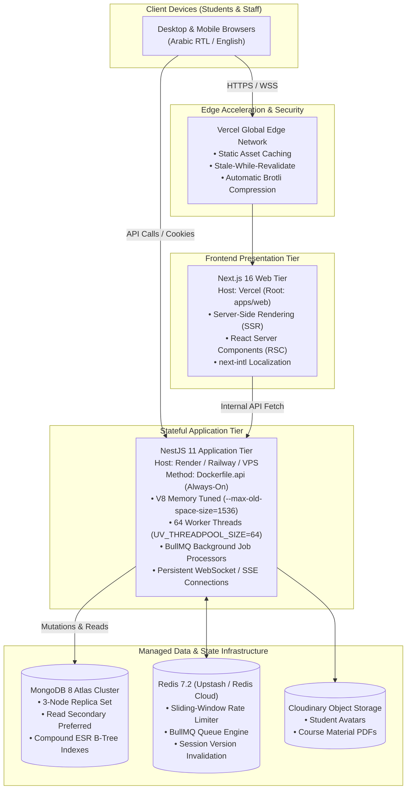

# Production Deployment Guide: Student Portal Enterprise Monorepo

**Applications:**
- **Frontend (`apps/web`):** Next.js 16 App Router (React 19, Tailwind CSS 4, next-intl)
- **Backend (`apps/api`):** NestJS 11 (Mongoose 8, Redis, BullMQ, WebSockets/SSE)
- **Shared (`packages/shared`):** Cross-app types, DTO contracts, permissions, enums

---

## 1. Executive Summary & Recommended Topology

To deliver sub-100ms response times, zero-cost edge distribution, and uninterrupted background processing (BullMQ queues, WebSocket notifications, streaming Excel exports), the **Decoupled Best-of-Breed Architecture** is the gold standard for this monorepo.



---

## 2. Why Not Pure Serverless for the Backend API?

While the Next.js frontend thrives on serverless/edge infrastructure, deploying the NestJS API as a serverless function introduces severe architectural bottlenecks:

| Capability | Serverless Functions (AWS Lambda / Vercel Serverless) | Always-On Container ([Dockerfile.api](file:///d:/BIS/bhi47a-full-stack-web/Dockerfile.api)) |
| :--- | :--- | :--- |
| **BullMQ Background Workers** | ❌ **Stalls / Terminates:** Serverless freezes execution immediately after the HTTP response returns. Background roster imports and bulk emails die mid-flight. | ✅ **Uninterrupted:** Workers continuously poll and process queues independently of incoming HTTP requests. |
| **WebSockets & SSE** | ❌ **Dropped Connections:** Serverless enforces strict request timeout limits (15s–60s), dropping persistent WebSocket channels. | ✅ **Persistent:** Supports thousands of concurrent live sockets for instant push notifications and attendance check-in. |
| **Streaming Data Exports** | ⚠️ **Timeout Hazard:** Long exports of 50,000+ rows risk hitting function execution ceilings. | ✅ **Native Streaming:** Streams gigabytes of chunked XLSX data with flat $O(1)$ memory usage. |
| **Cold Starts** | ❌ **High Latency:** Initial container/VM boot takes 1.5s–4.0s on traffic spikes. | ✅ **Zero Cold Starts:** Always warm in memory; sub-10ms response times. |
| **V8 Heap & Thread Tuning** | ❌ **Locked Defaults:** Cannot tune Libuv thread pool size (`UV_THREADPOOL_SIZE=64`) or semi-space nursery. | ✅ **Fully Optimized:** Configured for maximum throughput via container environment variables. |

---

## 3. Top 3 Deployment Options Ranked

### Option 1: Vercel (Web) + Render or Railway (API) ⭐ *(Recommended)*
**Best for:** Rapid launch, developer velocity, zero-maintenance operations, and startup scaling.

* **Frontend (`apps/web`):** Hosted on **Vercel** (Free / Pro $20/mo). Native Next.js 16 integration, global CDN, and automatic branch previews.
* **Backend (`apps/api`):** Hosted on **Render** (Starter $7/mo) or **Railway** ($5–$15/mo) running [`Dockerfile.api`](file:///d:/BIS/bhi47a-full-stack-web/Dockerfile.api). Always-on, automated rolling deployments, built-in health checks.
* **Database:** **MongoDB Atlas** (M0 Free Tier for dev/staging, M10 $57/mo for production).
* **Redis:** **Upstash Redis** (Serverless pay-per-request, free tier includes 10k commands/day).
* **Estimated Total Cost:** **$7 – $25 / month** to launch.

---

### Option 2: Self-Hosted VPS with Coolify *(Lowest Cost / Maximum Power)*
**Best for:** Institutions desiring complete data sovereignty, zero seat fees, and flat monthly costs.

* **Server:** **Hetzner Cloud** (CPX31: 4 vCPU, 8 GB RAM, 160 GB NVMe for **€13.50/month**) or **DigitalOcean Droplet** ($12–$24/mo).
* **Control Panel:** **[Coolify](https://coolify.io)** (Free, open-source self-hosted PaaS).
* **Architecture:**
  - Coolify connects to your GitHub repository and automatically builds `Dockerfile.api` and `apps/web`.
  - Built-in Traefik/Caddy reverse proxy manages automatic Let's Encrypt SSL certificates.
  - Redis runs as a container on the same VPS with zero-latency local loopback (`localhost:6379`).
  - Database can be self-hosted on the VPS or linked to MongoDB Atlas.
* **Estimated Total Cost:** **~$15 / month flat** for unlimited traffic and unrestricted CPU/RAM.

---

### Option 3: AWS / GCP Cloud-Native Enterprise *(Scale to 10M+ Users)*
**Best for:** National university systems requiring SOC2/ISO compliance, multi-region high availability, and auto-scaling to millions of students.

* **Frontend:** **AWS CloudFront** edge distribution pointing to an **AWS S3 / ECS Fargate** cluster.
* **Backend:** **AWS ECS Fargate** (running [`Dockerfile.api`](file:///d:/BIS/bhi47a-full-stack-web/Dockerfile.api)) with Application Load Balancer (ALB) and Horizontal Pod Autoscaler (HPA) triggered by CPU/Memory.
* **Cache:** **AWS ElastiCache Redis** (Multi-AZ with auto-failover).
* **Database:** **MongoDB Atlas Dedicated** in the same AWS region with VPC Peering (zero egress fees, sub-1ms database latency).
* **Estimated Total Cost:** **$150 – $800+ / month**.

---

## 4. Step-by-Step Setup Guide (Option 1: Vercel + Render)

### Step A: Provision Managed Database & Cache (10 minutes)
1. **MongoDB Atlas:**
   - Create a project and deploy an `M0` (Free) or `M10` cluster in your target region (e.g. Frankfurt `eu-central-1` or Bahrain `me-south-1` for Middle East latency).
   - Under **Database Access**, create a user (e.g. `portal_api_user`).
   - Under **Network Access**, allow access from `0.0.0.0/0` (secured by strong password) or specify your backend provider's static egress IPs.
   - Copy connection string: `mongodb+srv://<user>:<password>@cluster0.xxxxx.mongodb.net/student-portal?retryWrites=true&w=majority`.
2. **Upstash Redis:**
   - Create a database in the same region.
   - Copy `REDIS_HOST`, `REDIS_PORT`, and `REDIS_PASSWORD`.

---

### Step B: Deploy Backend API on Render or Railway (15 minutes)

#### Using Render:
1. Go to [dashboard.render.com](https://dashboard.render.com) and click **New > Web Service**.
2. Connect your GitHub repository: `iamahmedsalah/bhi47a-full-stack-web`.
3. Select **Docker** environment:
   - **Dockerfile Path:** `./Dockerfile.api`
   - **Docker Context:** `.` (root of the repository)
4. Set Instance Type: **Starter** (512MB RAM minimum, 2GB RAM recommended for production imports).
5. Configure Health Check:
   - **Health Check Path:** `/api/health`
6. Add Environment Variables (see Section 5 below).
7. Deploy. Your API will be live at `https://<service-name>.onrender.com` (or your custom domain `https://api.yourinstitute.edu`).

---

### Step C: Deploy Frontend Web on Vercel (10 minutes)

1. Go to [vercel.com/new](https://vercel.com/new) and import the repository.
2. In Project Configuration:
   - **Framework Preset:** Next.js
   - **Root Directory:** Click `Edit` and select `apps/web`.
   - **Root Directory Option:** Ensure **"Include source files outside the Root Directory"** is **CHECKED** (critical for resolving `@student-portal/shared`).
3. Build Settings:
   - Leave Build Command and Output Directory **Empty** (let Vercel's Next.js adapter handle it).
4. Add Environment Variables:
   - `NEXT_PUBLIC_API_URL`: `https://api.yourinstitute.edu/api` (or your Render URL + `/api`)
   - `NEXT_PUBLIC_APP_ENV`: `production`
5. Click **Deploy**.

---

## 5. Production Environment Variables Reference

### Backend (`apps/api`)
| Variable | Example Value | Description |
| :--- | :--- | :--- |
| `NODE_ENV` | `production` | Enables production optimizations & disables verbose debugging. |
| `PORT` | `4000` | HTTP listening port inside the container. |
| `API_PORT` | `4000` | Matching port variable for NestJS bootstrap. |
| `MONGODB_URI` | `mongodb+srv://...` | Connection URI with replica set and database name. |
| `REDIS_HOST` | `fly-xxx.upstash.io` | Hostname for Redis instance. |
| `REDIS_PORT` | `6379` | Port for Redis (default 6379). |
| `REDIS_PASSWORD` | `secret_password` | Auth token for Redis. |
| `JWT_SECRET` | `64_char_random_hex` | Cryptographic secret for signing auth tokens. |
| `JWT_EXPIRES_IN` | `7d` | Token lifetime duration. |
| `COOKIE_DOMAIN` | `.yourinstitute.edu` | Shared root domain for seamless cross-subdomain cookies. |
| `COOKIE_SAME_SITE` | `lax` (or `none` if cross-domain) | Cookie security policy (`lax` with shared domain, `none` with SSL). |
| `FRONTEND_URL` | `https://portal.yourinstitute.edu` | Trusted frontend origin for CORS whitelist. |
| `CORS_ORIGINS` | `https://portal.yourinstitute.edu` | Comma-separated allowed origins. |
| `RESEND_API_KEY` | `re_xxxxxxxxxxxx` | API key for transactional emails. |
| `CLOUDINARY_CLOUD_NAME` | `your_cloud_name` | Media asset object storage. |
| `CLOUDINARY_API_KEY` | `your_api_key` | Cloudinary authentication key. |
| `CLOUDINARY_API_SECRET` | `your_api_secret` | Cloudinary authentication secret. |

### Frontend (`apps/web`)
| Variable | Example Value | Description |
| :--- | :--- | :--- |
| `NEXT_PUBLIC_API_URL` | `https://api.yourinstitute.edu/api` | Public endpoint for backend REST and streaming requests. |
| `NEXT_PUBLIC_APP_ENV` | `production` | Deployment environment label. |
| `NEXT_PUBLIC_APP_VERSION` | `1.0.0` | Application version displayed in banners and telemetry. |

---

## 6. Domain & Cookie Security Architecture

To ensure secure, frictionless authentication via `httpOnly` cookies across frontend and backend:

### Recommended: Shared Parent Domain
Assign both applications under the same organizational parent domain:
* **Frontend:** `https://portal.yourinstitute.edu`
* **Backend API:** `https://api.yourinstitute.edu`

**Configuration:**
```env
# Backend Environment
COOKIE_DOMAIN=.yourinstitute.edu
COOKIE_SAME_SITE=lax
```
**Benefits:**
* The browser automatically attaches authentication cookies to API calls without third-party tracking restrictions.
* `SameSite=Lax` provides native CSRF defense.

### Alternative: Separate Top-Level Domains
If using separate default hostnames (e.g. `portal.vercel.app` and `api.onrender.com`):
```env
# Backend Environment
COOKIE_DOMAIN=
COOKIE_SAME_SITE=none
```
* `COOKIE_SAME_SITE=none` allows cross-origin cookie transmission over HTTPS.
* `COOKIE_DOMAIN` must remain empty so cookies bind to the specific host.

---

## 7. Health Checks, Monitoring & Zero-Downtime Rollouts

1. **Liveness & Readiness Probes:**
   - Both Render and Kubernetes support automated health polling via:
     ```http
     GET /api/health
     ```
   - Returns `200 OK` with database connection state, Redis ping latency, and memory consumption metrics.
2. **Graceful Shutdown:**
   - NestJS listens for `SIGTERM` and `SIGINT` signals.
   - When a rolling deployment triggers, existing HTTP requests are completed, BullMQ workers stop accepting new jobs, and database connections close cleanly without dropped requests.
3. **Database Index Synchronization:**
   - The API uses predefined compound ESR indexes. When starting up, Mongoose synchronizes indexes without rebuilding existing ones, ensuring immediate availability.
