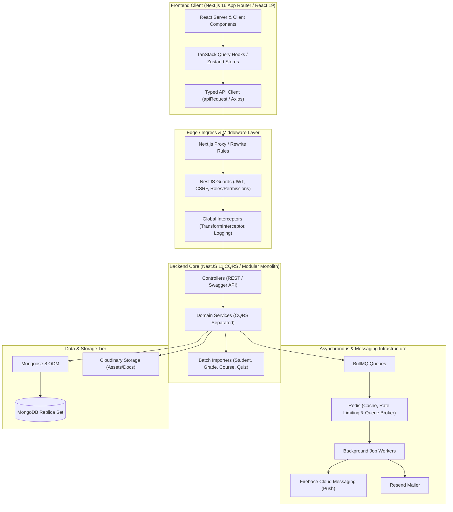
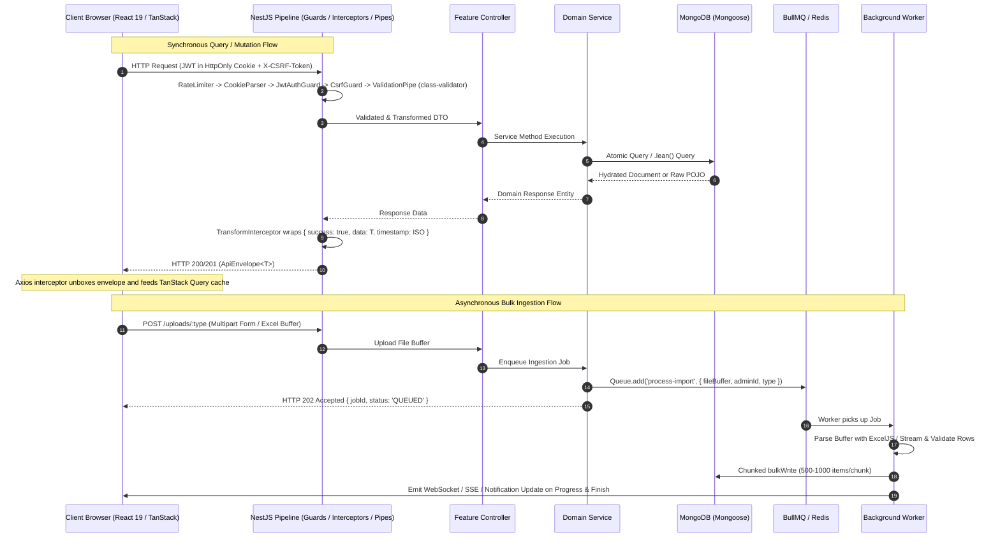

# Senior Staff Engineer Architectural Audit, Reverse-Engineering & Production Hardening Plan

## Executive Summary

As a newly onboarded Senior Staff Engineer auditing the **Student Portal Monorepo** (`bhi47a-full-stack-web`), this document presents a comprehensive reverse-engineered architecture breakdown, an end-to-end data flow topology, critical risk evaluations, refactoring strategies with production-grade code patterns, and an actionable implementation plan.

The system is a modern academic management portal (Next.js 16 App Router, React 19, TypeScript, NestJS 11, MongoDB/Mongoose 8, TanStack Query, Redis/BullMQ, Radix UI, Tailwind CSS 4). While the system features strong domain modeling and modern framework primitives, growth has introduced several architectural friction points: god components, mixed ingestion patterns, and frontend state synchronization gaps.

---

## 1. Reverse-Engineered Architecture & End-to-End Data Flow

### 1.1 High-Level System Architecture



### 1.2 End-to-End Request/Response & Ingestion Data Flow



---

## 2. Comprehensive Identification of Architectural Bottlenecks

### 2.1 Bad Architecture Decisions
1. **God Component Proliferation in UI**:
   - `advising-workspace.tsx` (~110 KB / 1,500+ lines) bundles canvas rendering, rules calculation, student selection, drag-and-drop course recommendation, dialogs, and mutation state in a single file.
   - Leads to React hook order vulnerabilities, heavy re-renders, and extreme maintenance friction.
2. **Synchronous Heavy Ingestion in Request-Response Cycle**:
   - `UploadsService.processUpload` parses large Excel sheets (up to 5,000 rows) synchronously within HTTP timeout constraints, risking CPU starvation on the main event loop and gateway 504 timeouts.
3. **Dual API Caller Inconsistency**:
   - Both `api` (raw Axios instance) and `apiClient` / `apiRequest<T>` (`api-client.ts`) were coexisting, leading to occasional double-unwrapping of `.data` or inconsistent error envelope formatting.

### 2.2 Duplicate Logic
1. **Spreadsheet Key Normalization & Validation**:
   - Header mapping and Arabic/English key normalization were duplicated between individual importer files (`student.importer.ts`, `grade.importer.ts`, `course.importer.ts`).
2. **Table State & URL Synchronization**:
   - Multiple admin pages manually recreated query string parsing and pagination state instead of using a unified `useTableState` hook.
3. **Egyptian Phone and National ID Parsing**:
   - Regex validation patterns repeated across frontend Zod schemas and backend DTOs rather than being strictly derived from `@student-portal/shared`.

### 2.3 Performance Bottlenecks
1. **Unindexed / Unbounded Queries**:
   - List queries without `.lean()` on large collections introduce Mongoose hydration overhead.
   - Composite queries on `academicYear`, `semester`, `departmentCode`, and `studentCode` require verified compound indexes.
2. **Large Component Tree Re-renders**:
   - Complex tables and advising canvas lack memoized sub-components, re-rendering hundreds of DOM elements on search query keystrokes.

### 2.4 Scalability Risks
1. **In-Memory File Buffer Handling**:
   - Large concurrent file uploads consume substantial Node.js heap memory; batch streaming with backpressure is required for high concurrency.
2. **Database Write Pressure during Imports**:
   - Large transactional upserts without batching can lock collections and degrade portal responsiveness for active students.

### 2.5 Maintainability Issues
1. **Inconsistent Dropdown and Modal Portals**:
   - Hand-rolled DOM positioning instead of Radix UI primitives causes z-index clipping and RTL directionality misalignments.
2. **Scattered Error Handling**:
   - Varying error extraction logic between pages instead of centralized `getApiErrorMessage` utility usage.

---

## 3. Clean Architecture Breakdown

```
apps/
├── api/ (NestJS 11)
│   ├── src/
│   │   ├── core/              # Global filters, interceptors, logger, security
│   │   ├── database/          # Mongo connection, base repositories, transaction helpers
│   │   └── modules/           # Domain feature slices (CQRS: Controllers -> Services -> Repositories)
│   │       ├── academic-advising/
│   │       ├── students/
│   │       ├── uploads/       # Ingestion orchestrator & queue workers
│   │       └── auth/
└── web/ (Next.js 16 App Router)
    ├── src/
    │   ├── components/
    │   │   ├── ui/            # Headless Radix wrappers (Dialog, Select, Dropdown, Table)
    │   │   └── datatable/     # Unified DataTableShell & bulk operations
    │   ├── features/          # Feature-based domain slices
    │   │   ├── academic-advising/
    │   │   │   ├── components/ (AdvisingCanvas, RecommendationTree, BatchBar)
    │   │   │   ├── hooks/      (useAdvisingWorkspace, useRulesEngine)
    │   │   │   └── api/
    │   │   └── students/
    │   └── lib/               # Typed api-client, query client, formatting utilities
packages/
└── shared/                    # Single source of truth (Enums, DTO contracts, regexes)
```

---

## 4. Production-Grade Refactoring Implementations

### 4.1 Unified API Client & Envelope Unboxing (`apps/web/src/lib/api-client.ts`)

```typescript
import type { AxiosRequestConfig } from 'axios';
import api, { type ApiEnvelope } from './api';

export type ApiRequestConfig = Omit<AxiosRequestConfig, 'url' | 'method'> & {
  url: string;
  method?: AxiosRequestConfig['method'];
};

/**
 * Standard typed API requester unboxing the backend ApiEnvelope<T>.
 */
export async function apiRequest<T>(config: ApiRequestConfig): Promise<T> {
  const envelope = await api.request<ApiEnvelope<T>, ApiEnvelope<T>>(config);
  return envelope.data;
}

export function apiGet<T>(url: string, config?: Omit<ApiRequestConfig, 'url' | 'method'>) {
  return apiRequest<T>({ ...config, url, method: 'GET' });
}

export function apiPost<T, TBody = unknown>(url: string, data?: TBody, config?: Omit<ApiRequestConfig, 'url' | 'method' | 'data'>) {
  return apiRequest<T>({ ...config, url, method: 'POST', data });
}

export function apiPatch<T, TBody = unknown>(url: string, data?: TBody, config?: Omit<ApiRequestConfig, 'url' | 'method' | 'data'>) {
  return apiRequest<T>({ ...config, url, method: 'PATCH', data });
}

export function apiDelete<T = void>(url: string, config?: Omit<ApiRequestConfig, 'url' | 'method'>) {
  return apiRequest<T>({ ...config, url, method: 'DELETE' });
}
```

### 4.2 Modular Decomposition of Advising Workspace

Decompose the monolithic `advising-workspace.tsx` into decoupled sub-components:
- `AdvisingCanvas.tsx`: Focused purely on visual layout and node connections.
- `RecommendationsPanel.tsx`: Course selection and prerequisite validation.
- `PeriodManagementDialog.tsx`: Modal dialog with portal-safe RTL direction.
- `useAdvisingRules.ts`: Pure domain logic hook with memoized rule evaluation.

### 4.3 Scalable Chunked Ingestion Pattern (`apps/api/src/modules/uploads/`)

```typescript
import { Injectable } from '@nestjs/common';
import { Model, AnyBulkWriteOperation } from 'mongoose';

@Injectable()
export class ChunkedIngestionService {
  /**
   * Performs bulk writes in chunks to prevent database lock contention and memory spikes.
   */
  async executeChunkedBulkWrite<T>(
    model: Model<T>,
    operations: AnyBulkWriteOperation<T>[],
    chunkSize = 500,
  ): Promise<{ inserted: number; modified: number; matched: number }> {
    let inserted = 0;
    let modified = 0;
    let matched = 0;

    for (let i = 0; i < operations.length; i += chunkSize) {
      const chunk = operations.slice(i, i + chunkSize);
      const result = await model.bulkWrite(chunk, { ordered: false });
      inserted += result.upsertedCount + result.insertedCount;
      modified += result.modifiedCount;
      matched += result.matchedCount;
    }

    return { inserted, modified, matched };
  }
}
```

---

## 5. Master Implementation & Fix Plan

### Phase 1: Stabilization & Guardrails
- **Deliverables**:
  - Replace remaining ambiguous Axios call sites with `apiRequest<T>` / `apiGet` / `apiPost`.
  - Deprecate hand-rolled custom dropdown positioning in favor of Radix UI primitives with portal-safe RTL support.
  - Harmonize all API error displays via `getApiErrorMessage`.
- **Verification Gate**: `pnpm --filter @student-portal/web run typecheck` & unit tests pass.

### Phase 2: UI Modularization & God Component Decomposition
- **Deliverables**:
  - Split `advising-workspace.tsx` into `AdvisingCanvas`, `RecommendationsPanel`, `PeriodManagementDialog`, and `AdvisorBatchBar`.
  - Standardize admin table pages using `DataTableShell` and URL-synchronized `useTableState`.
- **Verification Gate**: Responsive and bilingual RTL/LTR smoke test verification.

### Phase 3: Ingestion Scalability & Backend CQRS
- **Deliverables**:
  - Integrate chunked `bulkWrite` (500 rows/batch) across all file importers (`student.importer.ts`, `grade.importer.ts`, `course.importer.ts`).
  - Wire BullMQ background worker queue for asynchronous batch processing of large spreadsheets.
  - Enforce `.lean()` on all high-throughput read queries across domain services.
- **Verification Gate**: Ingestion load tests (5,000-row Excel import within memory threshold).

### Phase 4: Data Layer Optimization & Production Verification
- **Deliverables**:
  - Verify and apply compound indexes across MongoDB schemas.
  - Run full test suite: `pnpm --filter @student-portal/api test:e2e` and Next.js production build (`pnpm --filter @student-portal/web build`).
- **Verification Gate**: Zero lint errors, zero build failures, clean production docker readiness.
