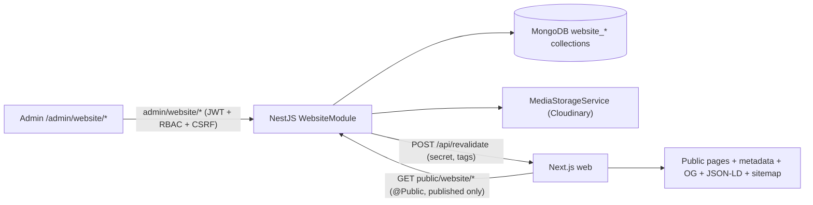

# BHI47a — Website CMS, SEO & Bilingual Content: Implementation Plan

> Scope: add a CMS-driven public website and a `/admin/website` management area **on top of** the existing portal, without breaking auth, RBAC, CSRF, first-login gates, or portal routes.

---

## 0. What exists today (verified in repo)

| Area | Current state | Implication |
|---|---|---|
| Public pages | `apps/web/src/app/[locale]/{about,academics,activities,news,news/[slug],events,gallery,downloads,contact}` | Keep routes; swap data source |
| Content source | Hardcoded in `apps/web/src/data/institutional-data.ts` (`INSTITUTE_INFO`, `ACADEMIC_PROGRAMS`, `NEWS_ITEMS`, `EVENTS`, `ACTIVITIES`, `GALLERY_ITEMS`, `DOWNLOAD_DOCUMENTS`, `QUICK_ACCESS_LINKS`) | Becomes the **seed** for the CMS |
| Homepage | `[locale]/page.tsx` renders a fixed list of sections | Becomes config-driven renderer |
| Portal | `[locale]/portal/page.tsx` re-exports `login/page` | Untouched |
| Admin shell | `[locale]/admin/layout.tsx` + `components/admin/sidebar` + `ADMIN_ROUTE_RULES` permission gate | Add `website/*` here — **no second admin UI** |
| API pattern | NestJS modules, e.g. `modules/faqs` (`GET faqs` public-ish / `admin/faqs` guarded by `@Roles` + `@RequirePermissions`) | Mirror for `website` module |
| Public endpoints | `@Public()` decorator in `modules/auth/decorators/public.decorator.ts` | Use for published-content reads |
| RBAC | `packages/shared/src/constants/permissions.ts` (`PERMISSIONS`, `STAFF_ASSIGNABLE_PERMISSIONS`) | Add website permissions here |
| Storage | Cloudinary signed REST upload inside `exam-schedules.service.ts` (no SDK); `next.config.ts` allows `res.cloudinary.com` | Extract into a shared `MediaStorageService`; reuse |
| Cloudinary env | Read via `ConfigService` but **not** in `config/env.validation.ts` | Add to env validation |
| SEO | `app/sitemap.ts` (static + `NEWS_ITEMS`), `app/robots.ts`, per-page `generateMetadata`, JSON-LD on homepage | Make dynamic from CMS |
| Icons | `app/favicon.ico`, `public/favicon_io/*`, `public/logo.webp` | Move to `app/icon.png` / `apple-icon.png` conventions |
| DnD | No dnd library installed; `framer-motion` is installed | Use `Reorder` from framer-motion → no new dep |
| Rich text / sanitizer | None installed | Decision needed (§13) |

---

## 1. Architecture



Principles:
- **Public reads**: `GET /api/public/website/...` — `@Public()`, rate-limited, returns only `status=published` and `publishedAt <= now`, `.lean()`, projection excludes audit/internal fields.
- **Admin writes**: `/api/admin/website/...` — `@Roles('admin','staff')` + `@RequirePermissions(...)`, existing CSRF guard.
- **Mutations by `_id`**, public detail by `slug` (per `slug-url-architecture.md`).
- Public pages stay **Server Components**; fetch with `next: { tags: [...] }`; CMS writes trigger tag revalidation. No redeploy for content edits.

---

## 2. Data model (Mongoose, `apps/api/src/modules/website/schemas`)

Shared localized type (in `@student-portal/shared`):
```ts
export interface LocalizedText { en: string; ar: string }
export type ContentStatus = 'draft' | 'published' | 'archived';
```

Common mixins on every content doc: `status`, `publishedAt`, `createdBy`, `updatedBy`, timestamps, `seo?: SeoFields`.

```ts
interface SeoFields {
  title?: LocalizedText;          // ≤ 60 chars recommended
  description?: LocalizedText;    // ≤ 160 chars
  ogImage?: ObjectId;             // MediaAsset
  index: boolean;                 // default true
  follow: boolean;                // default true
  canonicalOverride?: string;     // admin-only (advanced)
}
```

| Collection | Key fields | Notes |
|---|---|---|
| `website_settings` (singleton) | instituteName, address, phones, emails, workingHours (Localized), mapUrl, socialLinks[], logos {primary, light, dark, social}, defaultSeo, verification {google, bing}, canonicalBaseUrl, footer {description, copyright, linkGroups[]} | Cannot unset primary logo (validated) |
| `website_homepage` (singleton, draft+published copies) | `sections: HomeSection[]` with `key`, `enabled`, `order`, `visibility {desktop, mobile}`, `title`, `description`, `cta {label, href}`, `itemsLimit`, `media`, `hero?` block | Stable `order` integer; `key` is enum |
| `website_pages` | `key` (`about`, `academics`, `contact`, …), structured blocks (intro, history, vision, mission, objectives[], leadership[]), `seo` | One doc per static page |
| `website_news` | slug (unique, immutable), title, summary, content, featuredImage, imageAlt, category, author, status, publishedAt, seo | |
| `website_events` | slug, title, description, startAt, endAt (Africa/Cairo), location, featuredImage, registrationUrl, status, seo | Event JSON-LD |
| `website_activities` | slug, title, description, category, date, location, coverImage, gallery[], status, seo | |
| `website_gallery_albums` | slug, title, description, coverImage, images[] {media, caption, alt, order}, status | Images embedded (bounded per album, e.g. ≤ 200) |
| `website_downloads` | title, description, file (media), category, publishedAt, status | |
| `website_navigation` (singleton) | items[] {label, href, type internal/external, enabled, order} | URL allowlist validation |
| `website_media` | publicId, url, mimeType, width, height, bytes, alt, caption, uploadedBy, usageCount | Single media library |

Academic programs: only `BIS` and `Accounting & Auditing` exist in current data → model as `website_programs` (slug, name, description, degree, creditHours, careers[], topics[], image, order, status). **No invented programs.**

Indexes: `{ slug: 1 } unique`, `{ status: 1, publishedAt: -1 }`, `{ order: 1 }`.

Seeding: `scripts/seed-website.ts` migrates every export in `institutional-data.ts` into these collections (idempotent upsert by slug/key). After migration, `institutional-data.ts` remains only as a **build-time fallback** if the API is unreachable, then is deleted in Phase 6.

---

## 3. Permissions (extend existing RBAC — no new auth system)

Add to `packages/shared/src/constants/permissions.ts` and `STAFF_ASSIGNABLE_PERMISSIONS`:

| Permission | Maps to requested role | Allows |
|---|---|---|
| `website.read` | Website Viewer | View CMS screens |
| `website.write` | Website Editor | Create/edit drafts, upload media |
| `website.publish` | Website Publisher | Publish / unpublish / archive / reorder homepage |
| `website.settings` | (admin-delegable) | Settings, navigation, global SEO, brand assets |

`admin` role keeps full access (existing behavior). Add `ADMIN_ROUTE_RULES` entries for `/admin/website/*` in `admin/layout.tsx`, and sidebar group "Website Management" filtered by permission.

---

## 4. API surface (`modules/website`)

Split controllers to stay small (CQRS-style per `student-portal-patterns.md`):

```
website-public.controller.ts   @Public
  GET  public/website/settings
  GET  public/website/navigation
  GET  public/website/homepage
  GET  public/website/pages/:key
  GET  public/website/news?page&limit&category      (paginated, max 50)
  GET  public/website/news/by-slug/:slug
  GET  public/website/events?upcoming=true
  GET  public/website/events/by-slug/:slug
  GET  public/website/activities | /by-slug/:slug
  GET  public/website/gallery | /by-slug/:slug
  GET  public/website/downloads?category
  GET  public/website/programs | /by-slug/:slug
  GET  public/website/sitemap-entries                (slugs + updatedAt only)

website-admin.controller.ts    @Roles + @RequirePermissions
  GET/PATCH        admin/website/settings
  GET/PATCH        admin/website/navigation
  GET/PATCH        admin/website/homepage            (draft)
  POST             admin/website/homepage/publish
  GET/PATCH        admin/website/pages/:key
  CRUD             admin/website/{news,events,activities,gallery,downloads,programs}
  POST             admin/website/{type}/:id/{publish|unpublish|archive}
  PATCH            admin/website/gallery/:id/images/reorder
  POST             admin/website/preview-token       (short-lived signed token)

website-media.controller.ts
  POST   admin/website/media        (multipart, FileInterceptor)
  GET    admin/website/media?search&page
  PATCH  admin/website/media/:id    (alt/caption)
  DELETE admin/website/media/:id    (blocked if usageCount > 0)
```

Services: `WebsiteSettingsService`, `HomepageService`, `ContentService<T>` (generic draft/publish lifecycle reused by news/events/activities/downloads/programs), `GalleryService`, `MediaService`, `RevalidationService`.

Error envelope: reuse existing filters (`common/filters`) per `validation-architecture.md`.

---

## 5. Media & upload validation

1. Extract Cloudinary signing/upload from `exam-schedules.service.ts` into `common/storage/media-storage.service.ts`; make exam-schedules consume it (behavior unchanged).
2. Add `CLOUDINARY_CLOUD_NAME/API_KEY/API_SECRET` to `config/env.validation.ts` (optional; feature disabled with clear error if absent).
3. Validation (server-side):
   - Images: JPEG/PNG/WebP/AVIF; documents: PDF (downloads only).
   - **Magic-byte check** of the buffer (not extension/mimetype header only).
   - Max size: images 8 MB, PDF 20 MB; min dimensions 600×315 for OG candidates; max 6000×6000.
   - Upload with Cloudinary `c_limit,w_2400` incoming transformation so originals aren't stored oversized.
4. Delivery: store `publicId`; web builds `f_auto,q_auto,w_*` URLs and uses `next/image`.
5. Deleting media referenced by content returns `409` with usage list.

---

## 6. Homepage CMS (the priority screen)

Section keys (enum in shared): `hero, quickAccess, about, academics, news, events, activities, gallery, studentServices, downloads, contact, finalCta`.

**Admin UI** `/admin/website/homepage`:
- List of section cards with drag handle (framer-motion `Reorder.Group`), keyboard reorder buttons (↑/↓) for accessibility.
- Each card: status chip (`StatusBadge` via next-intl), short summary, `[Edit]` opens `Dialog`/`Sheet` editor.
- Footer: `[Preview Website]` `[Save Draft]` `[Publish Changes]` with `ConfirmDialog` on publish.
- Draft and published stored separately → editors can't break the live site mid-edit.

**Hero editor**: EN/AR tabs; eyebrow, title, subtitle, description, primary/secondary CTA (label + validated href), desktop image, mobile image, alt (EN/AR), focal point (x/y %), overlay opacity. Video: **deferred** unless requested.

**Public renderer** (`[locale]/page.tsx`):
```ts
const SECTION_REGISTRY: Record<HomeSectionKey, ComponentType<SectionProps>> = {...};
homepage.sections
  .filter(s => s.enabled)
  .sort((a, b) => a.order - b.order)
  .map(s => <ScrollReveal key={s.key} className={visibilityClass(s.visibility)}>
             <Section {...s} locale={locale} /></ScrollReveal>);
```
Existing section components receive props instead of importing `institutional-data.ts`. The floating nav derives its items from the **same enabled/ordered list**, so ordering changes never desync the scroll-spy again.

---

## 7. Content editors (news / events / activities / gallery / downloads / about / programs)

Shared editor shell:
- `[ English ] [ العربية ]` tab switch; AR tab renders inputs with `dir="rtl"`, URLs/emails/phones/slugs forced `dir="ltr" text-left`.
- Sections: Content · Media · SEO · Publishing.
- Buttons: `Save Draft`, `Preview`, `Publish` / `Unpublish`, `Archive`; delete via 3-dots menu + `ConfirmDialog`.
- Lists use `DataTable<T>` + `useTableState` (URL-synced filters, pagination), checkbox selection + bulk publish/archive/delete — per `table-and-ui-standards.md`.
- React Hook Form + Zod schemas in `@student-portal/shared/validations/website.ts`, mirrored by class-validator DTOs.

Validation limits (shared): title ≤ 120, summary ≤ 300, SEO title ≤ 70 (warn > 60), SEO description ≤ 180 (warn > 160), slug `^[a-z0-9]+(?:-[a-z0-9]+)*$`, URL must be `https:` or internal `/...` (reject `javascript:`, `data:`).

---

## 8. SEO, Open Graph, JSON-LD

**Admin**
- `/admin/website/seo`: global defaults (site name EN/AR, default title/description, default OG image, X handle, Google/Bing verification, canonical base URL).
- Every content editor has an SEO tab with: language switch, title, description, OG image picker, `Search engine visibility: ● Index ○ Don't index`, `Links: ● Follow ○ Don't follow`. Canonical override shown only to `website.settings` holders.
- Live **Google preview** (title truncated ~60 chars, URL breadcrumb, description ~160) and **social card preview** (1200×630).

**Public (Next.js Metadata API)** — one helper `buildMetadata({ locale, path, seo, fallback, image })`:
- `title`, `description`, `alternates.canonical`, `alternates.languages { en, ar, 'x-default': /ar }` — only emitted for routes that exist in both locales (all CMS routes do, since content is bilingual in one doc).
- `openGraph { title, description, url, siteName, locale: ar_EG|en_US, alternateLocale, type: website|article, images }`, `twitter { card: summary_large_image, ... }`.
- `robots` from `seo.index/follow`; drafts and previews always `noindex,nofollow`.
- `verification` from settings.

**Dynamic OG images**: `app/[locale]/opengraph-image.tsx` and per-route `news/[slug]/opengraph-image.tsx` etc. using `next/og` `ImageResponse` (1200×630): logo, page title, category chip, institute name. Load **Cairo** font file from `public/fonts/ar` so Arabic shapes correctly (`ImageResponse` needs explicit font data). If content has a featured image, prefer it.

**JSON-LD** (generated only from real data):
- Home: `EducationalOrganization` + `WebSite` (exists; move to helper, values from settings).
- News detail: `NewsArticle`; Event detail: `Event` (startDate/endDate with Cairo offset, location); all detail pages: `BreadcrumbList`; FAQ page only if FAQs are rendered publicly (existing `faqs` module).

**Sitemap / robots**
- `sitemap.ts` fetches `public/website/sitemap-entries` (revalidate 1h) → static routes × locales + published news/events/activities/albums/programs, with `alternates.languages`.
- `robots.ts`: allow public; disallow `/*/admin`, `/*/student`, `/*/login/*`, `/*/portal`, `/api/`, preview route. Auth remains the real protection.

---

## 9. Icons & brand

- Create simplified mark from `public/logo.webp` (crest is too detailed at 16px) → `app/icon.png` (512), `app/apple-icon.png` (180), regenerate `app/favicon.ico` (16/32/48).
- Remove manual `<link rel="icon">` tags from `[locale]/layout.tsx` once file conventions are in place (avoid duplicates).
- PWA icons (192/512 + manifest): **only if** PWA is required — currently not configured, so skipped by default.

---

## 10. Revalidation

- Web: `app/api/revalidate/route.ts` (POST, `x-revalidate-secret` header compared with `crypto.timingSafeEqual`, body `{ tags: string[] }` → `revalidateTag`).
- API `RevalidationService` calls it after publish/unpublish/settings/navigation/homepage publish; fire-and-forget with retry via existing BullMQ queue so admin requests don't block.
- Tags: `website:settings`, `website:nav`, `website:home`, `website:page:<key>`, `website:news`, `website:news:<slug>`, same for events/activities/gallery/downloads/programs.
- New env: `WEB_REVALIDATE_URL`, `WEB_REVALIDATE_SECRET` (API) and `REVALIDATE_SECRET` (web).

---

## 11. Preview mode

- Admin clicks Preview → API issues short-lived (10 min) signed token bound to `{type, id, userId}`.
- Web route `/[locale]/preview/[type]/[id]?token=` (excluded from sitemap, `noindex`, disallowed in robots) fetches `admin/website/preview/...` server-side with the token; renders real section components.
- Uses Next.js `draftMode()` cookie so preview never caches into the public tag cache.

---

## 12. Bilingual / RTL rules (applies everywhere)

- One document, `LocalizedText {en, ar}` per field — never duplicate pages.
- Public display: `ar` → `field.ar || field.en`; `en` → `field.en || field.ar`. Admin shows a "missing translation" badge when one side is empty; publish blocked if **title** missing in either language.
- Portaled Radix content gets `dir`; dates via `ar-EG` / `en-GB` + `Africa/Cairo`; codes/URLs in `<bdi>`.
- Slugs: **single immutable ASCII slug per item** (repo slug standard), shared by both locales → `/en/news/x` and `/ar/news/x`. This keeps hreflang pairs valid. (The request mentioned Slug EN/AR — see Decision D1.)

---

## 13. Rich text

Options (Decision D2):
- **A (recommended)**: Tiptap with a restricted schema (paragraph, heading h2–h3, lists, bold/italic, link, image from media library), stored as **JSON**, rendered server-side by a whitelist renderer → no HTML injection surface. New deps: `@tiptap/react`, `@tiptap/starter-kit`, `@tiptap/extension-link`.
- **B (no new deps)**: structured blocks (`paragraph | heading | list | image | quote`) edited as form arrays. Less pleasant editing, zero sanitization risk.

Either way: no `dangerouslySetInnerHTML` of user content.

---

## 14. Phased delivery

| Phase | Deliverables | Exit criteria |
|---|---|---|
| **P0 Foundations** | Shared types/Zod schemas, permissions, env validation, `MediaStorageService` extraction, `website` module skeleton, revalidate route | Lint/typecheck/tests green; exam-schedules upload unchanged |
| **P1 Settings + Nav + Footer + Seed** | settings/navigation APIs + admin screens, seed script from `institutional-data.ts`, header/footer read from API | Changing phone/address/nav in admin updates site without deploy |
| **P2 Homepage CMS** | Homepage draft/publish, section registry renderer, hero editor, reorder, floating nav from config | Reordering Gallery above News reflects live after publish |
| **P3 Content types** | News, Events (+ `/events/[slug]`), Activities (+ `/activities/[slug]`), Downloads, Programs, About/Contact pages | Public pages contain no imports from `institutional-data.ts` |
| **P4 Gallery + Media library** | Albums, image reorder/cover/captions, `/gallery/[album]`, media library UI | Media in use cannot be deleted |
| **P5 SEO** | Global SEO screen, per-item SEO tab + previews, `buildMetadata`, dynamic OG images, JSON-LD helpers, dynamic sitemap/robots, icons | Share-link checklist (§16) passes for all page types in both locales |
| **P6 Preview, polish, cleanup** | Preview mode, audit display, empty/loading/error states, a11y pass, delete static data file | Full CI verification passes |

Each phase is independently mergeable.

---

## 15. Files to add / touch (summary)

**Shared**: `constants/permissions.ts`, `constants/website.ts` (section keys, statuses, categories), `validations/website.ts`.

**API**: `modules/website/**` (schemas, dto, controllers, services), `common/storage/media-storage.service.ts`, `config/env.validation.ts`, `app.module.ts`, `exam-schedules.service.ts` (use shared storage), `scripts/seed-website.ts`, tests `*.spec.ts` for ContentService lifecycle, public filtering, permission guards, upload validation.

**Web**:
- `lib/website-api.ts` (server fetchers with tags), `lib/seo/build-metadata.ts`, `lib/seo/json-ld.ts`
- `app/api/revalidate/route.ts`, `app/[locale]/preview/**`, `app/[locale]/{events,activities,gallery}/[slug]/page.tsx`, `opengraph-image.tsx` files, `app/icon.png`, `app/apple-icon.png`, `sitemap.ts`, `robots.ts`
- `app/[locale]/admin/website/**` pages, `features/website/**` (hooks, forms, editors, SEO preview, media picker, homepage reorder)
- `components/admin/sidebar` (Website group), `admin/layout.tsx` (route rules)
- `components/institutional/*` → props-driven; `InstitutionalFloatingNav` driven by homepage config
- `messages/{ar,en}.json` (CMS labels, statuses)

---

## 16. Verification & acceptance

CI (per `ci-cd-verifier`): `pnpm run lint`, `pnpm run typecheck`, `pnpm run test -- --runInBand`, `pnpm run build`, `pnpm run test:e2e`.

Functional:
- [ ] Draft content never appears on public pages, sitemap, or API public endpoints.
- [ ] Staff without `website.publish` can save drafts but publish buttons are hidden and API returns 403.
- [ ] Homepage order/visibility/enabled flags drive public render and floating nav.
- [ ] Upload rejects renamed `.exe → .jpg` (magic bytes), oversize, undersized OG images.
- [ ] `javascript:` URLs rejected in nav/CTA.
- [ ] Content edit → public page updated within seconds, no deploy.

SEO / share test for Home, About, News, Event, Activity, Gallery in **both** `/ar` and `/en`:
- [ ] title, description, canonical, hreflang (en/ar/x-default)
- [ ] og:title/description/image/url/locale/site_name, twitter summary_large_image
- [ ] OG image renders Arabic correctly
- [ ] JSON-LD validates (Rich Results Test)
- [ ] favicon visible at 16/32px, apple-icon on iOS shortcut

---

## 17. Decisions needed before P0

| # | Question | Recommendation |
|---|---|---|
| D1 | Single shared slug vs. separate EN/AR slugs | **Single ASCII slug** (repo standard, simpler hreflang). Arabic slugs possible later via `slugAr` alias + redirect |
| D2 | Rich text approach | **Tiptap JSON** (adds 3 deps) vs. structured blocks (0 deps) |
| D3 | Scheduled publishing | Implement via `publishedAt` in the future + public filter `publishedAt <= now` + BullMQ delayed job to revalidate — real, not faked. Include in P3? |
| D4 | Hero video | Defer |
| D5 | PWA icons/manifest | Skip unless required |
| D6 | Canonical production domain | Currently fallback `https://bhi47a.edu.eg` in code — confirm real domain for `NEXT_PUBLIC_APP_URL` |
